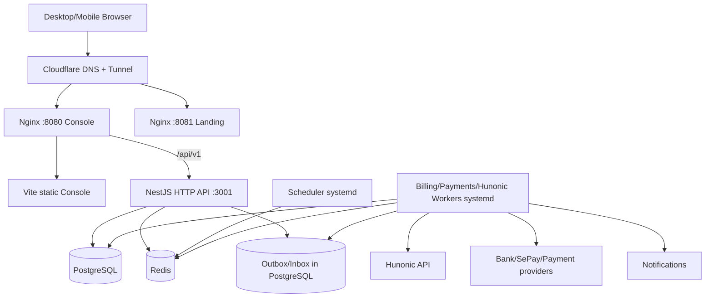
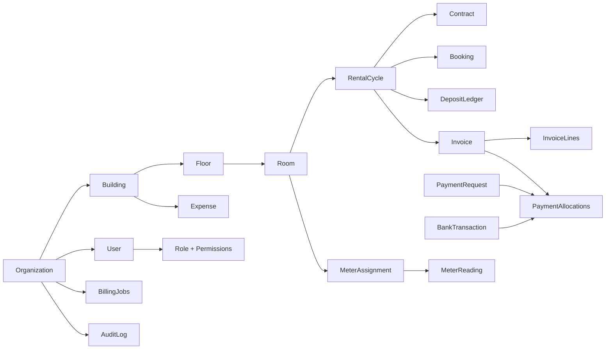
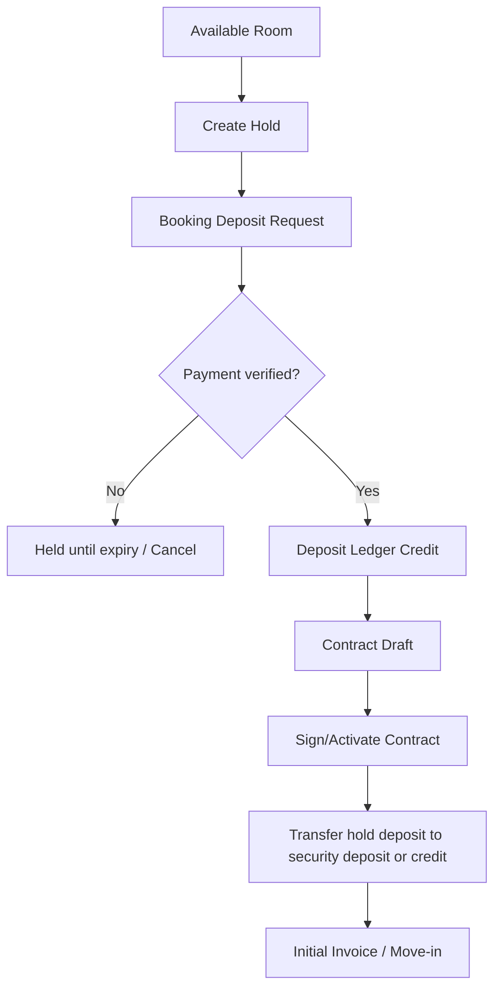
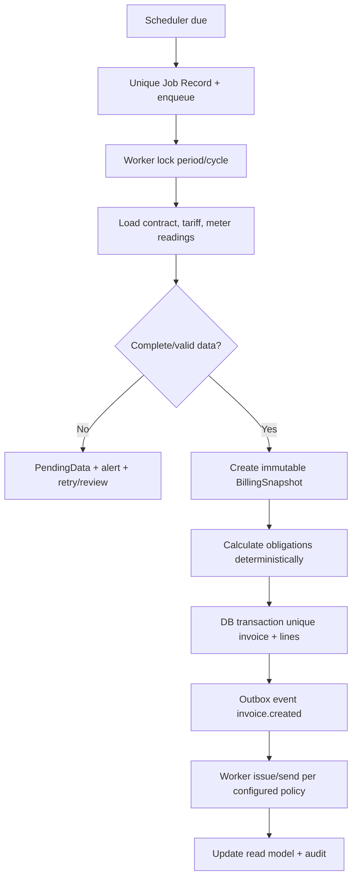
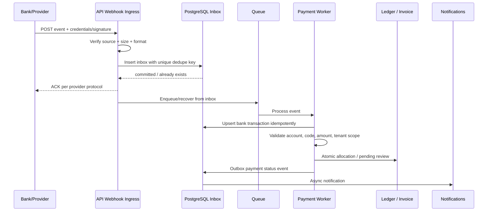

# ADHOME V2 — BLUEPRINT TRIỂN KHAI CHI TIẾT

**Document ID:** ADHOME-BP-002  
**Version:** 1.0 — Blueprint/Specification (chưa triển khai)  
**Ngày soạn:** 28/10/2026 (Asia/Ho_Chi_Minh)  
**Mục tiêu:** Xây dựng AdHome V2 — SaaS quản lý căn hộ dịch vụ, dựa trên nghiệp vụ Homeland-SaaS, giao diện mới và khả năng mở rộng.  
**Ưu tiên:** **Console trước, Landing Page sau.**  
**Ràng buộc cứng:** **KHÔNG SỬ DỤNG DOCKER** trong dự án, quy trình phát triển, kiểm thử và phương án triển khai mặc định.

> **Trạng thái kiểm chứng:** Đây là BLUEPRINT/ĐỀ XUẤT, không phải báo cáo đã triển khai. Các URL, cổng, bản ghi DNS, chứng chỉ, dữ liệu production và kết quả chịu tải chưa được xác minh trên máy chủ thực tế. Chỉ những chi tiết về source đã đọc trực tiếp hoặc tài liệu chính thức có liên kết nguồn mới được ghi là đã đối chiếu. Đối với API bên thứ ba, phải kiểm tra quyền sử dụng và đặc tả hiện hành trước khi kích hoạt.

---

# 0. EXECUTIVE DECISIONS — KHÔNG ĐƯỢC TỰ Ý THAY ĐỔI

| ID | Quyết định | Mức độ |
|---|---|---|
| D-01 | Console tại **`https://console-adhome.vn`** | MUST |
| D-02 | Landing Page tại **`https://adhome.vn`** | MUST |
| D-03 | Console được xây dựng, kiểm thử và nghiệm thu **trước** Landing Page | MUST |
| D-04 | Console Vite + React + TypeScript; API NestJS; PostgreSQL + Prisma; Redis/BullMQ cho worker | TARGET |
| D-05 | Không dùng Docker, Docker Compose, container image hay chạy DB/Redis trong container | MUST |
| D-06 | Desktop và Mobile có **layout + page implementation riêng**, chung backend/domain model | MUST |
| D-07 | Một workspace hiển thị tất cả tòa nhà/phòng trong cùng tổ chức; không bắt chuyển console | MUST |
| D-08 | Cùng một trang login, role/permission được backend xác định từ user/session | MUST |
| D-09 | Admin có toàn quyền trong tổ chức; Manager chỉ có quyền mặc định giới hạn, cấu hình được | MUST |
| D-10 | API công khai tại **`https://console-adhome.vn/api/v1`** bằng reverse proxy same-origin | TARGET |
| D-11 | Cron, đồng bộ Hunonic, hóa đơn, thông báo và đối soát chạy tách khỏi HTTP API process | MUST |
| D-12 | Mọi nghiệp vụ tài chính idempotent, transaction-safe, immutable audit trail | MUST |
| D-13 | Mục tiêu phục vụ 1.000 phiên đồng thời là **điều kiện kiểm thử**, không phải tính năng được mặc nhiên đảm bảo | MUST |
| D-14 | Tài khoản bootstrap `admin@adhome.vn` dùng mật khẩu được chủ dự án cung cấp riêng qua secret lúc khởi tạo, **không hardcode**, phải đổi lần đầu | MUST |
| D-15 | Không sửa Homeland-SaaS; AdHome phát triển trong repository riêng | MUST |
| D-16 | Không triển khai production, cấu hình DNS hay import dữ liệu thật trước khi được phê duyệt | MUST |

**MUST** = bất biến, **TARGET** = phương án khuyến nghị; thay đổi TARGET phải ghi ADR và bằng chứng, không thay đổi MUST khi chưa được người sở hữu sản phẩm yêu cầu.

## 0.1. Ranh giới phạm vi

**Trong V2 core:** quản lý căn hộ dịch vụ, nhiều tòa trong một tổ chức, khách thuê, đặt phòng/cọc, hợp đồng, kỳ tổng hợp, hóa đơn, công nợ, thanh toán nhiều nguồn, chi phí, doanh thu, báo cáo, lịch sử giao dịch, cài đặt, vai trò Admin/Manager, Hunonic và thông báo.

**Không nằm trong bản core:** console riêng cho khách sạn/nhà nghỉ, marketplace đặt phòng, PMS khách sạn, IoT điều khiển thiết bị, AI tự ý ra quyết định tài chính, ứng dụng native iOS/Android. Có thể thiết kế extension points để triển khai sau, nhưng **không tạo trang rỗng và báo là hoàn thành**.

## 0.2. Nguồn đã đối chiếu

- Homeland-SaaS: https://github.com/tcandt/homeland-saas — có `apps/api`, `apps/web`, `packages/database`, `packages/shared`; API NestJS, Prisma; giao diện gốc Next.js; các module Contracts, Deposits, Invoices, Monthly Settlement, Payments, Hunonic, Finance, Buildings, Customers, Reports, Auth và nhiều test. Có `docs/engineering/INVOICE_FSM.md`, `apps/api/src/monthly-settlement/monthly-settlement.scheduler.ts`, `apps/api/src/payments/payments.controller.ts` và `AGENTS.md`.
- Hunonic adapter: https://github.com/tcandt/api-hunonic — có `src/hunonic-provider.js`, `README.md`, `README_PROVIDER.md`; có chế độ `mobile` và `website`; cung cấp dữ liệu công tơ như `energy_month_kwh`, `power_current_w`, thời điểm cập nhật. Repository riêng tư: quyền truy cập/giấy phép cần được xác nhận cho môi trường V2.
- Animate UI v2: https://animate-ui.com/docs/installation và https://animate-ui.com/docs/skills — `@animate-ui/react`, `motion`, skill và lệnh audit animation.
- Vite: https://vite.dev/guide/ — yêu cầu Node.js tối thiểu 20.19+ hoặc 22.12+ theo tài liệu đã tra cứu; ưu tiên một bản Node LTS còn được hỗ trợ khi khởi tạo.
- Cloudflare Tunnel: https://developers.cloudflare.com/tunnel/get-started/ và https://developers.cloudflare.com/tunnel/features/locally-managed-tunnels/configuration-file/ — định tuyến hostname đến dịch vụ HTTP nội bộ; chưa kiểm tra tunnel hiện tại của người dùng.

**Quy tắc nguồn:** Khi coding agent bắt đầu, phải đọc lại source ở commit SHA cụ thể, ghi SHA vào `docs/source-audit.md`, đối chiếu mọi kết luận và tuyệt đối không suy diễn từ tên file rằng luồng nghiệp vụ đã đúng.

---

# 1. PRODUCT CONTRACT / PERSONAS

## 1.1. Sản phẩm

AdHome là nền tảng SaaS quản lý **căn hộ dịch vụ** với một workspace điều hành toàn bộ danh mục tòa nhà của một tổ chức. Mỗi màn hình ưu tiên truy cập nhanh dữ liệu tổng hợp, có bộ lọc toàn tổ chức, không phân mảnh thao tác.

### Tổ chức nghiệp vụ

- **Platform:** hạ tầng AdHome quản lý nhiều tổ chức sử dụng phần mềm (quyền nội bộ platform phải tách biệt về sau).
- **Organization/Tenant:** một đơn vị kinh doanh/sở hữu căn hộ sử dụng AdHome.
- **Building:** một tòa nhà thuộc Organization.
- **Floor / Room:** tầng/phòng, có lịch sử thay đổi trạng thái, bố trí, giá, hợp đồng và người thuê.
- **Rental Cycle:** vòng đời thuê của phòng/nhóm người thuê, làm trục gắn các chứng từ tài chính.
- **User:** tài khoản nhân viên Admin hoặc Manager; quyền theo tổ chức và tùy chọn giới hạn các tòa.

**Tổ chức có N tòa nhà không có N console.** `Building` chỉ là bộ lọc/nhóm hiển thị trong cùng màn hình và API.

## 1.2. Người dùng

| Vai trò | Nhu cầu chính | Mặc định |
|---|---|---|
| Admin (Organization Admin) | Toàn bộ vận hành, tài chính, cài đặt, phân quyền, tích hợp | Toàn quyền trong Organization của mình |
| Manager | Phòng, hợp đồng, tiền cọc và hồ sơ thuê liên quan | Quyền giới hạn do Admin cấu hình |
| Platform Operator (tương lai) | Vận hành nền tảng SaaS | KHÔNG dùng tài khoản Admin tenant để thao tác toàn nền tảng |

### Định nghĩa hoàn thành sản phẩm

Người dùng có thể đăng nhập, tự nhận đúng vai trò, xem tòa nhà/phòng theo đúng quyền, thao tác luồng khách thuê → cọc → hợp đồng → hóa đơn → thu tiền → đối soát → báo cáo mà dữ liệu vẫn đúng khi refresh, retry, mất mạng, chạy cron đồng thời.

---

# 2. URL, DOMAIN, NAVIGATION & ROUTING

## 2.1. Chỉ có 02 public hostnames ở phiên bản đầu

| Public hostname | Cổng origin đề xuất | Chức năng | Quy tắc |
|---|---|---|---|
| `adhome.vn` | `127.0.0.1:8081` (Nginx) | Landing Page | Public, SEO, assets cache dài hạn |
| `console-adhome.vn` | `127.0.0.1:8080` (Nginx) | Console + API same-origin | Protected pages no-store, assets immutable |

**Không tạo public `api-adhome.vn` chỉ vì có API.** Backend nghe nội bộ `127.0.0.1:3001`, frontend gọi relative URL `/api/v1`. Nếu một bên thứ ba yêu cầu webhook riêng, sử dụng `https://console-adhome.vn/api/v1/webhooks/{provider}` với xác thực webhook riêng và WAF phù hợp. Việc tách domain API về sau cần ADR.

## 2.2. Login / auth flows

- `GET /login` — Login dùng chung cho Admin và Manager.
- `POST /api/v1/auth/login` — Server xác thực, trả về profile/capabilities/session an toàn.
- `GET /api/v1/auth/me` — Trả vai trò, permission keys, building scope, yêu cầu đổi mật khẩu.
- `GET /change-password` — Trang bắt buộc đổi mật khẩu khi tài khoản bootstrap/đến hạn.
- Sau login: quyền được tính từ server; điều hướng về `/overview` hoặc module đầu tiên được phép dùng; **không tự chọn quyền** bằng tham số query/form.
- Admin và Manager **chung một Console**, cùng định danh route; sidebar, API và hành động dựa trên server capabilities.
- Reload/đổi thiết bị: session xác thực vẫn phải lấy lại quyền mới nhất. Khi bị thu hồi quyền/session, client cập nhật ngay.
- Unauthorized/Forbidden/Expired session có UI riêng và không lộ dữ liệu nhạy cảm từ cache cũ.

## 2.3. Route map Console

| Route | Module | Admin | Manager mặc định | Presentation |
|---|---|---|---|---|
| `/login` | Đăng nhập | Public | Public | DesktopLogin / MobileLogin |
| `/overview` | Tổng quan | Full | Limited | DesktopOverview / MobileOverview |
| `/billing` | Cron tổng hợp & kỳ thu | Full | Không | DesktopBilling / MobileBilling |
| `/buildings` | Toàn bộ tòa nhà | Full | Scoped | DesktopBuildings / MobileBuildings |
| `/rooms` | Danh sách phòng đa tòa | Full | Scoped | DesktopRooms / MobileRooms |
| `/tenants` | Khách thuê | Full | Scoped + minimum data | DesktopTenants / MobileTenants |
| `/contracts` | Hợp đồng | Full | Scoped | DesktopContracts / MobileContracts |
| `/deposits` | Đặt cọc | Full | Scoped, không refund mặc định | DesktopDeposits / MobileDeposits |
| `/invoices` | Hóa đơn | Full | Không, trừ khi cấp | DesktopInvoices / MobileInvoices |
| `/revenue` | Doanh thu | Full | Không | DesktopRevenue / MobileRevenue |
| `/expenses` | Chi phí | Full | Không | DesktopExpenses / MobileExpenses |
| `/transactions` | Lịch sử giao dịch | Full | Không | DesktopTransactions / MobileTransactions |
| `/reports` | Báo cáo | Full | Không | DesktopReports / MobileReports |
| `/settings` | Cài đặt | Full | Không | DesktopSettings / MobileSettings |
| `/forbidden` | Không đủ quyền | UI | UI | Adaptive message |
| `/*` | Không tìm thấy | UI | UI | Adaptive message |

**Room/Contract details:** ưu tiên URL deep-link như `/rooms/:roomId`, `/contracts/:contractId` nhưng thể hiện nội dung trong **drawer/panel/bottom sheet ngay workspace** khi navigation context còn tồn tại. Mở trực tiếp link vẫn phải hoạt động và kiểm tra quyền. Không mở browser tab mới cho luồng nội bộ thông thường.

## 2.4. Navigation trong một workspace

- Global scope mặc định = **All Buildings** (tất cả tòa được phép xem).
- Filter `buildingIds[]`, `floorIds[]`, `roomStatus[]`, kỳ thời gian và tìm kiếm được chia sẻ có kiểm soát giữa trang, có thể lưu URL search params.
- Chuyển tòa qua filter trên cùng page, không thay toàn bộ console hoặc dùng subdomain theo tòa.
- Lưu filter tùy người dùng; `All Buildings` trở lại dễ dàng bằng một thao tác.
- Không bắt buộc chọn tòa mới được tìm phòng; search toàn portfolio theo room code/customer reference, server kiểm tra scope.

## 2.5. Routing Nginx / Cloudflare nguyên tắc

- `console-adhome.vn/api/v1/*` → Nginx reverse proxy → NestJS 127.0.0.1:3001.
- `console-adhome.vn/assets/*` → Vite static build có hash, cache dài hạn.
- `console-adhome.vn/*` → `index.html` fallback SPA **sau** các quy tắc API/static.
- `adhome.vn/*` → Landing static/prerender build, xử lý route SEO theo manifest.
- Cloudflare Tunnel chỉ route hai hostnames về 127.0.0.1:8080/8081, fallback 404.
- API/session/HTML người dùng: cache-control `private, no-store`; không lưu private data tại CDN.
- Không suy ra tunnel/DNS đã hoạt động: chạy DNS lookup, kiểm tra hostname và health check trước khi đánh dấu PASS.

---

# 3. PHASE ORDER — CONSOLE FIRST

## 3.1. Hai quá trình, trình tự bắt buộc

### PROCESS A — CONSOLE (PRIORITY P0)

1. Audit Homeland / Hunonic + chốt domain và data model.
2. Khởi tạo repo native (không container), monorepo, CI.
3. Auth + bootstrap Admin + RBAC + organization scope.
4. Design system + DesktopShell/MobileShell + animated header/sidebar.
5. Unified Buildings + Rooms + Overview.
6. Tenant / Contract / Booking / Deposit.
7. Billing, Meter/Hunonic, Invoices.
8. Payment/Reconciliation, Expenses, Revenue, Reports, Settings.
9. Reliability / security / concurrency tests / release gate.

**Console shell và auth phải chạy thực tế trước khi đi vào những màn hình dữ liệu còn lại.** Các API có thể triển khai theo vertical slice, không cần hoàn thiện toàn backend trước khi dựng UI.

### PROCESS B — LANDING (PRIORITY P1)

Bắt đầu sau khi Console đạt baseline dùng được và quy trình core qua gate; không dành nguồn lực chủ đạo xây landing trước.

1. Brand/design system adaptation từ Console.
2. Public pages + product tour sử dụng demo có nhãn.
3. SEO/pre-rendering + CTA đến Console.
4. Conversion, accessibility, performance, nghiệm thu.

## 3.2. Tách release

- `console-alpha`: shell, login, role, unified building, phòng, dữ liệu mẫu có schema rõ.
- `console-beta`: contract/deposit, billing, Hunonic, payment sandbox/test.
- `console-rc`: reconciliation, report, settings, hardening, e2e.
- `console-ga`: production gate + restore/recovery evidence + load test.
- `landing-ga`: xuất bản `adhome.vn` sau khi Console phù hợp để giới thiệu.

Tất cả trạng thái trên là **milestone dự kiến**, chưa thực hiện.

---

# 4. ARCHITECTURE V2 — NATIVE, NON-DOCKER



> PostgreSQL là source of truth cho dữ liệu tài chính. Redis/BullMQ dùng queue/cache/coordination; Redis không phải sổ cái giao dịch. Scheduler không nằm trong HTTP request path.

## 4.1. Tech stack được khuyến nghị

| Layer | Stack | Ghi chú |
|---|---|---|
| Console | Vite, React 19, TypeScript strict | Separate desktop/mobile presentations |
| Router | React Router hoặc TanStack Router | Chọn một, không trộn hai router |
| UI | Tailwind, shadcn/ui, Animate UI v2, Motion | Kiểm tra compatibility trước khi lock version |
| Data fetching | TanStack Query | Server state, cache keys, invalidation |
| Local UI state | Zustand | Không lưu ledger hay số dư làm nguồn chính |
| Forms | React Hook Form + Zod | Validate cả client và API |
| Charts | Recharts hoặc thư viện phù hợp | Lazy-load, data aggregation phía backend |
| Backend | NestJS/TypeScript | Modular monolith, multi-process runtime |
| ORM | Prisma | Migrations, transactions, scoped access |
| Main DB | PostgreSQL native/managed | Index, constraints, backup/restore |
| Queue | Redis + BullMQ native/managed | Bounded concurrency, retry, DLQ |
| Static origin | Nginx | Phục vụ 2 Vite builds |
| Service manager | systemd | Restart policies, logs, health checks |
| Monitoring | OpenTelemetry + metrics/logs | Chọn exporter native/managed sau khi kiểm tra hạ tầng |
| Unit/E2E/Load | Vitest, Playwright, k6 | Kiểm thử cả desktop/mobile và tài chính |

**Version policy:** chốt các version đã kiểm tra về tương thích ở thời điểm bootstrap, commit lockfile; không bật `latest` tự động trong production. Node.js phải thỏa yêu cầu Vite và NestJS.

## 4.2. Monorepo đích

```text
adhome-v2/
├── AGENTS.md
├── BLUEPRINT.md
├── README.md
├── package.json
├── pnpm-workspace.yaml
├── pnpm-lock.yaml
├── .env.example
├── .gitignore
├── apps/
│   ├── console/
│   │   ├── index.html
│   │   ├── vite.config.ts
│   │   ├── public/
│   │   └── src/
│   │       ├── app/
│   │       │   ├── router/
│   │       │   ├── providers/
│   │       │   ├── auth/
│   │       │   └── capabilities/
│   │       ├── presentation/
│   │       │   ├── desktop/
│   │       │   │   ├── layouts/
│   │       │   │   ├── navigation/
│   │       │   │   ├── pages/
│   │       │   │   └── components/
│   │       │   └── mobile/
│   │       │       ├── layouts/
│   │       │       ├── navigation/
│   │       │       ├── pages/
│   │       │       └── components/
│   │       ├── features/
│   │       │   ├── overview/
│   │       │   ├── buildings/
│   │       │   ├── rooms/
│   │       │   ├── tenants/
│   │       │   ├── contracts/
│   │       │   ├── deposits/
│   │       │   ├── billing/
│   │       │   ├── invoices/
│   │       │   ├── revenue/
│   │       │   ├── expenses/
│   │       │   ├── transactions/
│   │       │   ├── reports/
│   │       │   └── settings/
│   │       ├── shared/
│   │       │   ├── api/
│   │       │   ├── query/
│   │       │   ├── hooks/
│   │       │   ├── state/
│   │       │   ├── ui/
│   │       │   ├── utils/
│   │       │   └── styles/
│   │       └── tests/
│   ├── landing/
│   │   ├── vite.config.ts
│   │   └── src/{pages,sections,components,seo,styles}/
│   ├── api/
│   │   └── src/
│   │       ├── modules/{auth,organizations,users,rbac,buildings,floors,rooms,tenants,contracts,bookings,deposits,billing,invoices,meters,payments,reconciliation,expenses,revenue,reports,settings,audit}/
│   │       ├── common/{guards,interceptors,filters,pipes}/
│   │       └── main.ts
│   ├── worker/
│   │   └── src/{billing,meters,payments,notifications,reports,outbox}/
│   └── scheduler/
│       └── src/{schedules,locks,dispatch}/
├── packages/
│   ├── database/{prisma,src}/
│   ├── domain/{contracts,deposits,invoices,ledger,metering}/
│   ├── api-contracts/{src}/
│   ├── integrations/{hunonic,sepay,banking,zalo}/
│   ├── ui-tokens/{src}/
│   └── config/{typescript,eslint}/
├── scripts/{bootstrap,verify,maintenance}/
├── infrastructure/
│   ├── nginx/
│   ├── systemd/
│   ├── cloudflared/
│   ├── migrations/
│   └── backups/
├── docs/{architecture,business,design,api,testing,operations,security,evidence}/
└── tests/{integration,e2e,load,fixtures}/
```

> Dấu `{...}` là shorthand mô tả nhóm thư mục trong blueprint, không phải đường dẫn shell phải chạy nguyên văn. Việc tạo module code tuân thủ dependency boundaries; không tự chia microservices sớm.

## 4.3. Quy tắc module boundaries

- UI page gọi **feature hook**; hook gọi API client; không gọi SQL trong frontend.
- Controller → application service → domain policy → repository transaction.
- Financial domain không import UI, Notification, Provider transport.
- Provider adapter chuẩn hóa dữ liệu, không phát hành hóa đơn trực tiếp.
- Event/outbox thay cho side effects trước khi transaction commit.
- Read models/dashboard có thể eventual-consistent; **trạng thái thanh toán xác nhận** phải đọc từ transaction ledger hoặc source có độ tin cậy tương ứng.
- Mọi domain operation trả structured result, error code và correlation ID.

---

# 5. AUTHENTICATION, BOOTSTRAP ADMIN, RBAC

## 5.1. Tài khoản bootstrap theo yêu cầu

| Thuộc tính | Giá trị |
|---|---|
| Email | `admin@adhome.vn` |
| Mật khẩu khởi tạo cho môi trường riêng | Theo yêu cầu chủ dự án; chỉ đưa qua biến môi trường bí mật, không ghi giá trị vào repository |
| Role | `ORG_ADMIN` |
| Organization | Tổ chức ban đầu cần tạo trong seed (`AdHome Demo` nếu chưa có tên được xác nhận) |
| Trạng thái | `ACTIVE`, `mustChangePassword=true` |
| Nguồn secret | `.env.local`/secret store **không commit**, không nằm trong client bundle |

**CẤM:** hardcode password trong `seed.ts`, frontend, SQL migration, tests commit lên Git, log; cấm seed account này vào production với mật khẩu được công khai. Dùng biến môi trường `ADHOME_BOOTSTRAP_ADMIN_EMAIL`, `ADHOME_BOOTSTRAP_ADMIN_PASSWORD`, `ADHOME_BOOTSTRAP_ENABLED=true` chỉ ở local/staging cô lập. Production cần tạo admin bằng quy trình invite/setup secret mới, hết hạn và bắt buộc đổi lần đầu. Password phải được băm bằng Argon2id hoặc thuật toán phù hợp được kiểm chứng.

Ví dụ `.env.local` **chỉ dùng trên máy phát triển, tuyệt đối không commit**:

```dotenv
NODE_ENV=development
ADHOME_BOOTSTRAP_ENABLED=true
ADHOME_BOOTSTRAP_ADMIN_EMAIL=admin@adhome.vn
ADHOME_BOOTSTRAP_ADMIN_PASSWORD=<nhập mật khẩu khởi tạo đã cung cấp qua secret local>
ADHOME_BOOTSTRAP_REQUIRE_CHANGE=true
```

Khi bootstrap thành công: xóa/bỏ biến mật khẩu khỏi môi trường chạy thường xuyên; không tự reset mật khẩu khi seed được chạy lại. Seed phải idempotent và kiểm tra tài khoản tồn tại trước khi tạo.

## 5.2. Login state machine

```mermaid
flowchart TD
  A[Open /login] --> B[Submit credentials]
  B --> C{Server authenticate?}
  C -- No --> E[Generic error + rate limit]
  C -- Yes --> D[Create/rotate secure session]
  D --> F[GET /auth/me]
  F --> G{Must change password?}
  G -- Yes --> H[/change-password]
  G -- No --> I[Read roles, permissions, building scopes]
  I --> J{Has overview.read?}
  J -- Yes --> K[/overview]
  J -- No --> L[First permitted module]
```

Không cho frontend tự đoán `ADMIN` từ email, localStorage hay route.

### Auth strategy

- Ưu tiên cookie `HttpOnly; Secure; SameSite=Lax/Strict` theo mô hình same-origin được kiểm chứng.
- Session/refresh token phải có rotation/revocation và thời gian sống xác định.
- CSRF protection cho state-changing requests nếu dùng cookie auth.
- `GET /auth/me` và permission version/etag giúp cập nhật khi role bị thay đổi.
- MFA cho Admin hoặc thao tác nhạy cảm trước production GA; step-up auth cho hoàn tiền, đổi tài khoản ngân hàng.
- Login errors không tiết lộ email tồn tại hay không.
- Tất cả session cũ phải bị vô hiệu hóa theo chính sách khi reset/change password hoặc role revoked.
- Khi 401: xoá private cached state; khi 403: hiển thị Forbidden, không thử đổi vai trò ở client.

## 5.3. Permission model

`permissions` phải được quản lý tại backend, theo cấu trúc `resource.action` + scope + policy.

| Nhóm | Permission keys (đề xuất) |
|---|---|
| Tổng quan | `overview.read` |
| Tòa/phòng | `building.read`, `building.manage`, `room.read`, `room.create`, `room.update`, `room.assign` |
| Khách | `tenant.read`, `tenant.create`, `tenant.update`, `tenant.identity.read` |
| Hợp đồng | `contract.read`, `contract.create`, `contract.update`, `contract.approve`, `contract.terminate` |
| Cọc | `deposit.read`, `deposit.create`, `deposit.update`, `deposit.transfer`, `deposit.refund` |
| Billing | `billing.read`, `billing.preview`, `billing.run`, `billing.close`, `billing.reopen` |
| Hóa đơn | `invoice.read`, `invoice.issue`, `invoice.adjust`, `invoice.cancel` |
| Thanh toán | `payment.read`, `payment.allocate`, `payment.refund`, `payment.reconcile` |
| Tài chính | `revenue.read`, `expense.read`, `expense.write`, `transactions.read`, `report.read`, `report.export` |
| Hệ thống | `setting.read`, `setting.write`, `user.manage`, `role.manage`, `integration.manage`, `audit.read` |

### Chính sách mặc định

**ORG_ADMIN:** tất cả permission thuộc Organization, nhưng thao tác cực nhạy cảm có thể đòi MFA/step-up + audit.

**MANAGER:** `overview.read` giới hạn, `building.read`, `room.read/create/update`, `tenant.read/create/update` trong phạm vi được phân công, `contract.read/create/update`, `deposit.read/create/update`. **Không mặc định:** `deposit.refund`, `payment.*`, `billing.*`, `invoice.*`, `revenue.*`, `expense.*`, `transactions.*`, `report.*`, `setting.*`, `user.manage`, `role.manage`.

Admin có thể đổi permission Manager trong cài đặt, ngoại trừ những bất biến security/tenant boundary. Quyền xem tài khoản nhận tiền hoặc dữ liệu CCCD cần kiểm soát độc lập.

### Building scope

- `ALL_ASSIGNED` hoặc tập `buildingIds[]` từ server.
- Queries, mutations và exports bắt buộc scope ở server/database.
- Không cho dùng `organizationId` từ body để truy cập tổ chức khác.
- Negative tests: đổi `roomId`, `contractId`, `buildingId`, `tenantId`, lọc nhiều tòa, deep link, export, realtime channel đều phải xác nhận quyền.

---

# 6. DESIGN SYSTEM — DESKTOP / MOBILE INDEPENDENT

## 6.1. Thiết kế thị giác

**Design direction:** enterprise SaaS hiện đại, tinh giản, dễ nhìn, tương phản rõ, thao tác ít click, phù hợp cả bảng dữ liệu nhiều dòng lẫn sơ đồ tầng/phòng.

Token gợi ý (phải visual review trước khi chốt):

| Token | Giá trị đề xuất |
|---|---|
| `--brand-primary` | `#2563EB` |
| `--brand-hover` | `#1D4ED8` |
| `--success` | `#16A34A` |
| `--warning` | `#D97706` |
| `--danger` | `#DC2626` |
| `--surface` | `#FFFFFF` |
| `--background` | `#F7F9FC` |
| `--text` | `#101828` |
| `--border` | `#E5E7EB` |
| `--radius-card` | `12px` |
| Font | Inter hoặc system font (kiểm tra tiếng Việt) |

Các badge trạng thái phòng/hóa đơn phải có nhãn chữ, không mã hóa ý nghĩa bằng màu duy nhất.

## 6.2. Desktop layout — implementation riêng

**Breakpoint mang tính định hướng:** workspace rộng `>= 1024px` dùng Desktop presentation (cho phép ngoại lệ theo capability). Cửa sổ nhỏ hơn dùng Mobile/compact presentation. Quy tắc không phụ thuộc duy nhất vào User-Agent.

```text
┌────────────────────────────────────────────────────────────────────────────┐
│ HEADER: Breadcrumb | Global Search | Time period | Notifications | Profile│
├────────────────┬───────────────────────────────────────────────────────────┤
│ SIDEBAR        │ PAGE HEADER / GLOBAL FILTERS                              │
│ Overview       ├───────────────────────────────────────────────────────────┤
│ Cron tổng hợp  │ KPI / CONTENT / MULTI-BUILDING WORKSPACE                  │
│ Tòa nhà        │                                                           │
│ Khách thuê     │ [ALL BUILDINGS] [FLOOR] [STATUS] [SEARCH]                  │
│ Đặt cọc        │                                                           │
│ Hóa đơn ...    │ Cards / Floor Map / Tables / Activity                     │
│ Cài đặt        │                                                           │
└────────────────┴───────────────────────────────────────────────────────────┘
```

**Yêu cầu:**

- Header sticky; sidebar expand/collapse có remember preference và animation ngắn.
- Navigation hiển thị đúng permission và role; route không đủ quyền vẫn bị backend chặn.
- Global search tìm phòng/khách/hợp đồng có grouping, chỉ tìm nội dung được phép.
- Skeleton từng khu vực; không che toàn bộ dashboard mỗi khi refetch.
- Data table: column visibility, sort, server filter, cursor pagination, keyboard, virtual list cho lượng lớn.
- Drawer chi tiết không làm mất scroll/filter ở page phía sau.
- Không trình bày 10 biểu đồ nặng cùng lúc chỉ để 'đẹp'.

## 6.3. Mobile layout — implementation riêng, không phải responsive-only

```text
┌───────────────────────────────┐
│ AdHome  [Search] [Bell] [User]│
├───────────────────────────────┤
│ ALL BUILDINGS  [Filter]       │
│ KPI swipe/cards               │
│ Action shortcuts              │
│ Room / Contract cards         │
│ Activity feed                 │
├───────────────────────────────┤
│ Home  Buildings  Contracts ...│
└───────────────────────────────┘
```

**Yêu cầu:**

- `MobileShell`, `MobileHeader`, `MobileBottomNav`, `MobileDrawer`, `MobileFilterSheet` và **MobilePage riêng từng module**.
- Filter sheet và search sheet native-feeling; không nhét sidebar desktop vào màn hình 390px.
- Tables đổi thành cards/compact list, chỉ giữ thông tin quan trọng; expand detail khi cần.
- Màn hình hợp đồng/đặt cọc dùng multi-step form trên mobile; sticky action đúng safe area.
- Trạng thái loading/empty/error/offline được thiết kế riêng cho mobile.
- Touch targets tối thiểu xấp xỉ 44x44 CSS px khi phù hợp; hỗ trợ keyboard/screen reader.
- Các phần nhập liệu không bị bàn phím ảo che; scroll và body lock đúng khi mở sheet.
- 320/360/375/390/430/768/1024 CSS px phải qua visual QA; thêm desktop 1280/1440/1920.
- Tôn trọng `prefers-reduced-motion`.

## 6.4. Component split rule

```tsx
// Pseudocode minh họa, không phải component hoàn chỉnh.
function OverviewRoute() {
  const mode = usePresentationMode();
  return mode === 'desktop' ? <DesktopOverviewPage /> : <MobileOverviewPage />;
}
```

`DesktopOverviewPage` và `MobileOverviewPage` phải là **hai cấu trúc UI độc lập**; nhưng cùng dùng `useOverviewQuery`, DTO, status policy, formatters và permissions. Route-level lazy import chỉ tải bundle đang dùng. Không remount làm mất draft form chưa lưu khi đổi viewport; cần lưu draft ở feature state phù hợp.

## 6.5. Animate UI

```bash
pnpm --filter @adhome/console add @animate-ui/react motion
pnpm dlx skills add imskyleen/animate-ui
pnpm dlx @animate-ui/cli@latest animate all --dry-run
pnpm dlx @animate-ui/cli@latest audit
```

Lệnh `animate all` chỉ chạy sau khi kiểm tra phiên bản component và diff. Ưu tiên áp dụng từng component, dùng token nhất quán; không animate mọi hàng của bảng.

**Motion budget gợi ý:** menu, dialog, sheet và sidebar phải phản hồi gọn; độ trễ tương tác và accessibility cao hơn hiệu ứng. Chỉ dùng transform/opacity khi phù hợp, không `transition: all` tràn lan; test mid-animation interruption và reduced motion.

---

# 7. UNIFIED BUILDING WORKSPACE — TRỌNG TÂM V2 (SAAS MULTI-TENANT ARCHITECTURE)

> [!IMPORTANT]
> **CRITICAL ARCHITECTURAL DIRECTIVE (P0):** AdHome V2 là nền tảng SaaS quản lý bất động sản cho thuê đa khách hàng (Multi-Tenant).
> Hệ thống **TUYỆT ĐỐI KHÔNG** giới hạn ở 4 tòa nhà hay 34 phòng cố định của Homeland-SaaS.
> Homeland-SaaS chỉ là nguồn tham khảo nghiệp vụ và bộ dữ liệu seed/demo mẫu.
> Cấu trúc thực tế: **Organization (1) → Buildings (0..N) → Floors (0..N) → Rooms (0..N)** hoàn toàn động, được quản lý độc lập theo từng Tenant từ database.

## 7.1. Nguyên tắc Multi-Tenant & Dynamic CRUD

- **Organization Scope:** Mỗi tổ chức sở hữu danh mục tài sản, cấu hình, hợp đồng, hóa đơn và dữ liệu tài chính độc lập.
- **Dynamic Building CRUD:**
  - Admin tổ chức có thể thêm mới tòa nhà (`POST /api/v1/buildings`), xem chi tiết, đổi tên, mã, địa chỉ, người quản lý, loại hình bất động sản.
  - Ngừng hoạt động / Lưu trữ tòa nhà (`POST /api/v1/buildings/:id/archive`).
  - Xóa vĩnh viễn có điều kiện (`DELETE /api/v1/buildings/:id`).
- **Dynamic Floor CRUD:**
  - Khai báo số tầng tùy ý (1..50+), bao gồm Tầng hầm (B1, B2...), Tầng trệt (0), Tầng lửng (M), Tầng số (1..N), Tầng kỹ thuật hoặc Tầng khác.
  - Tên hiển thị và thứ tự sắp xếp linh hoạt theo từng tòa nhà.
- **Dynamic Room CRUD:**
  - Thêm phòng đơn lẻ hoặc khởi tạo hàng loạt (batch generate) theo quy tắc sinh mã tiền tố (vd: tầng 5 sinh 501, 502, 503...).
  - Thiết lập giá thuê, diện tích, loại phòng (Studio, 1PN, 2PN, Duplex, Penthouse...), tiện nghi và gắn thiết bị Hunonic IoT.

## 7.2. Chính sách Xóa An Toàn (Safe Deletion & Financial Integrity)

- **Nguyên tắc bảo toàn tài chính:** Tuyệt đối không xóa cứng (hard delete/cascade delete) tòa nhà hoặc phòng đã phát sinh giao dịch, hóa đơn FSM, tiền cọc đang giữ, hoặc hợp đồng đang còn hiệu lực.
- **Phân định rõ 3 trạng thái:**
  1. **Deactivate:** Tạm dừng nhận khách mới.
  2. **Archive (Lưu trữ):** Đưa tòa nhà/phòng vào kho lưu trữ, ẩn khỏi workspace vận hành thường ngày nhưng bảo toàn 100% lịch sử giao dịch, sao kê ngân hàng và báo cáo tài chính.
  3. **Delete (Xóa vĩnh viễn):** Chỉ cho phép đối với tài sản rỗng, chưa phát sinh ràng buộc nghiệp vụ.
- **Báo cáo kiểm tra an toàn (DeleteSafetyReport):** Trả về lý do cụ thể nếu bị chặn (số phòng đang ở, công nợ quá hạn, số hóa đơn đang xử lý) và tự động khuyến nghị chuyển sang Archive.

## 7.3. Unified Portfolio Workspace (Giao diện động thích ứng)

- Không hardcode bố cục cố định 2×2. Grid tự động thích ứng theo số lượng tòa nhà thực tế của tổ chức:
  - **0 tòa:** Hiển thị Empty State thân thiện + CTA "+ Thêm tòa nhà đầu tiên" + Nút nạp dữ liệu mẫu Homeland (4 tòa, 34 phòng).
  - **1 tòa:** Hiển thị Full-width Building Panel.
  - **2 tòa:** Hiển thị 2 Building Panels song song.
  - **4 tòa:** Bố cục 2×2 Portfolio Board.
  - **5..N tòa:** Lưới động thích ứng, hỗ trợ tìm kiếm, lọc trạng thái, lọc theo tầng.
- Tích hợp 2 chế độ xem linh hoạt: `Bảng Portfolio` và `Sơ đồ mặt bằng & 3D (Floorplan SVG)`.
- Không tự động ép chọn riêng một tòa; hỗ trợ tìm kiếm toàn bộ portfolio từ thanh công cụ tập trung.

## 7.4. Room states và status precedence

Các thuộc tính nguồn phải tách biệt:

- **Physical:** `AVAILABLE`, `OCCUPIED`, `MAINTENANCE`, `UNAVAILABLE`.
- **Reservation:** `NONE`, `HELD`, `EXPIRED`, `CANCELLED`.
- **Contract:** `DRAFT`, `PENDING_SIGNATURE`, `ACTIVE`, `EXPIRING`, `ENDED`.
- **Financial:** `CURRENT`, `PARTIAL`, `OVERDUE`, `CREDIT`.

**Không lưu một chuỗi trạng thái tổng hợp duy nhất thay cho toàn bộ state.** UI tính badge chính qua selector/domain policy có precedence đã test, ví dụ `MAINTENANCE` hoặc `OCCUPIED` không bị badge `EXPIRING` lấn át khiến người dùng hiểu phòng trống.

## 7.5. Room details và quick actions

Panel hiển thị: mã phòng, tòa/tầng, ảnh/sơ đồ, diện tích, giá, khách hiện tại, hợp đồng, cọc, kỳ thanh toán, công nợ, meter status, ghi chú, sự cố.

Action theo quyền: `Thêm khách`, `Giữ phòng`, `Tạo hợp đồng`, `Gia hạn`, `Nhập chỉ số`, `Xem hóa đơn`, `Báo sự cố`.

Chỉ hiển thị action khả dụng theo **business invariant** và **permission**; ví dụ không tạo hợp đồng mới trùng kỳ thuê/room occupancy.

## 7.6. SVG floorplan

- Mỗi building có thể có layout riêng, mỗi floor có immutable source version + geometry mapping.
- Hành lang/cầu thang chỉ hiển thị, không bắt buộc clickable.
- Khu vực trong phòng (kể cả WC) thuộc một vùng chọn tương ứng cả phòng.
- Tối ưu SVG hit areas cho mouse và touch; người dùng có thể chọn từng phòng hoặc chọn tất cả phòng theo tầng.
- Không giả lập kích thước thực nếu chưa đối chiếu CAD/PDF bản vẽ.
- Mỗi room map polygon/group phải có `roomId`; phát hiện trùng geometry mapping.
- Sơ đồ lớn được tải lazy, không block tổng quan.

## 7.7. REST API Contracts cho Dynamic Portfolio

```http
# Building Endpoints
GET    /api/v1/buildings               # Lấy danh sách tòa nhà theo tổ chức (hỗ trợ filter, pagination)
POST   /api/v1/buildings               # Tạo tòa nhà mới
GET    /api/v1/buildings/:id           # Chi tiết tòa nhà
PATCH  /api/v1/buildings/:id           # Chỉnh sửa thông tin tòa nhà
DELETE /api/v1/buildings/:id           # Xóa tòa nhà (nếu thỏa điều kiện an toàn tài chính)
POST   /api/v1/buildings/:id/archive   # Lưu trữ tòa nhà (bảo toàn lịch sử)
GET    /api/v1/buildings/:id/safety    # Kiểm tra an toàn trước khi xóa

# Floor Endpoints
GET    /api/v1/buildings/:id/floors    # Danh sách tầng của tòa nhà
POST   /api/v1/buildings/:id/floors    # Khai báo thêm tầng mới (tầng số, hầm, lửng, kỹ thuật)
PATCH  /api/v1/floors/:id              # Sửa thông tin / đổi tên tầng
DELETE /api/v1/floors/:id              # Xóa tầng (yêu cầu tầng không còn phòng)

# Room Endpoints
GET    /api/v1/rooms                   # Danh sách phòng toàn tổ chức (filter by building, floor, status)
POST   /api/v1/rooms                   # Thêm 1 phòng đơn lẻ
POST   /api/v1/rooms/batch             # Khởi tạo hàng loạt phòng theo tầng
GET    /api/v1/rooms/:id               # Chi tiết phòng, khách thuê và công tơ Hunonic
PATCH  /api/v1/rooms/:id               # Cập nhật thông tin phòng / giá / diện tích
DELETE /api/v1/rooms/:id               # Xóa phòng an toàn (chặn nếu có hợp đồng/công nợ)

# Portfolio Aggregations
GET    /api/v1/portfolio/summary       # Thống kê động: tổng tòa, phòng, công suất, nợ, doanh thu
```

# 8. MODULE-LEVEL BLUEPRINT / ACCEPTANCE CONTRACTS

**Quy tắc chung mỗi module:** có DesktopPage, MobilePage, API contracts, DB/domain policies, loading/empty/error states, permission tests, audit logs với mutation quan trọng, accessibility checks, focused unit/integration/e2e tests. Báo cáo hoàn thành phải kèm file changed, test command và kết quả thực tế.

## M01. TỔNG QUAN — `/overview`

**Mục tiêu:** người quản lý nhìn được toàn bộ trạng thái hoạt động ngay sau đăng nhập, trên tất cả tòa nhà trong Organization.

**Widget Admin:** số tòa/phòng, occupancy, phòng trống/đang cọc/sắp hết hạn, hợp đồng chờ ký, tổng tiền phải thu trong kỳ, đã thu, quá hạn, doanh thu/chi phí/lợi nhuận, 10 giao dịch mới nhất, 10 sự cố cần xử lý, trạng thái cron và Hunonic.

**Widget Manager:** số phòng được phân quyền, giữ cọc/sắp hết hạn/hợp đồng chờ xử lý, quick actions; không nhận dữ liệu tài chính toàn tổ chức theo default.

**Filter:** All Buildings / specific buildings, thời gian tháng/quý/năm, custom range khi có ý nghĩa. Chỉ expose các metric mà role có permission.

**Data source:** `GET /workspace/summary`, `GET /workspace/activity` trả dữ liệu summary/read models có `asOf`/`lastUpdatedAt` để giải thích độ trễ cập nhật.

**DOD:** tổng KPI đối chiếu SQL test fixtures chính xác; Overview mở nhanh trong kịch bản dữ liệu chuẩn; không query thống kê qua từng phòng riêng lẻ; Manager không thể suy đoán doanh thu bị cấm qua response.

## M02. CRON TỔNG HỢP / BILLING OPS — `/billing`

**Hiển thị:** kỳ đang mở, kỳ cần chốt, tiền thuê, điện, nước, phí dịch vụ, phí khác, số phòng đủ/thiếu dữ liệu, hàng đợi job, trạng thái worker, kết quả close, hóa đơn đã tạo, lỗi và retry.

**Action Admin:** `Preview kỳ`, `Reconcile missing data`, `Chốt kỳ`, `Retry failed jobs`, `Xem diff`, `Xuất kết quả`. Không mở API scheduler trigger cho Manager theo default.

**Phân biệt:**
- Daily preview: tính tạm, không phát hành hóa đơn hàng ngày.
- Usage cutoff: lock meter snapshot theo kỳ và policy.
- Billing close: sinh nghĩa vụ từ snapshot bất biến.
- Invoice issue: phát hành chứng từ sau validation/approval policy.
- Notification dispatch: gửi sau commit, retry độc lập.

**DOD:** chạy hai nút `Close` đồng thời không sinh trùng; retry sau crash không đổi tổng số tiền; chỉ số thiếu không bị ghi thành 0; audit event và thông báo lỗi có thể kiểm tra.

## M03. TÒA NHÀ / PHÒNG — `/buildings`, `/rooms`

**CRUD:** building/floor/room; ảnh, tiện nghi, loại phòng, giá, chính sách phụ phí, layout SVG, archive/status; có soft delete khi liên quan dữ liệu thuê.

**One Workspace:** `All Buildings` mặc định; rooms hiển thị tòa/tầng, trạng thái, contract/deposit/financial badges; quick edit có validations; support hàng trăm/hàng nghìn phòng bằng cursor + virtualization.

**DOD:** không thể thấy tòa ngoài assigned scope; room number uniqueness theo building/floor policy; không xóa phòng có hợp đồng active; floorplan room map đúng identity.

## M04. KHÁCH THUÊ — `/tenants`

**Danh sách:** tên, liên hệ đã mask nếu cần, room hiện tại, hợp đồng đang hiệu lực, trạng thái hồ sơ; tìm theo tên/phone normalized có index.

**Detail:** thông tin cơ bản, người ở ghép, tiền cọc, hóa đơn, nợ, lịch sử thay đổi phòng/hợp đồng, chứng từ. CCCD/ảnh chỉ được xem khi có quyền và mục đích hợp lệ; access logging.

**DOD:** nhiều người cùng phòng/đại diện thanh toán theo hợp đồng được model hóa; không hợp nhất hai khách chỉ vì trùng tên; xử lý duplicate phone/identity theo policy.

## M05. HỢP ĐỒNG — `/contracts`

**Lifecycle đề xuất:** `DRAFT -> PENDING_SIGNATURE -> ACTIVE -> EXPIRING -> ENDED/TERMINATED`; `CANCELLED` chỉ trong pha hợp lệ. Gia hạn/thay đổi/chuyển phòng tạo `ContractRevision`/new cycle hoặc amendment đúng policy, không overwrite lịch sử.

**Workflows:** giữ phòng sang hợp đồng, nhập thông tin khách, giá thuê + kỳ tính, ngày hiệu lực, người chịu phí, cọc bảo đảm, mẫu hợp đồng, preview PDF, ký/xác nhận, nhận bàn giao, gia hạn, thanh lý.

**DOD:** một phòng không có active exclusive contract xung đột; sửa tiền thuê chỉ ảnh hưởng từ effective date; các hợp đồng đã kết thúc vẫn tra cứu được; Manager không được duyệt hoặc thanh lý nếu bị cấm.

## M06. ĐẶT CỌC — `/deposits`

**Loại:** `BOOKING_HOLD`, `SECURITY_DEPOSIT`, `TRANSFER`, `DEDUCTION`, `REFUND`, `FORFEITURE` theo chính sách và căn cứ pháp lý.

**Model:** nguyên tắc sổ cái deposit ledger, không ghi đè `amountPaid` tùy tiện; nguồn payment được liên kết đến ledger.

**Luồng chuẩn:** tạo giữ phòng → nhận tiền → giữ phòng có thời hạn → chuyển cọc sang hợp đồng (atomic) / hủy & hoàn một phần/toàn bộ → ghi audit.

**DOD:** chuyển cọc 1 lần duy nhất, không nhân đôi số dư; refund không vượt số dư hợp lệ; Manager không thể hoàn tiền nếu mặc định không cấp quyền; xử lý giữ phòng cùng lúc từ 2 người theo unique/exclusion policy.

## M07. HÓA ĐƠN — `/invoices`

**Nguồn:** initial move-in, deposit/booking conversion, monthly billing, renewal, adjustments, service/utility charges.

**State:** `DRAFT`, `ISSUED`, `PARTIALLY_PAID`, `PAID`, `OVERDUE`, `CANCELLED`, `WRITTEN_OFF`; transition được mô tả bằng state machine và guard; PAID/CANCELLED/WRITTEN_OFF không được hồi sinh tùy tiện.

**Nội dung:** mã, organization/building/room, billing period, rental cycle, customer/obligation, line items, totals, paid/remaining, due, QR, payment history, adjustment notes.

**DOD:** không sửa trực tiếp hóa đơn đã issued để che thay đổi; dùng adjustment/credit note/void theo policy; số dư tính từ allocations; invoice unique business key tránh trùng billing period; thanh toán từng phần và dư có lịch sử chính xác.

## M08. DOANH THU — `/revenue`

**Phân biệt:** billings/accrual revenue, cash collected, deposit liability, refund, credit, actual profit; định nghĩa metric không được thay đổi giữa chart và export.

**Bộ lọc:** ngày/tháng/quý/năm; theo tòa/nhóm tòa/chủ sở hữu; trend và comparison, summary về doanh thu-chi phí-lợi nhuận; owner profit sharing theo ownership contract/effective date, không hardcode 50/50.

**DOD:** một giao dịch không đồng thời bị tính là revenue và deposit liability; chart/export/SQL ledger reconciliation khớp; dữ liệu ghi rõ đơn vị, thời điểm, kỳ.

## M09. CHI PHÍ — `/expenses`

**Chức năng:** thêm/sửa (khi còn draft)/phê duyệt/hủy có audit, định kỳ, chứng từ, khoản phân bổ cho tòa/phòng/chủ, payer, trạng thái chi, category và dashboard.

**DOD:** không double-count recurring expense, phân bổ tổng không vượt tổng chi phí theo cấu hình; upload file an toàn; report đủ nguồn gốc.

## M10. LỊCH SỬ GIAO DỊCH — `/transactions`

**Unified feed:** nhiều ngân hàng/provider, inbound/outbound, amount, timestamp, code, account masked, match status, invoice/deposit relation, reconciliation decision, reviewer.

**Actions:** review unmatched, manual match theo permission, split allocation khi policy cho phép, overpayment resolution, refund workflow, export.

**DOD:** duplicate webhooks cùng external ID không thêm transaction/ledger allocation; wrong account không auto-match; operator manual assignment ghi audit; provider unavailable không block UI.

## M11. BÁO CÁO — `/reports`

**Reports:** occupancy by period, contracts expiry, collection rate, aging receivables, revenue vs expense, owner allocations, electricity usage anomalies, cashflow.

**UI:** Admin chỉnh bố cục widget, chart types tương thích metric, so sánh periods, filter/building scope, saved presets, export asynchronous.

**DOD:** API không tải 100% raw rows để tổng hợp chart; exports lớn chạy background; report có `asOf`, định nghĩa metric và quyền truy cập.

## M12. CÀI ĐẶT — `/settings`

**Sections:** General, Organization Profile, Buildings, Users/Roles, Security, Billing Policies, Deposit Rules, Utility Tariffs, Hunonic, Bank/SePay, Notification Channels, Audit, Service Health.

**Policy changes:** mỗi thay đổi ảnh hưởng đến tiền có version, effective date, actor và audit; không áp ngược cho kỳ đã close trừ adjustment được phép.

**DOD:** Admin có thể tạo Manager, cấp/thu quyền và giới hạn building; thay đổi quyền có hiệu lực trong phiên hiện tại theo mô hình refresh/invalidation; không lộ integration secret từ endpoint settings.

## M13. NOTIFICATIONS & INCIDENTS (supporting feature)

Mặc dù chưa yêu cầu là sidebar chính riêng, cần domain service cho: nhắc hợp đồng, hóa đơn, thanh toán, lỗi meter, lỗi cron, sự cố căn hộ; template version, channel policy, delivery retry, DLQ.

Dashboard có activity/incident panel; có thể tách thành module riêng sau khi nhu cầu và vai trò được xác minh.

---

# 9. DATA MODEL / POSTGRESQL CONTRACT

## 9.1. Entity map



## 9.2. Logical schemas

| Entity/table | Key fields | Invariants/indexes |
|---|---|---|
| `organizations` | id, name, status, timezone | PK; timezone default `Asia/Ho_Chi_Minh` |
| `users` | id, organizationId, emailNormalized, passwordHash, mustChangePassword, status | Unique `(organizationId,emailNormalized)`; auth policy |
| `roles` / `permissions` | orgId, keys, scope grants | No global privilege escalation |
| `buildings` | id, orgId, code, name | Unique `(orgId,code)` |
| `floors` | id, orgId, buildingId, floorNo | Unique `(buildingId,floorNo)` |
| `rooms` | id, orgId, buildingId, floorId, code, type, price | Unique `(buildingId,code)` hoặc theo policy rõ |
| `customers` | id, orgId, normalizedIdentifiers | Sensitive fields minimized/encrypted as needed |
| `rental_cycles` | id, orgId, roomId, startAt, endAt, occupancyMode | Invariant chống exclusive overlap |
| `bookings` | id, orgId, roomId, status, expiryAt | Single active hold per exclusive room theo policy |
| `contracts` | id, orgId, cycleId, version, status | Không overwrite lịch sử đã effective |
| `deposit_entries` | id, orgId, depositAccountId, signedAmount, reason, sourceId | Sổ cái không xóa; double-entry hoặc balanced subledger |
| `invoices` | id, orgId, obligationKey, period, status, totalMinor | Unique business key cho active issue/draft policy |
| `invoice_lines` | invoiceId, type, amountMinor, quantity | Immutability sau ISSUE |
| `billing_snapshots` | orgId, period, cycleId, sourceHash, version, status | Snapshot bất biến khi locked |
| `payment_requests` | id, orgId, code, bankAccountSnapshot, amount | Unique scoped payment code |
| `bank_transactions` | id, orgId, provider, accountRef, externalTxId, amount | Unique `(provider,accountRef,externalTxId)` sau chuẩn hóa |
| `payment_allocations` | id, orgId, transactionId, targetType, targetId, amount | Không allocate > available; atomic |
| `meter_assignments` | id, orgId, meterId, roomId, activeFrom, activeTo | No conflicting periods |
| `meter_readings` | id, meterId, sourceTime, receivedTime, consumption | Uniqueness cần xem source ID/provider capabilities |
| `job_executions` | id, orgId, type, period, businessKey, state, attempt | Unique businessKey + legal transitions |
| `webhook_inbox` | provider, dedupeKey, payloadHash, payloadEncrypted, receivedAt | Unique event identity, status, replay-aware |
| `outbox_events` | id, aggregateId, type, payload, publishedAt | Transactional outbox, at-least-once dispatch |
| `audit_logs` | actor, org, entity, action, before/after redacted, time | Append-only, access controlled |

### Important constraints

- PostgreSQL `CHECK` constraints cho số tiền hợp lệ và enum/state khi có thể.
- Unique indexes cần tính đến lifecycle: `CANCELLED` record có thể cùng business period với replacement nhưng phải có liên hệ đến bản gốc; không viết index mơ hồ rồi dùng `upsert` không đúng nghiệp vụ.
- Chống overlap exclusive rental bằng DB exclusion constraint hoặc advisory-lock + serialized transaction/constraint đã được integration test; test concurrent workers.
- Foreign keys cần giữ organization consistency (composite FK hoặc cross-entity validation transaction), không dùng ID thuần rồi bỏ qua tenant scope.
- Monotonic version cho optimistic concurrency của contract, room, allocation state khi cần.
- `DateTime` lưu UTC; kỳ/năm/tháng và cutoff xác định theo `Asia/Ho_Chi_Minh`; lưu chính xác applied timezone.
- `moneyMinor`: VND integer, kiểm soát số nguyên an toàn; nếu đa tiền tệ thì amount decimal và currency/scale policy riêng, không trộn FX mặc định.
- Financial tables không hard delete; correction bằng reversal/adjustment có reference.

## 9.3. SQL example: idempotent webhook transaction

```sql
-- Mẫu thiết kế, không chạy trực tiếp lên production nếu chưa qua migration review.
CREATE UNIQUE INDEX IF NOT EXISTS uq_bank_provider_tx
ON bank_transactions(provider, bank_account_ref, external_transaction_id)
WHERE external_transaction_id IS NOT NULL;

CREATE UNIQUE INDEX IF NOT EXISTS uq_webhook_event
ON webhook_inbox(provider, dedupe_key);
```

Khi provider không có external ID tin cậy, phải có reconciliation review hoặc fingerprint có giới hạn rõ; **không suy luận rằng hash payload luôn là transaction identity ổn định**.

## 9.4. Ledger invariants

- `invoiceOutstanding = max(invoiceTotal - allocatedValidPayments + validReversals, 0)` theo chính sách credit/overpayment rõ ràng; phần dư không biến mất.
- `depositAvailable = received - transferred - deducted - refunded` theo ledger hợp lệ và policy.
- Mỗi payment allocation có source BankTransaction/verified payment reference và target invoice/deposit/credit rõ.
- Các allocation không được vượt quá transaction funds available; cạnh tranh cùng payment xử lý transactionally.
- Mọi correction tạo dòng bù trừ, không sửa lịch sử transaction đã commit.
- `PAID` chỉ khi balance đạt quy tắc 0 và reconciliation nguồn hợp lệ.

---

# 10. BUSINESS WORKFLOWS / STATE MACHINES

## 10.1. Khách đặt phòng → cọc → hợp đồng



**Invariants:**

- Booking hold uniqueness under concurrent attempts.
- Payment received after hold expiration goes to review/refund/credit policy, not auto-activate expired hold.
- Deposit transfer idempotent, atomic, receipt preserved.
- Initial invoice formula determined by business policy: initial rent + security deposit obligation + fees - valid booking credit; **đừng biến cọc đã thu thành doanh thu**.
- Room occupancy status đổi khi contract thực sự có hiệu lực; pending signature chưa phải active occupancy nếu policy quy định vậy.

## 10.2. Renewal/transfer/termination

- Renewal phải phân biệt cùng kỳ vs kỳ mới, hợp đồng amendment hoặc new version.
- Transfer room: end old occupancy + create new assignment in controlled transaction, deposit liability transfer separately, invoice prorations explicit.
- Termination: calculate final rent/utility/fees, apply deposit deductions, refund outstanding deposit, archive contract record.
- Có policy thời gian thanh toán và ngày hiệu lực, tránh tính đôi ngày chuyển phòng hoặc gia hạn.

## 10.3. Invoice finite-state machine

| From | To | Guard/action |
|---|---|---|
| DRAFT | ISSUED | Validate line items, total, period, unique obligation key |
| DRAFT | CANCELLED | No committed payment allocations |
| ISSUED | PARTIALLY_PAID | Verified valid allocation between 0 and total |
| ISSUED | PAID | Verified allocations cover total |
| ISSUED/PARTIALLY_PAID | OVERDUE | Due date passed + remaining > 0 |
| PARTIALLY_PAID/OVERDUE | PAID | Reconciled outstanding zero |
| ISSUED/OVERDUE | CANCELLED/WRITTEN_OFF | Explicit policy, approval/reversal handling |
| PAID/CANCELLED/WRITTEN_OFF | — | Terminal; changes require defined corrective document/workflow |

**Note:** Có thể biểu diễn `OVERDUE` như derived flag thay vì state nếu domain review cho thấy hợp lý, nhưng phải thống nhất trên cả backend, UI, events và tests.

## 10.4. Partial payment & overpayment examples

- Invoice 3.800.000 VND, thanh toán 2.000.000 → allocated 2.000.000, remaining 1.800.000, status PARTIALLY_PAID.
- Thanh toán tiếp 2.000.000 → invoice allocation 1.800.000; 200.000 dư vào `UNALLOCATED_CREDIT / REVIEW` hoặc policy hợp lệ, không tự ghi tăng doanh thu.
- Cùng webhook gửi 5 lần chỉ tạo **1** provider transaction có cùng định danh và tối đa 1 lần allocation có cùng business intent.
- Giao dịch sai tài khoản/mã không hợp lệ → REQUIRES_REVIEW; không auto-match bằng amount trùng đơn thuần.

## 10.5. Owner shares / multiple buildings

- `OwnerShareRule` có scope building/asset, percentage, effectiveFrom/To; một thời điểm tổng shares cần khớp theo policy.
- Không hardcode 50/50: có thể cấu hình cho tổ chức thực tế, kể cả hai chủ sở hữu và nhiều tòa.
- Revenue, cost và profit allocation phải dùng cùng snapshot/rule version; nếu thay đổi rule thì không sửa kết quả lịch sử tùy tiện.

---

# 11. CRON, QUEUES, BILLING ENGINE — ANTI-DUPLICATION

## 11.1. Split responsibility

| Process | Công việc | Không được |
|---|---|---|
| `api` | Auth, CRUD, read models, webhook ingress nhanh, enqueue actions | Chạy billing toàn tổ chức trong HTTP handler |
| `scheduler` | Detect due jobs, acquire distributed lease, enqueue unique work | Tính tất cả tiền/hóa đơn trực tiếp tại cron callback |
| `worker-billing` | meter snapshot, charges, invoice creation, close/recovery | Tạo lại invoice khi retry |
| `worker-payments` | bank transaction normalization, match, allocation | Tin frontend payment success |
| `worker-integrations` | Hunonic polling, notifications, report exports | Đăng nhập Hunonic mỗi browser request |

Có thể gộp worker entrypoint cho giai đoạn đầu nếu scale nhỏ nhưng **không gộp vào API process**; concurrency per queue riêng. Scheduler chỉ một logical leader với DB/business key uniqueness.

## 11.2. Queue names / job business keys

| Queue | Job | Business key đề xuất |
|---|---|---|
| `meter` | `sync-meter` | `{org}:{provider}:{meter}:{syncWindow}` |
| `meter` | `daily-snapshot` | `{org}:{meter}:{date}` |
| `billing` | `daily-preview` | `{org}:{cycle}:{date}:{policyVersion}` |
| `billing` | `cutoff-meter` | `{org}:{meter}:{billingPeriod}` |
| `billing` | `close-period` | `{org}:{cycle}:{billingPeriod}` |
| `billing` | `generate-invoice` | `{org}:{obligationType}:{cycle}:{period}` |
| `payments` | `reconcile-transaction` | `{provider}:{account}:{externalTxId}` |
| `notifications` | `send-notification` | `{eventId}:{channel}:{templateVersion}` |
| `reports` | `generate-export` | `{org}:{requestId}` |

Chuỗi trên là concept; phải có hashing/length policy và bản ghi DB ràng buộc tương ứng. Queue job ID riêng **không đủ** để bảo vệ exactly-once financial effects.

## 11.3. Time schedules đề xuất

| Job | Lịch đề xuất | Bảo vệ |
|---|---|---|
| Meter sync | Theo provider limits, ví dụ 15–60 phút | Provider throttle, token coordination, stale flags |
| Daily preview | Hằng ngày vào giờ thấp tải | Không issue invoice |
| Contract expiry | Hằng ngày | Dedupe thông báo theo window |
| Usage cutoff | Cuối kỳ theo timezone HCM và timestamp rõ | Snapshot lock + rescue job |
| Billing close | Sau cutoff đã validated | Unique business key / locks / transactional commits |
| Payment notice | Sau invoice issued, giờ quy định | Outbox dedupe, per recipient rate limit |
| Payment reconcile | Event-driven + periodic missing-event check | Inbox uniqueness, allocation transaction |
| Health check | Định kỳ | Cảnh báo nếu queue delay/integration stale |

Lịch chính xác về chốt tháng và gửi hóa đơn phải cấu hình theo chính sách tổ chức; không copy máy móc ngày 01 từ V1 cho mọi hợp đồng. Hạn thanh toán theo hợp đồng có thể khác nhau.

## 11.4. Billing workflow



**Rule SCHED-001:** Mọi điểm ghi nghiệp vụ sử dụng `organizationId`, `cycleId`, `period`, `obligationType` và policy version được review. Một job lặp không cộng thêm phí hoặc tạo trùng nghĩa vụ.

**Rule SCHED-002:** Retry sau khi commit DB nhưng trước khi ACK queue: worker phải đọc trạng thái DB và nhận ra đã xử lý, không sinh bản ghi khác.

**Rule SCHED-003:** Worker crash sau create invoice nhưng trước khi send notification: outbox phát lại notification, invoice không bị tạo lại.

**Rule SCHED-004:** Manual close và scheduled close cùng thời điểm: chỉ một lần mutate; request thứ hai trả kết quả hiện tại/in progress, không thực hiện side effect thứ hai.

**Rule SCHED-005:** Không đợi Hunonic trong chính transaction DB quá lâu; snapshot dữ liệu đã ingest trước khi tính billing, giới hạn transaction duration.

**Rule SCHED-006:** Chỉ số công tơ thiếu/offline: flag `PENDING_DATA`, không mặc nhiên bằng 0, không chốt nếu policy bắt buộc.

**Rule SCHED-007:** Late meter corrections chỉ qua adjustment có reference, không âm thầm rewrite issued invoice.

**Rule SCHED-008:** Queue dispatch có backpressure, per-provider rate limit, circuit breaker; không retry vô hạn.

**Rule SCHED-009:** Đo queue depth, active jobs, oldest job age, failure count, dead-letter count, throughput, invoice duplicates committed phải bằng 0 ở test scenarios.

**Rule SCHED-010:** All timestamps UTC lưu DB, business period chốt theo timezone HCM, có test cuối tháng 28/29/30/31 và năm nhuận, DST dù timezone HCM hiện không sử dụng DST.

## 11.5. Failure model

| Fault | Expected response |
|---|---|
| API restart | Worker vẫn xử lý nếu độc lập, requests retry an toàn |
| Worker restart giữa billing | Resume from committed state + requeue |
| Redis tạm mất | API CRUD quan trọng xử lý degrade có kiểm soát; backlog/outbox không mất theo chính sách |
| PostgreSQL mất kết nối | Fail closed với tiền, không thông báo thành công giả |
| External provider timeout | Circuit open/retry, UI hiển thị stale/integration issue |
| 2 schedulers cùng kích hoạt | DB business uniqueness + lease tránh duplicate financial effects |
| Month-end large batch | Bounded concurrency + chunk; API latency được theo dõi |

---

# 12. HUNONIC — DATA INTEGRATION CONTRACT

## 12.1. Reference behavior

`api-hunonic` repo có mobile/website API modes và export fields như `provider_meter_id`, `provider_device_id`, `provider_root_id`, `provider_home_id`, `provider_room_id`, `power_current_w`, `energy_month_kwh`, `energy_prev_month_kwh`, `money_month_vnd`, `updated_at` (đối chiếu bản gốc ở commit được chọn khi triển khai).

Không giả định các endpoint hoặc tính năng đọc realtime/history đều được provider hỗ trợ ổn định. Kiểm chứng response bằng integration test theo tài khoản được phép sử dụng.

## 12.2. Adapter interface đề xuất

```ts
interface MeterProvider {
  providerId: string;
  discoverDevices(orgId: string): Promise<ProviderDevice[]>;
  readLatest(orgId: string, meterIds: string[]): Promise<ProviderMeterReading[]>;
  readHistory?(orgId: string, meterId: string, range: PeriodRange): Promise<ProviderMeterReading[]>;
  healthCheck(orgId: string): Promise<ProviderHealth>;
}
```

Đây là **interface nội bộ V2**, không phải tài liệu API Hunonic chính thức.

## 12.3. Meter sync rules

- Credentials server-side encrypted/secrets store; tuyệt đối không truyền browser.
- Multi-worker logins phải điều phối shared session/lease; lưu ý source Homeland nêu mobile login có khả năng invalid session trước.
- Adapter trả normalized data kèm raw reference/quality flags có retention.
- `power_current_w` = công suất tức thời, **không phải** điện năng tính tiền.
- `energy_month_kwh` là số provider phản ánh trong kỳ; phải kiểm tra semantics reset/cutoff với công tơ thực tế.
- `money_month_vnd` mang tính tham khảo từ provider, không mặc định thay tariff AdHome.
- Meter→room mapping có effective date; thay công tơ phải ghi lịch sử.
- Stale reading có status và timestamp hiển thị trên UI.
- Thay đổi meter ID, duplicate reading, negative usage, reset, rollover và data gaps phải được test.
- Mọi `sync now` giới hạn tần suất, trả job ID và progress; không giữ HTTP request đến lúc provider hoàn thành.

## 12.4. Utility charge computation

`Usage = closingReading - openingReading` chỉ dùng khi hai reading cùng loại cumulative meter và được validate. Khi provider chỉ trả monthly consumption, phải xác minh nguồn/kỳ và dùng rule phù hợp; không trộn hai cơ chế.

`Charge = tariff(usage, period, policyVersion) + authorizedFees` — chính sách giá điện/định mức phải được xác nhận rõ, không sao chép giá provider mặc định.

Billing snapshot chứa source reading IDs, timestamp, tariffVersion, usage, charge, quality status và `sourceHash` giúp trace.

## 12.5. UI

- Settings → Hunonic: kết nối, health, mapping, sync status, last sync, lỗi.
- Buildings/Rooms → meter badge, last reading, usage preview và nguồn dữ liệu.
- Billing → những phòng thiếu chỉ số, cần kiểm tra, pending snapshot.
- Không tự đưa mật khẩu Hunonic vào client logs hoặc error toast.

---

# 13. PAYMENTS, SEPAY & MULTI-CHANNEL RECONCILIATION

## 13.1. Source of truth và payment boundaries

Ngân hàng/payment provider là nguồn sự kiện chuyển tiền bên ngoài, không đồng nghĩa tất cả event là verified business payment. Hệ thống chỉ ghi nhận allocated payment sau xác thực, dedupe, validation và transaction commit.

Có thể tích hợp thêm ngân hàng/provider qua adapters, nhưng **không tuyên bố đã hỗ trợ một nhà cung cấp nếu chưa có API/docs/test**.

## 13.2. Pipeline chuẩn



**Không ACK thành công trước khi đã lưu sự kiện một cách bền vững theo chính sách.** Nếu lưu thất bại, trả lỗi để provider có cơ hội retry; nếu provider không retry, cần reconciliation polling phù hợp.

## 13.3. Payments tables

- `bank_accounts`: ownership, active, provider configuration, masked metadata, allowed buildings.
- `payment_requests`: type INVOICE/DEPOSIT, source ID, code, immutable receiving bank snapshot, amount, expiry/status.
- `webhook_inbox`: raw event (redacted/encrypted where needed), provider auth result, dedupe key, receive time, attempts.
- `bank_transactions`: provider transaction identity, amount, direction, currency, account, source timestamp.
- `payment_allocations`: confirmed allocation to target, amount, actor/system, version.
- `unallocated_credits`: remaining money not allocated to invoice/deposit, with source transaction.
- `refund_requests`: workflow state, reviewer, proof/linked outgoing transaction.
- `payment_audit`: actions, replay outcomes and corrective entries.

## 13.4. PaymentRequest

- Code unique per organization/provider account scope and sufficiently unpredictable.
- Bank receiving snapshot recorded at time of request; later routing changes do not rewrite historical document.
- Có route theo tòa/phòng/chủ sở hữu nếu business đã cấu hình; snapshot route policy và effective date.
- QR thanh toán là instruction cho khách, không phải bằng chứng đã trả.

## 13.5. Reconciliation precedence

1. Verify webhook source/signature or trusted polling channel.
2. Locate unique external transaction identity and account.
3. Validate direction/currency/amount and tenant mapping.
4. Exact payment code + correct account + compatible amount → deterministic match.
5. Partial/overpayment → allocate according to explicit policy.
6. Missing/wrong code/account/ambiguous reference → `REQUIRES_REVIEW`.
7. Human reconciliation requires restricted permission and audit.

**Cấm** auto-match duy nhất bằng số tiền, tên người chuyển hoặc thời điểm gần đúng nếu gây rủi ro ghép sai.

## 13.6. Duplicate/replay/async guarantees

- At-least-once delivery là giả định an toàn cho queue và webhooks.
- Unique keys và DB transaction ràng buộc financial effect exactly-once theo business intent; không hứa distributed exactly-once delivery.
- Webhook duplicate, out-of-order, delayed, conflicting updates, wrong target, partial và overpayment phải có tests.
- Gửi notification từ outbox sau commit; lỗi gửi không rollback payment đã xác nhận.

## 13.7. Refund governance

- Manager không có quyền refund mặc định.
- Admin refund yêu cầu reason, availability check, audit, step-up authentication và approval tùy số tiền/policy.
- Không cập nhật thành `REFUNDED` trước khi có bằng chứng nguồn tiền đã hoàn; có trạng thái `REFUND_PENDING`/`REFUND_FAILED`.
- Reversal entries luôn liên kết giao dịch gốc và không xóa lịch sử.

# 14. PERFORMANCE / SCALABILITY BUDGET

## 14.1. Định nghĩa yêu cầu 1.000 khách đồng thời

**1.000 concurrent sessions** = 1.000 người dùng/phiên có thể mở Console và thực hiện một workload xác định đồng thời. Điều này **không tự động tương đương 1.000 HTTP requests mỗi giây**. Phải ghi rõ tỷ lệ người dùng đang xem trang, lọc dữ liệu, viết dữ liệu, nhận realtime và xử lý giao dịch.

Mục tiêu cần đo trong điều kiện:

- Ít nhất 1.000 sessions bằng k6/test runners phù hợp; định nghĩa realistic think-time, distribution.
- Dataset chứa nhiều tổ chức, tòa/phòng, lịch sử hợp đồng, invoices, transactions; dữ liệu mẫu không chỉ 34 phòng.
- API + workers + DB + Redis theo cấu hình thực, có thông số CPU/RAM/disk/network.
- Đang chạy đồng thời billing batch và webhook load trong một số kịch bản.
- Mục tiêu **không có financial duplicate committed** trong toàn bộ scenario; kiểm tra bằng SQL/ledger reconciliation, không chỉ đếm HTTP status.

## 14.2. SLO/performance targets (đề xuất, phải chứng minh)

| Metric | Target cho thử nghiệm | Ghi chú |
|---|---|---|
| HTTP read p95 | <= 500ms cho API thông thường | Exclude externally blocked operations |
| HTTP write p95 | <= 1.000ms cho CRUD thông thường | Batch jobs trả async job ID |
| 5xx rate | < 0,5% trong workload hợp lệ | Không tính lỗi cố ý injection/403 |
| Webhook ingest p95 | <= 500ms khi provider/schema cho phép | Đã persist safely trước ACK |
| LCP (realistic mobile) | <= 2,5s ở điều kiện đo được | Thực hiện Web Vitals test |
| INP | <= 200ms | UI responsiveness |
| CLS | <= 0,1 | Layout stability |
| Duplicate committed invoices | 0 | Kiểm bằng business keys |
| Duplicate bank allocation | 0 | Kiểm bằng ledger/database |
| Cross-tenant leakage | 0 | Security invariant |
| Queue oldest waiting age | Threshold theo job SLA | Riêng thông báo/billing/meter sync |
| Recovery after crash | Không mất committed money data; phục hồi qua retry/replay | Test bằng kill/restart |

Không được đưa ra báo cáo hệ thống **đạt** các con số trên nếu chưa chạy thực tế và lưu test evidence (SHA, môi trường, dữ liệu, kết quả).

## 14.3. Frontend performance rules

- Bundle analyzer tại từng release; chunk chính chỉ chứa shell/auth/core minimal.
- Lazy import các trang; dynamic import desktop/mobile presentation; chỉ tải một nhánh ban đầu.
- Không import toàn bộ icon library/chart/PDF vào initial bundle.
- TanStack Query keys gồm org/building/time period/query state; stale/cache policies per endpoint, tránh thừa call.
- Server-side filter/sort/cursor; không fetch hàng triệu row xuống browser.
- Virtualization cho 100+ row có scroll, và đánh giá hiệu năng trước khi bật với dynamic row height.
- Không animate skeleton, chart và mọi cell cùng lúc. Hạn chế long main-thread tasks.
- Ảnh responsive size, lazy load, dimensions/aspect-ratio cố định để tránh CLS.
- Không tự reconnect realtime vô hạn; exponential backoff, jitter, visibility-aware.
- Navigation không reset sidebar/filter/global frame nếu chỉ chuyển main content.
- Error boundary theo route và phần; một widget lỗi không làm trắng cả Console.
- Có stale data indicator và retry action, không phát minh số liệu thành công.

## 14.4. Backend performance rules

- API stateless nơi phù hợp; pool connections giới hạn theo số worker và DB capacity.
- Index theo `(organization_id, period/status/created_at)` dựa trên EXPLAIN ANALYZE thực tế.
- No unbounded lists/N+1 queries; pagination/cursor, max page sizes.
- Read model/materialized aggregate hoặc summary tables cho dashboard nhiều KPI.
- Giới hạn queue concurrency theo CPU/DB/external API, không cố chạy vô hạn.
- Không phát hành PDF, export XLSX lớn, gửi 1.000 thông báo trong HTTP request.
- Giữ DB transaction ngắn; không `await fetch(Hunonic)` trong transaction đang khóa row.
- Hệ thống rate limit theo IP/user/tenant/endpoint, phù hợp proxy trusted IP, không giới hạn sai 1 IP CDN thành toàn bộ người dùng.
- Caching có TTL/invalidation event rõ, không cache số dư theo cách gây stale payment confirmation.
- API instances phải có readiness/liveness và graceful shutdown.
- Queue/worker metrics và SLO alerts phải độc lập HTTP health.

## 14.5. Load-test scenarios

| Scenario | Workload | Expected evidence |
|---|---|---|
| LT-01 Read-heavy | 1.000 VUs: overview/buildings/rooms/contracts | latency p95/p99, errors, DB CPU/conn, cache hit |
| LT-02 Mixed | 70% read, 20% filters, 10% authorized writes (đề xuất) | Throughput, mutation correctness |
| LT-03 Month-end | Billing cho >=1.000 obligations cùng lúc UI load | API latency không vượt threshold dài hạn; queue drains |
| LT-04 Webhook burst | Bản tin payment + duplicate/out-of-order; sự kiện có identity rõ | committed duplicates = 0; audit, ACK |
| LT-05 Hunonic timeout | Provider 429/5xx/timeout, token expiry | circuit breaker, stale UI, retry đúng |
| LT-06 Worker kill | Kill trước/sau commit invoice/allocation | recover; không lost/duplicated money |
| LT-07 Multi-tenant | Nhiều org/role/building scopes đồng thời | zero cross-tenant access |
| LT-08 Frontend long-session | 2–4h giả lập mở/sử dụng console | no runaway memory/requests |
| LT-09 Release soak | Load ổn định theo capacity dự kiến trong thời gian đủ dài | CPU/RAM growth, memory leaks, queue age |
| LT-10 Recovery | Restart service/database/Redis có kiểm soát ở staging | graceful degradation + ledger reconciliation |

### Sample k6 scenario design (mô tả, chưa phải script đã chạy)

- Ramp-up: 0 → 250 → 500 → 1.000 VUs.
- Steady state: tối thiểu 15–30 phút hoặc thời lượng thống nhất.
- Burst: payment events/cron chung thời điểm.
- Teardown: query DB đối chiếu invoices/payment allocations, audit failed jobs.
- Báo cáo `rps`, `vus`, `p50`, `p95`, `p99`, requests, error breakdown, system telemetry và exact code SHA.

**Không chạy trên môi trường production có giao dịch thật** nếu chưa có phép và safety plan.

---

# 15. SECURITY & PRIVACY

## 15.1. Threat model tối thiểu

- Credential stuffing với tài khoản bootstrap hoặc Manager.
- Broken object-level authorization: đổi `buildingId`, `invoiceId`, `roomId`.
- Insecure direct access từ route/React devtools (client-side hidden actions).
- Cross-tenant data leakage qua cache, exports, logs, SSE/WebSocket.
- Replay/forged webhook and bank transaction tampering.
- Duplicate deposit refunds / payment allocations under concurrent requests.
- Sensitive CCCD/bank account info leaks.
- Secrets embedded in Vite `VITE_*` variables (bị công khai vào client).
- Excessive request rate affecting API/DB / external provider.
- CSV formula injection, file uploads, PDF/document processing.

## 15.2. Controls

- Secrets chỉ ở server environment/secret store; `VITE_*` chỉ chứa public config.
- Input schema validation, output serialization/PII masking, secure headers, file type/size checks, sanitization.
- Role permissions và object scope server-side; unauthenticated endpoint default-deny ngoại trừ public allowlist.
- TLS end-to-end theo topology; `X-Forwarded-*` phải có trusted proxy config.
- Cookie/session hardening, session rotation, lockout/backoff/rate limit, logout all sessions.
- Audit logs immutable/append-only ở mức nghiệp vụ; log masking tokens, phone, bank/CCCD.
- Signed webhooks theo provider; raw body đúng format, replay protection nếu provider hỗ trợ.
- CSRF protection cho cookie-backed writes, CORS không dùng `*` kèm credentials.
- Encrypted backups + restricted restore privileges.
- Database roles tách ứng dụng/migrations và least privilege, secrets rotation.
- Structured access logs có correlation ID, không log full API body chứa thông tin khách.
- Admin sensitive operations (refund/role change/bank route) require step-up authorization hoặc dual approval theo policy.

## 15.3. Release security gates

- Security unit/integration tests cho BOLA/RBAC.
- Secret scanning, dependency scanning, SAST, upload abuse test.
- Không có tài khoản bootstrap với mật khẩu công khai trên production.
- Audit review truy cập financial data và file CCCD.
- Verify HTTPS/cookie attributes/caching và cloudflare proxy headers ở staging.
- Report mọi Critical/High chưa xử lý; không lờ finding chỉ vì happy path chạy được.

---

# 16. NATIVE DEVELOPMENT SETUP — KHÔNG DOCKER

## 16.1. Máy phát triển đề xuất

- Ubuntu Server/Desktop hoặc Windows 11 (WSL2 Linux distro là môi trường tùy chọn; **không phải Docker**).
- Node.js LTS đáp ứng yêu cầu Vite (xác nhận version hiện tại), Corepack/pnpm, Git, PostgreSQL native hoặc managed PostgreSQL, Redis native hoặc managed Redis.
- Browser Chrome/Edge/Firefox và Chrome DevTools.
- Máy có đủ RAM/CPU để chạy Vite Console, API, scheduler, workers, PostgreSQL và Redis mà không swap quá mức.
- Không yêu cầu cài Nginx/cloudflared khi chỉ chạy localhost; chỉ cần khi test hostname/reverse proxy.

## 16.2. Bootstrap native — ví dụ quy trình, repository chưa tồn tại

```bash
# Kiểm tra toolchain trước khi tạo source
node --version
corepack --version
corepack enable
pnpm --version
git --version

# Khởi tạo repo mới (đường dẫn ví dụ)
mkdir -p ~/projects/adhome-v2
cd ~/projects/adhome-v2
git init

# Sau khi tạo package.json và pnpm-workspace.yaml theo blueprint:
pnpm install

# Cài các package/chức năng theo dependency plan, pin phiên bản sau compatibility check
# Install UI skill cho agent sau khi app Console và components.json đã tồn tại
pnpm dlx skills add imskyleen/animate-ui
```

**Không chạy `pnpm install` trước khi có workspace manifests.** `create-vite`/Nest CLI chỉ dùng để tạo cấu trúc ban đầu; agent phải kiểm tra generated code trước khi commit. Nên định nghĩa scripts chuẩn ở root sau khi monorepo được tạo.

## 16.3. Required root package scripts (phải tạo)

```json
{
  "scripts": {
    "dev": "concurrently --kill-others-on-fail \"pnpm dev:api\" \"pnpm dev:console\" \"pnpm dev:worker\" \"pnpm dev:scheduler\"",
    "dev:console": "pnpm --filter @adhome/console dev --host 127.0.0.1 --port 5174",
    "dev:landing": "pnpm --filter @adhome/landing dev --host 127.0.0.1 --port 5173",
    "dev:api": "pnpm --filter @adhome/api dev",
    "dev:worker": "pnpm --filter @adhome/worker dev",
    "dev:scheduler": "pnpm --filter @adhome/scheduler dev",
    "typecheck": "pnpm -r typecheck",
    "lint": "pnpm -r lint",
    "test": "pnpm -r test",
    "test:e2e": "playwright test",
    "test:load": "k6 run tests/load/console-1000-vus.js",
    "db:migrate:dev": "pnpm --filter @adhome/database prisma migrate dev",
    "db:migrate:deploy": "pnpm --filter @adhome/database prisma migrate deploy",
    "seed:bootstrap": "pnpm --filter @adhome/database seed:bootstrap",
    "build": "pnpm -r build"
  }
}
```

**Lưu ý:** đây là **script contract cần implement**, không phải lệnh đã tồn tại và chạy được. Agent phải chọn cách truyền CLI flags phù hợp với package scripts thực tế và kiểm tra `pnpm --filter ...` trước khi thông báo thành công. `concurrently` chỉ là ví dụ dev convenience; có thể chạy bằng nhiều terminal. Tool `k6`, Playwright và các package cần được cài native trước khi chạy test tương ứng.

## 16.4. Cổng dev đề xuất

| Service | Dev port | Bind |
|---|---|---|
| Console Vite | 5174 | `127.0.0.1` |
| Landing Vite | 5173 | `127.0.0.1` |
| NestJS API | 3001 | `127.0.0.1` |
| PostgreSQL | 5432 | localhost/native hoặc private managed |
| Redis | 6379 | localhost/native hoặc private managed |
| Nginx Console origin | 8080 | `127.0.0.1` khi dùng Tunnel |
| Nginx Landing origin | 8081 | `127.0.0.1` khi dùng Tunnel |

**Vite dev proxy:** console Vite `/api/v1` đến `http://127.0.0.1:3001`, giữ path; không phát tán `DATABASE_URL`, bank tokens hay Hunonic credentials ra Vite bundle. Cần bảo vệ Vite dev server không expose public unauthenticated; **đối với public hostname dùng build static/staging origin**, không coi HMR dev server là production.

## 16.5. Environment variables (schema)

```dotenv
# Public client: only non-secret values
VITE_APP_NAME=AdHome
VITE_API_BASE_PATH=/api/v1

# Server-only
APP_ENV=development
APP_PUBLIC_URL=https://console-adhome.vn
LANDING_PUBLIC_URL=https://adhome.vn
API_HOST=127.0.0.1
API_PORT=3001
DATABASE_URL=<secret_postgresql_connection_url>
REDIS_URL=<secret_redis_connection_url>
AUTH_SESSION_SECRET=<generated_secret>
SESSION_COOKIE_NAME=adhome_session
TRUSTED_PROXY_COUNT=<validated_proxy_hops>

# One-time bootstrap only (private local/staging, not committed)
ADHOME_BOOTSTRAP_ENABLED=false
ADHOME_BOOTSTRAP_ADMIN_EMAIL=admin@adhome.vn
ADHOME_BOOTSTRAP_ADMIN_PASSWORD=<secret_from_private_env>
ADHOME_BOOTSTRAP_REQUIRE_CHANGE=true

# Integrations: empty until validated and configured
HUNONIC_API_MODE=mobile
HUNONIC_USER=<secret>
HUNONIC_PASSWORD=<secret>
SEPAY_WEBHOOK_SECRET=<secret_if_supported_by_provider>
NOTIFICATION_PROVIDER_CONFIG=<secret_reference>
```

**Không đưa giá trị mật khẩu/tokens thật vào `.env.example` commit**; các placeholders chỉ minh họa. Không áp dụng một webhook secret scheme nếu provider yêu cầu cơ chế xác thực khác; kiểm tra docs trước.

## 16.6. PostgreSQL/Redis native

- Cài từ package manager của OS hoặc sử dụng dịch vụ managed có kết nối TLS và quyền rõ.
- PostgreSQL user ứng dụng không phải superuser; tách user migration nếu cần.
- Database `adhome_dev` và `adhome_test` riêng biệt, **không dùng database production** để chạy tests.
- Redis bind localhost/private, ACL/password khi phù hợp, không mở public port.
- Configure retention/persistence cho queue, backup PostgreSQL; Redis queue có khả năng phục hồi nhưng **không thay thế inbox/outbox trong PostgreSQL**.

Ví dụ kiểm tra services (Ubuntu):

```bash
sudo systemctl status postgresql
sudo systemctl status redis-server
psql --version
redis-cli ping
```

Không suy luận lỗi nếu service name khác trên bản phân phối; agent phải kiểm tra tên thực tế trước khi sửa.

---

# 17. NATIVE PRODUCTION DEPLOYMENT — NGINX + SYSTEMD + CLOUDFLARED

> Mục này là deployment blueprint; các lệnh bên dưới **chưa được thực thi trên máy chủ của người dùng**. Chỉ triển khai sau khi có quyền truy cập và phê duyệt. Không được ghi đè một Cloudflare Tunnel/Nginx đang phục vụ các ứng dụng khác.

## 17.1. Directory layout khuyến nghị

```text
/opt/adhome-v2/                  # source hoặc release workspace
/var/www/adhome/console/current # build tĩnh Console
/var/www/adhome/landing/current # build tĩnh Landing
/etc/adhome/adhome.env          # server-only secrets, 0640
/var/lib/adhome/                # writable app data, không chứa source
/var/log/adhome/                # logs nếu không dùng journal thuần
/etc/nginx/sites-available/adhome-console.conf
/etc/nginx/sites-available/adhome-landing.conf
/etc/systemd/system/adhome-api.service
/etc/systemd/system/adhome-worker.service
/etc/systemd/system/adhome-scheduler.service
```

Deploy theo release folder + atomic symlink khi cần, giữ release trước để rollback application; DB migration có phương án expand/contract và backup riêng.

## 17.2. Nginx Console — example (chưa phải cấu hình production đã kiểm chứng)

```nginx
server {
    listen 127.0.0.1:8080;
    server_name console-adhome.vn;
    root /var/www/adhome/console/current;
    index index.html;

    location /api/v1/ {
        proxy_pass http://127.0.0.1:3001;
        proxy_http_version 1.1;
        proxy_set_header Host $host;
        proxy_set_header X-Real-IP $remote_addr;
        proxy_set_header X-Forwarded-Host $host;
        proxy_set_header X-Forwarded-Proto https; # Chỉ dùng khi xác nhận Cloudflare đã terminate HTTPS
        proxy_set_header X-Forwarded-For $proxy_add_x_forwarded_for;
        proxy_read_timeout 60s;
        add_header Cache-Control "private, no-store" always;
    }

    location /assets/ {
        expires 1y;
        add_header Cache-Control "public, max-age=31536000, immutable" always;
        try_files $uri =404;
    }

    location / {
        try_files $uri $uri/ /index.html;
        add_header Cache-Control "private, no-store" always;
    }
}
```

**Review bắt buộc trước production:**

- `X-Forwarded-Proto`: ví dụ trên đặt `https` vì hostname public được yêu cầu qua Cloudflare HTTPS và origin chỉ được truy cập qua Tunnel; phải xác minh đúng topology, khóa truy cập origin và cấu hình Nest trust proxy thích hợp trước production.
- `/api/v1/` phải match chính xác prefix NestJS; không làm mất prefix vì dùng `proxy_pass` có URI thay thế.
- SSE/WebSocket nếu dùng phải có endpoint-specific config (`proxy_buffering off`, upgrade headers) riêng.
- Nginx bind loopback, Cloudflare Tunnel service cùng máy; nếu máy khác cần thiết kế private network mới.
- SPA fallback chỉ áp dụng HTML routes, API 404 phải là JSON 404 không trả `index.html`.
- HTTPS, HSTS, CSP, cookie security cần kiểm tra ở edge/origin theo topology, không phỏng đoán.

## 17.3. Nginx Landing — example

```nginx
server {
    listen 127.0.0.1:8081;
    server_name adhome.vn;
    root /var/www/adhome/landing/current;
    index index.html;

    location /assets/ {
        expires 1y;
        add_header Cache-Control "public, max-age=31536000, immutable" always;
        try_files $uri =404;
    }

    location / {
        try_files $uri $uri/ /index.html;
    }
}
```

**Landing SEO:** Nếu nhiều routes public, bắt buộc prerender/SSR tương thích Vite hoặc xuất HTML metadata từng route. Nginx config phải điều chỉnh theo output thực tế; không dùng SPA fallback duy nhất rồi tuyên bố SEO SSR.

## 17.4. systemd service template — API

```ini
# /etc/systemd/system/adhome-api.service (template)
[Unit]
Description=AdHome V2 API
After=network-online.target postgresql.service redis-server.service
Wants=network-online.target

[Service]
Type=simple
User=adhome
Group=adhome
WorkingDirectory=/opt/adhome-v2
EnvironmentFile=/etc/adhome/adhome.env
ExecStart=/usr/bin/node /opt/adhome-v2/apps/api/dist/main.js
Restart=on-failure
RestartSec=3
TimeoutStopSec=30
NoNewPrivileges=true
LimitNOFILE=65535

[Install]
WantedBy=multi-user.target
```

`ExecStart` và `After` chỉ là ví dụ: **kiểm tra đường dẫn build, location Node, tên service PostgreSQL/Redis và quyền OS thực tế**. Worker/Scheduler cần service độc lập, mỗi service dùng entrypoint build riêng; không bật scheduler trong API và worker cùng lúc. Các hardening directive như `ProtectSystem`, `ReadWritePaths` cần thêm sau khi đã kiểm tra chức năng upload/export và quyền file.

## 17.5. Native service release commands (chỉ chạy khi đã được phép)

```bash
sudo nginx -t
sudo systemctl daemon-reload
sudo systemctl enable --now adhome-api adhome-worker adhome-scheduler
sudo systemctl status adhome-api adhome-worker adhome-scheduler
sudo journalctl -u adhome-api -n 100 --no-pager
curl -fsS http://127.0.0.1:3001/api/v1/health/ready
```

**Health endpoints phải được thực sự implement.** Không mở public `/metrics` hoặc thông tin nội bộ nếu chưa có access control.

## 17.6. Cloudflare Tunnel — cấu hình 02 hostname

Nếu đang dùng locally-managed named tunnel, thêm hai ingress vào cấu hình hiện có **không xóa hostname cũ**:

```yaml
# Chỉ là cấu hình minh họa. Phải giữ nguyên tunnel UUID, credentials-file,
# các hostnames đang tồn tại và thứ tự rules hiện hành của server.
tunnel: <EXISTING_TUNNEL_UUID>
credentials-file: /path/to/authorized/tunnel-credentials.json
ingress:
  # ... các hostnames đang sử dụng, phải giữ lại ...
  - hostname: console-adhome.vn
    service: http://127.0.0.1:8080
  - hostname: adhome.vn
    service: http://127.0.0.1:8081
  - service: http_status:404
```

**Nếu tunnel remotely-managed**, cấu hình Published Application hostnames trong Cloudflare Zero Trust Dashboard thay vì sửa `config.yml` không được service dùng. Không tự tạo tunnel khác khi chưa audit existing.

**DNS:** Thêm hai public hostnames route vào Tunnel bằng dashboard hoặc `cloudflared tunnel route dns` theo credential/permission phù hợp. Chưa xác minh domain `adhome.vn` đã có zone/tunnel routing cho hai hostnames mới.

### Verify checklist

```bash
# Chỉ là lệnh kiểm tra; không tự ghi DNS.
cloudflared tunnel list
sudo systemctl status cloudflared
curl -I -H 'Host: console-adhome.vn' http://127.0.0.1:8080/
curl -I -H 'Host: adhome.vn' http://127.0.0.1:8081/
# Sau khi DNS/tunnel được cấu hình hợp lệ:
curl -I https://console-adhome.vn/login
curl -I https://adhome.vn/
```

Console cần test login/logout, redirect, deep link, API reverse proxy, session cookie và access permissions thực tế qua public hostname **trước khi release**.

## 17.7. Backups / recovery

- PostgreSQL automated encrypted backups, retention, offsite copy và periodic restore test.
- Object storage/files backup theo retention; tránh mất file hợp đồng/CCCD.
- Trước migration production: backup, verify snapshot, migration dry-run, compatibility review.
- Rollback app code không đồng nghĩa rollback DB; dùng expand/contract, backup/restore runbook rõ và người phê duyệt.
- RPO/RTO chỉ được công bố sau khi đo recovery test thực tế.

---

# 18. LANDING PAGE — THỰC HIỆN SAU CONSOLE

## 18.1. Domain + pages

Public: `https://adhome.vn`.

| Route | Nội dung |
|---|---|
| `/` | Hero, product preview, features, why AdHome, CTA |
| `/tinh-nang` | Quản lý nhiều tòa, hợp đồng, hóa đơn, điện/nước, payment, reports |
| `/giai-phap` | Giải pháp theo mô hình căn hộ dịch vụ |
| `/bang-gia` | Pricing với giá được Admin sản phẩm phê duyệt, không tự đặt giá |
| `/lien-he` | Contact/demo request + chống spam |
| `/dieu-khoan` | Terms |
| `/bao-mat` | Privacy |

CTA Đăng nhập → `https://console-adhome.vn/login`. Không tạo Landing session nếu không có mục tiêu nghiệp vụ chính đáng.

## 18.2. Vite SSR/prerender strategy

Landing có SEO cần nội dung HTML crawlable: chọn prerender plugin/build pipeline hoặc SSR framework tích hợp Vite theo ADR. Mỗi page có title, meta description, canonical, Open Graph, sitemap, robots, structured data khi phù hợp.

Sử dụng ảnh minh họa/screenshot **được phép sử dụng**; preview chứa dữ liệu giả có nhãn demo, không sao chép CCCD/điện thoại/số tài khoản thực từ Console.

## 18.3. Visual language

Đồng bộ design tokens với Console, nhưng Landing cho phép phong cách marketing sáng tạo hơn. Sử dụng Animate UI có tiết chế, hero rõ lợi ích, CTA nổi bật, trực quan các module, FAQ, pricing minh bạch.

## 18.4. Landing release DOD

SEO route-level metadata hoạt động; contact/CTA thật; accessibility; Web Vitals; screenshots mobile/desktop; không chứa data hay secret nội bộ; Nginx/Tunnel hostname hoạt động và cache rules được kiểm thử.

---

# 19. TEST STRATEGY, MATRICES, GATES

## 19.1. Test pyramid

**Unit:** domain state machines, pricing prorations, meter math, currency, deposit available balance, role policies, transform/normalization.

**Integration:** PostgreSQL transaction isolation, unique constraints, partial allocation, concurrent bookings, month close, Hunonic adapter contract mocks, webhook inbox/outbox, permission scope.

**E2E Desktop/Mobile:** Playwright routes, login role recognition, building workspace, room actions, contract deposit workflow, partial payment, settings, errors.

**Load/chaos:** k6 + worker kill + Redis/DB network failure simulation trên test/staging có kiểm soát.

**Security:** direct API tampering, cross-tenant scope, sensitive data access, CSRF, replay, file upload.

## 19.2. Acceptance matrix tối thiểu

| ID | Scenario | Expected |
|---|---|---|
| AUTH-01 | Login bằng tài khoản Admin bootstrap trong môi trường thử nghiệm | Role `ORG_ADMIN`, redirect đúng, đổi password bắt buộc |
| AUTH-02 | Tạo Manager và login | Nhận quyền tự động từ server, sidebar lọc đúng |
| AUTH-03 | Manager gọi API `revenue`, `settings`, `deposit.refund` | 403 mặc định, không rò dữ liệu |
| AUTH-04 | Admin thu hồi quyền Manager khi đang login | Session/permission refresh chặn thao tác tiếp |
| TENANT-01 | Đổi `organizationId`/`buildingId` sang tổ chức khác | 403/404, không leakage |
| UI-01 | Desktop 1440x900 → Mobile 390x844 | Hai page layout riêng, shared data, không vỡ UI |
| UI-02 | Bật `prefers-reduced-motion` | Không xuất hiện animation gây cản trở |
| UI-03 | Chuyển filter All Buildings → one building → back | Không mất context/scroll/draft không liên quan |
| ROOM-01 | Tìm phòng across all buildings | Đúng scope, không yêu cầu tab console |
| ROOM-02 | Hai user giữ cùng phòng đồng thời | Chỉ một hold exclusive hợp lệ |
| CONTRACT-01 | Gia hạn, chuyển phòng, chấm dứt | Lịch sử và hiệu lực đúng, không duplicate active lease |
| DEPOSIT-01 | Chuyển cọc giữ phòng sang cọc hợp đồng | Một lần chuyển, tổng liabilities đúng |
| DEPOSIT-02 | Hai refund request đồng thời | Không hoàn vượt số dư hoặc tạo double refund |
| BILL-01 | Daily cron lặp lại 3 lần | Không tạo invoice mới ngoài policy |
| BILL-02 | Month-close đồng thời manual/auto | Một obligation invoice duy nhất |
| BILL-03 | Worker chết sau DB commit | Retry an toàn, không double bill |
| METER-01 | Hunonic offline/timeout | UI vẫn hoạt động, hiển thị stale/error |
| METER-02 | Meter thiếu closing reading | Billing PENDING_DATA theo policy |
| PAY-01 | 5 webhook trùng transaction | Một transaction, allocation duy nhất |
| PAY-02 | Partial 2M trên invoice 3.8M | remaining 1.8M, PARTIALLY_PAID |
| PAY-03 | Overpay 200k | Credit/review/refund rõ, không tính đôi doanh thu |
| PAY-04 | Wrong bank account hoặc ambiguous code | Requires Review, không auto-match |
| FIN-01 | Revenue/expense/deposit reconcile | SQL ledger, API, export khớp |
| PERF-01 | LT-01 1.000 concurrent VUs | Đạt thresholds có evidence hoặc báo FAIL đúng |
| PERF-02 | Billing+payment+UI đồng thời | Không mất/cộng trùng tiền; SLO theo kết quả |
| OPS-01 | Restart API/worker/scheduler | Có recovery, logs/metrics đủ |
| OPS-02 | Restore backup trên môi trường cách ly | Data integrity và thời gian phục hồi đo được |
| OPS-03 | Hai domain qua Tunnel | Route đúng, API same-origin, public security test |

## 19.3. Definition of Done — mọi feature

Một feature chỉ PASS khi: (a) giao diện đúng Desktop + Mobile nếu là page; (b) backend đúng DTO/schema/validation; (c) permission/backend scope; (d) happy-path + negative/failure tests; (e) audit với mutation nhạy cảm; (f) error/empty/loading; (g) screenshot/test evidence; (h) docs và checklist cập nhật; (i) không có regression được xác nhận trong affected flows.

## 19.4. Quality gates

- **GATE-A Auth:** AUTH-01..04, TENANT-01.
- **GATE-B UI Shell:** UI-01..03, accessibility, animation audit.
- **GATE-C Rental:** ROOM, CONTRACT, DEPOSIT tests.
- **GATE-D Billing:** BILL, METER, INVOICE tests + PostgreSQL concurrency.
- **GATE-E Money:** PAY, FIN tests + independent review.
- **GATE-F Performance:** load + chaos + logs + capacity report.
- **GATE-G Release:** backup/restore, security, migration readiness, two domains.

---

# 20. EXECUTION ROADMAP — CHECKLIST THEO MILESTONE

> Tiến độ Console ban đầu: **0/14 Console milestones complete**, trạng thái PLANNED. Người triển khai cập nhật `docs/PROGRESS.md` theo bằng chứng thực tế. Không được đánh dấu PASS chỉ vì tạo xong component mock.

## C00 — Audit & Requirements Freeze (P0)

- [ ] Pin Homeland-SaaS commit SHA, Hunonic commit SHA.
- [ ] Đọc relevant schemas/README/service/test, vẽ source → V2 mapping.
- [ ] Chốt domain, multi-tenancy, scope cọc và tiền; lập ADRs.
- [ ] Inventory máy chủ/dịch vụ có sẵn, DNS/Tunnel (read-only).
- [ ] Kiểm tra nguồn secrets; không đưa secret vào Git.
- [ ] Tạo `AGENTS.md`, `docs/ROADMAP.md`, `docs/source-audit.md`.

**PASS:** architecture ADRs, module map, migration risks, no unsupported assumptions.

## C01 — Native Workspace Foundation (P0)

- [ ] Tạo monorepo và scripts không Docker.
- [ ] Khởi tạo Vite Console, NestJS API, database package, queue worker/scheduler skeleton.
- [ ] PostgreSQL/Redis local/managed, `.env.example`, config validation.
- [ ] Lint, Typecheck, Vitest, Playwright CI; lockfile.
- [ ] Stub `/api/v1/health/live`, `/health/ready`, structured logging.

**PASS:** commands dev/build/test thực sự chạy, no secret leak, health endpoints verified.

## C02 — Auth, Bootstrap, RBAC (P0)

- [ ] Login page Desktop + Mobile.
- [ ] One-time bootstrap Admin, force change password.
- [ ] Sessions, logout, `/auth/me`, role permissions, building scopes.
- [ ] Admin → create Manager/invite, edit grants, revoke.
- [ ] Route and API guards; negative tests.

**PASS:** AUTH-01..04, TENANT-01, GA auth review; không public bootstrap password.

## C03 — Design System + Console Shell (P0)

- [ ] Set shadcn + Animate UI dependencies; add official skill.
- [ ] DesktopHeader + Sidebar + Shell.
- [ ] MobileHeader + BottomNav + Sheets + Shell.
- [ ] Routes, permission-aware nav, breadcrumbs, search.
- [ ] Skeleton/empty/error/forbidden/offline states, keyboard, reduced motion.
- [ ] Snapshot visual QA viewport matrix.

**PASS:** UI-01..03; actual screenshots, animation audit, no layout overflow.

## C04 — All Buildings / Rooms (P0)

- [ ] Organization, Building, Floor, Room models.
- [ ] All Buildings unified workspace, filters, KPI counts.
- [ ] Desktop building portfolio/floor/room, Mobile cards/sheets.
- [ ] Room detail, multi-building search, permissions.
- [ ] Floorplan SVG support as optional progressive feature.

**PASS:** building/room isolation, filter correctness, UI responsive/independent.

## C05 — Customers, Booking, Contracts (P0)

- [ ] Customer profiles + safe PII display.
- [ ] Booking/hold state and race control.
- [ ] Contract state machine, create/renew/terminate/transfer.
- [ ] Desktop modal/drawer and mobile step forms.
- [ ] Document preview/export worker as necessary.

**PASS:** contract lifecycle E2E and concurrency invariant tests.

## C06 — Deposits / Ledger Foundation (P0)

- [ ] Hold deposit vs security deposit subledgers.
- [ ] Payment obligation, transfer, deduction/refund policies.
- [ ] Zero duplicate transfer, limits on refund; audit.
- [ ] Desktop/Mobile deposit views and role limits.

**PASS:** deposit positive/negative/concurrent financial tests + independent review.

## C07 — Billing Core / Invoices (P0)

- [ ] Billing snapshots, tariffs, invoice lines/status machine.
- [ ] Daily preview and month-close worker, deterministic business keys.
- [ ] Billing Ops UI, progress/errors/retry.
- [ ] Initial, renewal, monthly invoices; partial payment structure.
- [ ] Outbox notifications after commit.

**PASS:** BILL-01..03 and invoice tests, no duplicate committed invoice.

## C08 — Hunonic Integration (P0)

- [ ] Verify provider API rights/capabilities; implement adapter.
- [ ] Credential storage, shared login coordination.
- [ ] Meter discovery/mapping/snapshots/history where available.
- [ ] Stale/errors/quality status; UI room and billing.
- [ ] Circuit breaker, throttling, fake provider for repeatable tests.

**PASS:** METER-01..02 and deterministic adapters; no direct browser API Hunonic.

## C09 — Payment Gateway + Reconciliation (P0)

- [ ] Bank accounts/PaymentRequest, QR routing rules.
- [ ] SePay provider verify + webhook Inbox.
- [ ] BankTransaction unique identity + payment allocation ledger.
- [ ] Partial/overpayment/review/refund flow.
- [ ] Transaction feed Desktop/Mobile and audit.

**PASS:** PAY-01..04, burst+replay+race tests, external provider not required for test fixtures.

## C10 — Finance / Reports / Settings (P1)

- [ ] Revenue vs cash vs deposits; expenses/owner allocations.
- [ ] Summary charts, report filters, export worker.
- [ ] General, Billing Rules, Bank, Hunonic, Notification, Users/Roles, Audit settings.
- [ ] Configure settings effective date and permission policy.

**PASS:** FIN-01, report/setting permission/security tests.

## C11 — Notifications / Incident Ops (P1)

- [ ] Channel adapters, templates, retry/DLQ, dedupe.
- [ ] Contract expiry, payment notice and operational alerts.
- [ ] Dashboard activity and worker/integration health.

**PASS:** no duplicate customer notifications for same send intent; failure recovery.

## C12 — Performance / Security Hardening (P0 Release Gate)

- [ ] Profile queries, optimize indexes/read model.
- [ ] Run LT-01..10 as appropriate with dataset/hardware documented.
- [ ] Verify anti-duplicate SQL invariants.
- [ ] Security tests, dependency scan, privilege review.
- [ ] Backup restore and staged crash recovery.

**PASS:** recorded evidence meets agreed thresholds; if not, status FAIL/BLOCKED with corrective plan.

## C13 — Console Public URL / Production Readiness (P0 Release Gate)

- [ ] Build production Vite assets; smoke locally.
- [ ] Nginx/systemd configs verified, log paths/permissions.
- [ ] Cloudflare hostname `console-adhome.vn` + DNS reviewed.
- [ ] Session cookies/security/headers deep-link/API route verified.
- [ ] Dedicated production admin onboarding; default bootstrap disabled.
- [ ] Operator approval before go-live, release/rollback documentation.

**PASS:** Console URL verified externally by authorized tester; no assumption that DNS is active.

## L01 — Landing Design (P1 after Console baseline)

- [ ] Sitemap, hero, features, product demo, CTA, SEO.
- [ ] Shared tokens but independent Landing composition.

## L02 — Landing Build (P1)

- [ ] Vite app, prerender/SEO, contact flow, privacy and terms.
- [ ] Link login to Console host.

## L03 — Landing Release (P1)

- [ ] Mobile/desktop visual QA, SEO metadata, accessibility, Web Vitals.
- [ ] Nginx/Tunnel `adhome.vn` verified after approval.

**L01–L03:** Theo đúng yêu cầu Console first; không thay đổi thứ tự vì Landing dễ làm hơn.

---

# 21. PRIORITY TASK BOARD — BẮT ĐẦU CODE Ở ĐÂU?

| Priority | Task | Có thể làm ngay? | Blocker |
|---|---|---|---|
| P0 | Read sources + document SHA | Có, read-only | GitHub permission/network |
| P0 | Init new AdHome repo + workspace skeleton | Có khi xác định thư mục repo đích | Existing dirty repo/ownership |
| P0 | Build desktop/mobile login + auth contract | Sau C01 | Auth data model |
| P0 | Create Admin bootstrap (local-only) | Sau C01 | Secure env, DB migrations |
| P0 | Build animated desktop/mobile Shell | Sau C01 | Shared UI token baseline |
| P0 | Unified buildings + rooms | Sau C02/C03 | Data model, permissions |
| P0 | Booking/Deposit/Contract vertical slice | Sau C04 | Financial policy |
| P0 | Queue/billing/idempotency | Sau C06 | Snapshot and invoice model |
| P0 | Hunonic adapter | Sau provider audit | Credential rights/docs |
| P0 | SePay payment reconciliation | Sau ledger foundation | Provider docs/test credentials |
| P0 | Load 1.000 VU scenario | Sau baseline flows | Staging resources + dataset |
| P1 | Landing page | Sau Console baseline | Product screenshots/brand |

---

# 22. DELIVERY FORMAT / AGENT COMMUNICATION RULES

## 22.1. Tài liệu phải duy trì

- `BLUEPRINT.md` — nguồn yêu cầu sản phẩm, được thay đổi có version/changelog.
- `AGENTS.md` — quy tắc coding agent và scope của module; không được thay policy tiền bằng prompt ngắn.
- `docs/architecture/ADR-*.md` — quyết định kỹ thuật được ghi nhận.
- `docs/business/FINANCIAL_INVARIANTS.md` — tất cả bất biến tiền/hóa đơn.
- `docs/business/RBAC_MATRIX.md` — role+permission+scope table.
- `docs/design/DESKTOP_MOBILE_RULES.md` — component split and visual QA.
- `docs/api/openapi.yaml` — API contracts; generate từ source/DTO, không tự viết khác code.
- `docs/testing/LOAD_TEST_PLAN.md`, `docs/testing/E2E_MATRIX.md`.
- `docs/operations/DEPLOY.md`, `ROLLBACK.md`, `BACKUP_RESTORE.md`.
- `docs/PROGRESS.md` — tiến độ thực tế, blockers/evidence.
- `docs/source-audit.md` — source commit SHA, date, relevant paths, migration mapping.

## 22.2. Agent iteration loop

1. Đọc `BLUEPRINT.md`, `AGENTS.md`, current task và source liên quan.
2. Đảm bảo working tree không bị mất thay đổi, kiểm tra `git status`.
3. Thiết kế/kiểm tra contract/domain/permission trước UI nếu cần.
4. Sửa đúng scope của 1 vertical slice, không refactor module khác nếu không có evidence cần thiết.
5. Chạy focused tests/typecheck/lint phù hợp, không skip tests để báo PASS.
6. Kiểm tra Desktop và Mobile nếu đổi UI (screenshots, keyboard/reduced motion).
7. Với tiền/tenant isolation: review độc lập + concurrency tests trước milestone closure.
8. Cập nhật progress theo bằng chứng, commit code có phạm vi rõ nếu được phép.
9. Chỉ tạo/review deployment configs khi tới milestone; **không tự sửa hệ thống đang chạy**.

### Báo cáo sau task

```text
STATUS: PASS | IN_PROGRESS | BLOCKED | FAIL
SCOPE: <milestone + module>
CHANGED: <files/modules>
VERIFY: <commands + PASS/FAIL counts>
RISKS: <remaining>
NEXT: <one clear follow-on task>
```

Không tự tạo các con số test hoặc nói đã deploy nếu chưa chạy lệnh/quan sát kết quả.

## 22.3. Quy tắc riêng cho các thao tác nguy hiểm

**Cần phê duyệt trước khi:** chạy migration production; xóa dữ liệu; sửa DNS/Cloudflare Tunnel hiện có; đổi secret; triển khai public; chặn ports/network; cho phép refund thật; chạy load test trên production; gửi thông báo/QR tới khách thật.

Không hardcode ngân hàng/số tài khoản/mã khách; không publish credentials. Không sử dụng backup chứa CCCD thực để làm demo Landing.

---

# 23. RISK REGISTER VÀ GIẢM THIỂU

| ID | Rủi ro | Mức độ | Hành động |
|---|---|---|---|
| R-01 | Public default admin credentials | Critical | One-time bootstrap local, force change, disable prod seeding |
| R-02 | Duplicate billing cron & retry | Critical | DB unique business key, transactional snapshot, idempotency tests |
| R-03 | Double payment allocation | Critical | Webhook inbox + transaction identity + atomic ledger |
| R-04 | Cross-org/building data access | Critical | Backend RBAC + tenant scoped queries + negative E2E |
| R-05 | Wrong meter mapping/usage | High | Effective-dated meter mapping, quality flags, manual review |
| R-06 | API/Queue contention under month-close | High | Process isolation, bounded worker concurrency, load test |
| R-07 | Frontend mobile using desktop scaled table | High UX | Independent MobilePage, design review, viewport QA |
| R-08 | Unverified provider API compatibility | High | Source/docs audit, adapter contract tests, fallback statuses |
| R-09 | Tunnel config overwrites existing domains | High Ops | Read-only inventory, backup config, targeted change approval |
| R-10 | Next.js → Vite feature gap | Medium | Module mapping; replace server functions with API/worker, not copy blindly |
| R-11 | Financial metrics inconsistent across pages | High | Canonical ledger calculations, shared metric definitions, reconciliation |
| R-12 | Need to migrate sensitive legacy data | High | Dry-run, mapping, encrypt/backup, legal access approval |
| R-13 | Landing launched before Console product ready | Medium | Console-first milestone gate |
| R-14 | Native services not restarting after reboot | High Ops | systemd, startup health, alert, recovery test |

---

# 24. AGENT KICKOFF PROMPT — COPY VÀO CODEX SAU KHI ĐẶT FILE TRONG REPO

> **Có thể copy block sau để giao cho coding agent.** Agent phải có quyền vào repository AdHome đích; nếu chưa có repo, tạo repo mới theo phân quyền được cấp, không đụng source Homeland.

```text
ROLE: Principal Architect + Senior Fullstack + UI/UX + QA + DevOps for AdHome V2.

Read BLUEPRINT.md in full; treat Decision D-01..D-16 and all MUST rules as non-negotiable.

IMPORTANT OVERRIDES:
1) FIRST BUILD CONSOLE (https://console-adhome.vn), NOT LANDING.
2) LANDING URL is https://adhome.vn, implemented after console baseline.
3) NO DOCKER, DOCKER COMPOSE OR CONTAINER-BASED DEV/DEPLOYMENT.
4) Use Vite React TypeScript for Console, desktop and mobile presentations as separate implementations.
5) ONE LOGIN; Admin/Manager permissions derived from backend session, never from email or client route.
6) Initial Admin email admin@adhome.vn. Bootstrap password is supplied privately via env; mustChangePassword=true. Never hardcode/expose it in code, docs or client bundle.
7) Same-origin API under /api/v1 on Console host.
8) One workspace for all buildings; finance and payment operations must be transaction-safe and idempotent.

STEP 1: Read-only audit of tcandt/homeland-saas and tcandt/api-hunonic at pinned commit SHAs. Create docs/source-audit.md with verified business flows and gaps. Read latest Animate UI skills/install docs and Vite compatibility.
STEP 2: Inspect intended AdHome working tree. Preserve uncommitted changes. Produce concise ADRs, initial schema, permission matrix and C00 checklist with evidence.
STEP 3: Implement C01 + C02 + C03 vertical slices: native monorepo foundation, backend auth/role/session/bootstrap, Console desktop/mobile header/sidebar/login.
STEP 4: Implement C04 unified building portfolio/rooms after GATE-A and GATE-B. Continue by milestones in BLUEPRINT.

For every milestone: provide exact changed files, tests run/results, screenshot evidence if UI, blockers and next task. Do not claim 1000 concurrent users supported without actual k6 + infrastructure telemetry. Do not run migrations or change public DNS/Cloudflare until explicitly approved.

Do not generate a mock-only application and claim it is feature complete. Apply focused tests before each gate, document all unverified assumptions, and prioritize correctness of money/tenant scope over visual flourish.
```

---

# 25. CHANGELOG

| Version | Date | Changes |
|---|---|---|
| 1.0 | 28/10/2026 | Console-first; domains `console-adhome.vn` và `adhome.vn`; native non-Docker architecture; Admin bootstrap; RBAC; separate Desktop/Mobile; 14 Console milestones + 3 Landing milestones; financial, billing, payment and Hunonic invariants; deployment and tests. |

---

**KẾT LUẬN:** Bắt đầu ở **C00 → C01 → C02 → C03 → C04**. Chỉ công khai Console sau khi tài khoản Admin đã đổi mật khẩu mặc định và các gate bảo mật tối thiểu đạt PASS. Landing Page được phát triển sau Console, không đảo thứ tự chỉ vì giao diện marketing dễ hoàn thiện hơn. **Không có cam kết hệ thống chịu được 1.000 người dùng đồng thời nếu chưa kiểm thử thực tế.**
