# Codegraph: từ chọn phòng đến sổ sách

```mermaid
flowchart LR
  A[Chọn phòng] --> B[RentalOnboardingPage]
  B --> C{Nhu cầu}
  C -->|Ở ngay · DIRECT| D[Nhập khách, người ở, điều khoản]
  C -->|Giữ phòng · HOLD| H[Nhập khách, ngày giữ, cọc]
  D --> Q[quote · xem trước]
  D --> RM{Hình thức thuê}
  RM -->|ENTIRE_ROOM| ER[Nguyên căn/phòng: một hợp đồng, hóa đơn toàn phòng]
  RM -->|SHARED_ROOM| SR[Ở ghép: khách chính + ROOMMATE cùng một hợp đồng]
  ER --> Q
  SR --> Q
  H --> S[POST /rental/start]
  Q --> S
  S -->|DIRECT| DC[Hợp đồng DRAFT + cọc CONTRACT + hóa đơn kỳ đầu]
  S -->|HOLD| HR[Phiếu PENDING/CONFIRMED + cọc BOOKING]
  HR -->|Thực thu| HL[LedgerEntry INCOME]
  HR -->|Tiếp tục thuê| CV[convert-to-contract]
  HR -->|Hủy| CX[Hoàn / khấu trừ / chờ chi]
  CV --> ST[Đối trừ cọc giữ; cọc dư thành tín dụng thuê hoặc chờ hoàn]
  ST --> DC
  DC --> E{Phát hiện sai thông tin?}
  E -->|Có, chưa thu tiền và chưa đăng ký Bot| FIX[Sửa hợp đồng nháp]
  FIX -->|transaction: khách + người ở + điều khoản + hóa đơn| DC
  E -->|Không| CMD[Sao chép DANGKY PHONG SĐT]
  CMD --> WAIT[Chờ khách nhắn riêng Zalo Bot]
  WAIT -->|Webhook hỏi Console API nội bộ| MATCH[Đối chiếu hợp đồng và hóa đơn trên Console DB]
  MATCH -->|Khớp duy nhất| LINK[Bot DB lưu liên kết chat và tin xác nhận]
  LINK -->|Bot API xác nhận SENT| SEND[Gửi hóa đơn chưa thanh toán]
  SEND -->|Bot API xác nhận SENT| P[Khách thanh toán hóa đơn]
  P --> L[Thu tiền trong mục Hóa đơn; nhập chỉ số đầu kỳ khi thu đủ]
  L -->|thu một phần| DC
  L -->|thu đủ, đủ cọc và chỉ số| HG[Một giao dịch: PaymentTransaction + Invoice + Deposit + LedgerEntry; ACTIVE, OCCUPIED]
  HG --> DOC[Hợp đồng PDF / hồ sơ CT01]
  HG --> FUT[Hóa đơn kỳ sau → thông báo tiền phòng, điện nước → thu tiền → đối soát]
  HG --> EXP[Sắp hết hạn hợp đồng → Bot nhắc khách]
```

## Điểm nối trong code

| Bước | Console | API / dữ liệu |
| --- | --- | --- |
| Chọn phòng | `UnifiedBuildingCanvas.tsx` → `RoomProfileModal.tsx` → `RentalOnboardingPage.tsx` | `GET /api/v1/console/v2/rooms/:id/rental` |
| Xem trước | `RentalOnboardingPage.preview()` | `POST /rooms/:id/rental/quote`, `rentalSettlement()` |
| Chọn hình thức thuê | Bước điều khoản của DIRECT/IMPORT; chọn nguyên căn/phòng hoặc ở ghép chung hợp đồng | `rentalModel` được lưu ở `Contract` và `ConsoleRoom`; người cùng ở lưu ở `RoomOccupant`; tổng không vượt `maxOccupants` |
| Tạo ở ngay / giữ phòng | `RentalOnboardingPage.submit()` | `POST /rooms/:id/rental/start` trong `rentalWorkflowApi.ts`; khóa hàng phòng và ghi trong một transaction |
| Sửa hợp đồng nháp | Nút “Sửa hợp đồng nháp” → thông tin khách và điều khoản | `POST /rental-workflow/:roomId/draft`; chỉ trước khi có tiền thực thu hoặc khách liên kết Bot; tính lại hóa đơn đầu kỳ cùng transaction |
| Đăng ký Zalo | Câu lệnh có nút sao chép; trạng thái chờ dựa trên API | `DANGKY <PHONG> <SĐT>` qua webhook Bot → Console API nội bộ đối chiếu hợp đồng `DRAFT`/đang hiệu lực trong Console DB → Bot DB liên kết `chat_id` |
| Xác nhận và gửi hóa đơn | Console thăm dò `GET /contracts/:id/zalo-bot-status` | `zalo_bot_reply_outbox` và `zalo_bot_resident_outbox`; chỉ báo đã gửi khi trạng thái `SENT` sau phản hồi Bot API |
| Ghi nhận cọc giữ | Hồ sơ thuê / phòng | `RoomReservation`, `Deposit(BOOKING)`; chỉ tạo `LedgerEntry(INCOME)` cho số tiền thực nhận |
| Chuyển cọc thành hợp đồng | Nút “Tiếp tục thuê” | `POST /reservations/:id/convert-to-contract` trong `consoleBusinessApi.ts`; chuyển cọc cũ, xử lý tiền dư, tạo hợp đồng và hóa đơn |
| Thanh toán | Hồ sơ thuê mở đúng hóa đơn trong mục Hóa đơn; thu tiền và nhập chỉ số đầu kỳ khi thu đủ | `POST /invoices/:id/pay`; `allocateInitialReceipt()` ưu tiên cọc hợp đồng còn thiếu rồi tiền thuê |
| Bàn giao tự động | Hóa đơn đầu kỳ thu đủ; không thao tác trong popup hồ sơ thuê | Cùng giao dịch thu tiền: kiểm tra cọc và chỉ số, kích hoạt hợp đồng/người ở/phòng; thiếu điều kiện thì hoàn tác cả khoản thu |
| Tài liệu | Bước “Hồ sơ & tài liệu” | `POST /rooms/:id/rental/export`; hợp đồng, phiếu giữ chỗ, CT01 và bộ hồ sơ cư trú |
| Tin nhắn về sau | Cài đặt → Zalo Bot → Cấu hình mẫu thông báo | Bot lấy ứng viên từ Console API nội bộ; mẫu tiền phòng, điện nước lấy từ hóa đơn đã phát hành, nhắc hết hạn lấy từ hợp đồng đang hiệu lực |

**Lưu ý nghiệp vụ:** Chuyển cọc giữ sang hợp đồng không phải một khoản thu mới. Khoản hoàn cọc ở trạng thái chờ hoàn không được ghi sổ chi cho đến khi xác nhận đã chi thực tế.

**Lưu ý giao hàng:** Tin “đã gửi hóa đơn” chỉ xuất hiện khi Bot API đã nhận tin; hàng đợi `PENDING` vẫn được hiển thị là đang chờ. Nếu khách đã liên kết Bot hoặc đã thu tiền, hệ thống khóa sửa trực tiếp hợp đồng nháp để tránh hóa đơn đã gửi khác với dữ liệu hiện tại. Khi đó cần quy trình điều chỉnh riêng.
