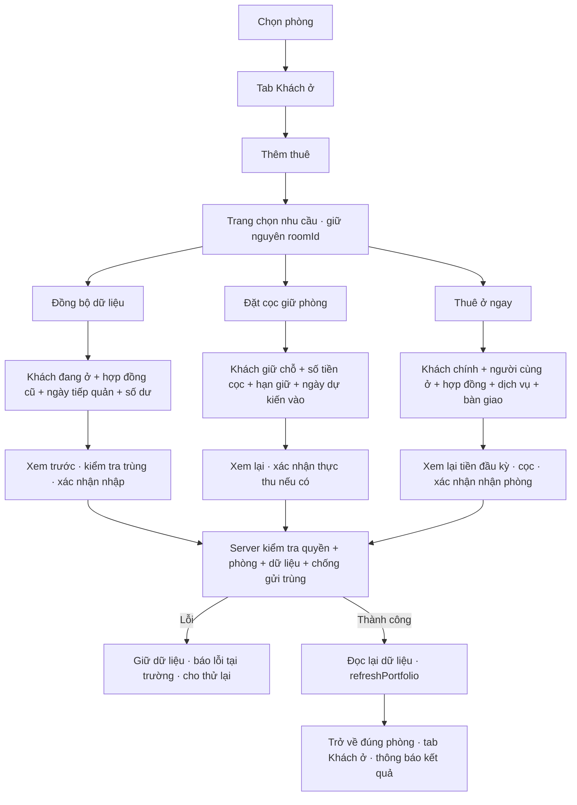
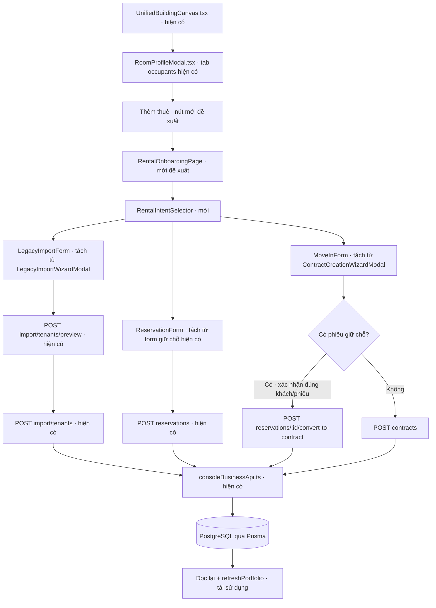

# Codegraph — Quy trình Thêm thuê (đề xuất trước triển khai)

> Bản thiết kế trước triển khai được giữ để đối chiếu. Trạng thái mã nguồn, đường dẫn màn hình thực tế và kết quả kiểm tra cập nhật tại [IMPLEMENTATION.md](IMPLEMENTATION.md).

## Phạm vi và căn cứ

Dựa trên yêu cầu người dùng và code AdHome đang có ngày 03/11/2026. Chưa đối chiếu trực tiếp repo/runtime Homeland-SaaS; không khẳng định giống hoàn toàn các trường, thứ tự hay nghiệp vụ của sản phẩm đó. “Đồng bộ dữ liệu” tạm hiểu là nhập khách đang thuê từ hồ sơ cũ, không phải kết nối tự động sang Homeland.

Chỉ tạo tài liệu và sơ đồ; chưa thay đổi ứng dụng. Sơ đồ HTML mô tả quy trình đích. Codegraph dưới đây phân biệt phần đang có với phần đề xuất.

## 1. Quy trình màn hình

Đề xuất dùng trang có URL riêng, ví dụ `/rooms/:roomId/add-rental`, tương thích cách điều hướng hiện tại khi triển khai. Chưa có route này trong ứng dụng. Có Quay lại, giữ dữ liệu nháp theo nhánh và cảnh báo khi rời trang có thay đổi. Mọi lần chuyển nhu cầu đều không ghi dữ liệu lên server.

## 2. Codegraph: UI → điều phối → API

Các API trên đều có tiền tố `/api/v1/console/v2/`. Đây là bản đồ tái sử dụng endpoint, chưa phải cam kết mỗi nhánh đã đáp ứng đủ quy trình đích.

### Căn cứ trong code

| Vị trí | Hiện trạng quan sát được | Thay đổi đề xuất |
|---|---|---|
| `apps/console/src/features/buildings/UnifiedBuildingCanvas.tsx:151` | Mở RoomProfileModal; giữ chỗ và hợp đồng đều mở ContractCreationWizardModal | Điều hướng qua trang chọn nhu cầu, truyền roomId/reservationId |
| `apps/console/src/features/buildings/modals/RoomProfileModal.tsx:559` | Tab Khách ở có Thêm người lưu trú | Bổ sung Thêm thuê; giữ chức năng thêm người cùng ở riêng |
| `apps/console/src/features/modules/modals/ContractCreationWizardModal.tsx` | Wizard 6 bước gộp giữ chỗ và thuê, tạo khách trước hợp đồng; mặc định xác nhận đã thu cọc là true | Tách biểu mẫu theo nhu cầu; không mặc định thực thu; xử lý retry không tạo khách trùng |
| `apps/console/src/features/modules/modals/LegacyImportWizardModal.tsx:201` | Có preview rồi nhập dữ liệu cũ theo batchKey | Tái sử dụng cho một phòng; bổ sung ngày tiếp quản/số dư nếu backend chưa hỗ trợ |
| `apps/landing/server/consoleBusinessApi.ts:3720` | Preview import | Kiểm tra dữ liệu và xung đột trước commit |
| `apps/landing/server/consoleBusinessApi.ts:3894` | Commit import | Rà soát không thay hợp đồng đang hoạt động một cách âm thầm |
| `apps/landing/server/consoleBusinessApi.ts:4753` | Tạo hợp đồng trực tiếp | Rà soát transaction, chống trùng và xử lý đầu kỳ |
| `apps/landing/server/consoleBusinessApi.ts:5421` | Tạo giữ chỗ | Tái sử dụng, xác nhận rõ trạng thái thu tiền |
| `apps/landing/server/consoleBusinessApi.ts:6188` | Chuyển giữ chỗ thành hợp đồng | Tái sử dụng quy tắc chuyển cọc, không thu lại |

## 3. Dữ liệu từng nhánh

| Nhóm | Đồng bộ dữ liệu | Đặt cọc giữ phòng | Thuê ở ngay |
|---|---|---|---|
| Phòng | Tự điền phòng đã chọn | Tự điền, kiểm tra còn giữ được | Tự điền, kiểm tra đủ điều kiện nhận |
| Khách | Chọn/tạo khách, tên, điện thoại, giấy tờ; người cùng ở | Tên, điện thoại; giấy tờ khi cần | Chọn/tạo khách chính; giấy tờ; người cùng ở |
| Thời gian | Ngày bắt đầu/kết thúc cũ, ngày tiếp quản, đã trả đến ngày | Hạn giữ, ngày dự kiến vào | Ngày nhận, thời hạn, ngày kết thúc, kỳ thanh toán |
| Tiền | Giá thuê, cọc đang giữ, nợ/dư đầu kỳ có xác nhận | Số cọc thỏa thuận, số thực thu, phương thức/ngày thu nếu có | Giá thuê, cọc yêu cầu, cọc chuyển từ giữ chỗ, khoản thực thu, tiền đầu kỳ |
| Vận hành | Dịch vụ và chỉ số tại thời điểm tiếp quản | Ghi chú/điều kiện hủy | Dịch vụ, đơn giá áp dụng, điện/nước đầu vào, bàn giao |
| Xác nhận | Xem trước dữ liệu, cảnh báo trùng | Xem lại phiếu và tiền thực thu | Xem lại hợp đồng, tiền cần thu, chỉ số bàn giao |

Trường nào bắt buộc phải khớp validation thực tế của server khi triển khai. Không hiển thị một form dài chung cho cả ba nhu cầu.

## 4. Trạng thái và tiền

- Đồng bộ: sau khi commit hợp lệ, ghi nhận khách/hợp đồng đang ở và số dư tiếp quản theo chính sách được xác nhận. Cọc lịch sử là số dư cọc, không tự sinh khoản thu mới. Không tự xuất lại hóa đơn kỳ đã trả.
- Giữ phòng: AVAILABLE → RESERVED khi server xác nhận phiếu hợp lệ. Phân biệt PENDING với PAID của khoản cọc. Không biến người giữ chỗ thành người đã nhận phòng.
- Nhận phòng: AVAILABLE → OCCUPIED khi hoàn tất nghiệp vụ thuê; RESERVED → OCCUPIED qua chuyển phiếu đúng khách. Cọc được phân bổ từ số thực thu còn lại sau hoàn/khấu trừ; cọc thiếu và tiền thừa hiển thị riêng.
- Phiếu giữ chỗ hết hạn/hủy: xử lý theo API và chính sách hiện có; không mở phòng chỉ bằng thay đổi state ở giao diện.
- Phòng đã có người: Thêm người cùng ở dùng API occupants. Thêm thuê mới phải kiểm tra mô hình nguyên phòng/ở ghép và sức chứa; không tự ghi đè hợp đồng hiện tại.
- Số dư đầu kỳ, dịch vụ và bàn giao trong quy trình đích cần rà soát transaction/API; endpoint contracts hiện tại không đồng nghĩa đã hoàn tất thu tiền hay bàn giao.

## 5. Điều phối và lỗi

1. Mở trang chỉ tải dữ liệu. Khóa roomId với ngữ cảnh đã chọn; server luôn kiểm tra lại quyền và trạng thái phòng lúc lưu.
2. Validate từng bước, giữ dữ liệu khi Quay lại. Các trường tiền dùng MoneyInput; không tự chọn khách đầu tiên thay người dùng.
3. Trang xem lại liệt kê rõ bản ghi sẽ tạo và số tiền thực sự thu. Nút cuối theo nhánh: Xác nhận đồng bộ / Xác nhận giữ phòng / Xác nhận thuê ở.
4. API ghi dữ liệu phải chống gửi trùng và tranh chấp. Nếu cần tạo khách rồi tạo hợp đồng, retry không tạo thêm khách; ưu tiên điều phối có transaction hoặc khóa idempotency được server thực thi.
5. Nếu server trả lỗi: giữ form, hiển thị lỗi. Nếu lưu thành công nhưng refresh lỗi: báo đã lưu, cho tải lại; không gửi lại thao tác tạo.
6. Chỉ báo thành công sau phản hồi hợp lệ và đọc lại dữ liệu. Loading vô định khi không có tiến độ thật; không dùng timer để giả hoàn tất.
7. Dùng shared UI và @animate-ui/react theo docs/skills/animate-ui/SKILL.md, kiểm tra bàn phím, reduced motion, điện thoại.

## 6. Thứ tự triển khai dự kiến

1. Chốt ý nghĩa “đồng bộ” và các trường/điều kiện nghiệp vụ theo Homeland nếu có quyền xem nguồn hoặc bản demo.
2. Tạo entry Thêm thuê trong tab Khách ở và trang chọn 3 nhu cầu; giữ roomId khi điều hướng.
3. Tách form dùng lại logic hiện có, tránh gắn nguyên wizard 6 bước sau từng lựa chọn.
4. Rà soát/bổ sung API cho giao dịch nhận phòng, số dư tiếp quản, idempotency và kiểm tra phòng.
5. Nối lưu → đọc lại → trả về tab Khách ở. Kiểm tra ba luồng, chuyển cọc, xung đột hai người thao tác, retry sau lỗi mạng và refresh thất bại.

## Tệp sơ đồ

- `rental-workflow.html`: sơ đồ quy trình tương tác, có tìm kiếm và phóng to.
- `rental-workflow.json`: đặc tả tái tạo sơ đồ.
- Nội dung sơ đồ bằng tiếng Việt; thanh công cụ Viewer và thuộc tính HTML lang dùng English theo khả năng thư viện.
