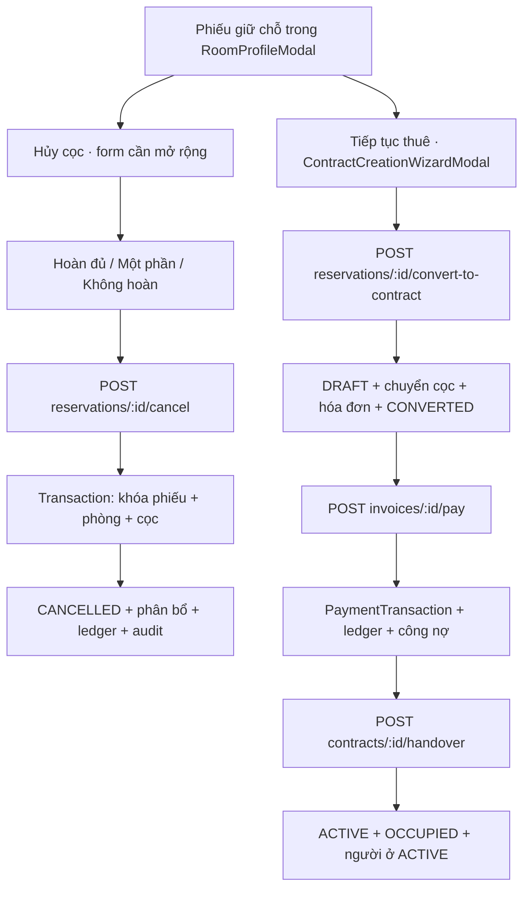

# Cọc giữ phòng → Hủy / Chuyển hợp đồng / Thu tiền / Bàn giao

> Bản thiết kế trước triển khai được giữ để đối chiếu. Trạng thái mã nguồn, đường dẫn màn hình thực tế và kết quả kiểm tra cập nhật tại [IMPLEMENTATION.md](IMPLEMENTATION.md).

Ngày cập nhật: 03/11/2026. Trạng thái: thiết kế nghiệp vụ và đối chiếu tĩnh mã nguồn AdHome; chưa triển khai, chưa kiểm thử giao dịch thực tế. Chưa xác minh trực tiếp Homeland-SaaS.

## 1. Điểm vào và hai hướng loại trừ nhau

Chọn phòng → Khách ở → Phiếu cọc giữ phòng → chọn **Hủy giữ phòng** hoặc **Tiếp tục thuê**.

Phiếu đã hủy không chuyển tiếp thành hợp đồng bằng phiếu đó. Nếu khách đổi ý quay lại sau khi đã hủy, tạo giao dịch thuê mới, kiểm tra lại phòng; không dùng lại tiền đã hoàn hoặc đã phân bổ chi phí/phạt. Hoàn một phần trong lúc vẫn giữ phiếu là nghiệp vụ khác, không đồng nghĩa Hủy cọc hoàn một phần.

Đính chính sơ đồ tổng quan phiên bản đầu: chuyển giữ chỗ sang hợp đồng hiện tạo **DRAFT / Chờ bàn giao**, phòng vẫn **RESERVED**. Bàn giao thành công mới chuyển hợp đồng **ACTIVE**, phòng **OCCUPIED**, người ở **ACTIVE**. Sơ đồ tổng quan thể hiện đích cuối của toàn bộ quy trình.

## 2. Số dư cọc được xử lý

Tính riêng từng khoản cọc đã thu và còn hợp lệ, sau đó cộng lại:

**B = Σ max(0, thực thu − đã hoàn − đã khấu trừ chi phí − đã phạt/giữ lại − đã chuyển).**

- Số tiền hẹn cọc không phải tiền đã thu. Phiếu chưa thu có B = 0, không được hoàn tiền hay tạo doanh thu phạt bằng tiền chưa nhận.
- B phải đọc lại từ server trong transaction, không lấy số tiền từ nhãn trên giao diện làm nguồn quyết định.
- “Khấu trừ chi phí khi hủy” khác “chuyển cọc sang hợp đồng / cấn trừ tiền thuê”. Cần hiển thị tên nghiệp vụ riêng.

## 3. Hủy giữ phòng

### Các bước

1. Tải lại phiếu, trạng thái, lịch sử tiền và B.
2. Chọn Hoàn đủ / Hoàn một phần / Không hoàn.
3. Nhập lý do, khoản chi phí giữ lại và khoản phạt theo thỏa thuận; trường hoàn tiền có thông tin người nhận, phương thức, tham chiếu chứng từ khi thực chi.
4. Xem lại bảng phân bổ. Bắt buộc **H + K + F = B**, trong đó H là hoàn khách, K là khấu trừ chi phí, F là khoản phạt/giữ lại theo chính sách.
5. Xác nhận thao tác với quyền hợp lệ; chỉ xác nhận đã hoàn khi thực tế đã chi. Lưu server → đọc lại phiếu/sổ tiền → báo kết quả.
6. Phiếu CANCELLED; cọc được tất toán phân bổ. Phòng chỉ trở về AVAILABLE nếu không có hợp đồng chờ bàn giao/đang hoạt động; cần kiểm tra thêm giữ chỗ khác khi triển khai.

| Lựa chọn | Phân bổ | Ví dụ B = 2.000.000 đ |
|---|---|---|
| Hoàn đủ | H = B; K = F = 0 | Hoàn 2.000.000; giữ lại 0 |
| Hoàn một phần | 0 < H < B; K + F = B − H | Hoàn 1.200.000; chi phí 300.000; phạt 500.000 |
| Không hoàn | H = 0; K + F = B | Chi phí 300.000; phạt 1.700.000; chi hoàn 0 |
| Chưa thực thu | B = H = K = F = 0 | Chỉ hủy phiếu, không có dòng tiền |

Không mặc định toàn bộ phần không hoàn là chi phí. Người xử lý phải biết đang phân bổ chi phí hay phạt và có lý do tương ứng. Tiền giữ lại lấy từ cọc đã thu, không phải một khoản khách nộp thêm vào ngày hủy.

### Hai thời điểm hoàn tiền

- **Chờ hoàn:** đã xác định nghĩa vụ phải trả, chưa xác nhận tiền ra. Hiển thị số còn phải hoàn, không báo Đã hoàn.
- **Đã hoàn:** nhân viên xác nhận đã thực chi hoặc nhà cung cấp trả kết quả xác minh; ghi nhận phiếu chi đúng một lần.

API cancel hiện tại ghi hoàn tiền và phiếu chi ngay trong transaction khi gửi H > 0. Vì vậy chỉ sử dụng thao tác này như xác nhận hoàn đã thực hiện; muốn cho phép hủy trước rồi chi sau cần bổ sung cơ chế nghĩa vụ chờ hoàn. Đây là hạng mục cần triển khai, chưa có qua endpoint cancel hiện tại.

## 4. Khách tiếp tục thuê

1. Mở phiếu hợp lệ PENDING/CONFIRMED → Tiếp tục thuê. Kiểm tra đúng khách, đúng phòng; không tự chuyển cọc sang người khác.
2. Điền hợp đồng: khách chính/người ở, ngày nhận, ngày kết thúc, giá thuê, cọc hợp đồng, chính sách tính kỳ đầu, dịch vụ, điều kiện bàn giao.
3. Server tính lại B, cọc yêu cầu C, tiền thuê kỳ đầu R. R có thể tính theo ngày, chu kỳ riêng hoặc chính sách thực tế; không tự lấy nguyên giá tháng nếu chính sách tính lẻ ngày.
4. Hiển thị bảng quyết toán, chọn cách xử lý dư cọc: trừ tiền thuê hoặc hoàn dư.
5. Xác nhận chuyển: phiếu CONVERTED; hợp đồng DRAFT; phòng RESERVED; người ở SCHEDULED. Lập hóa đơn đầu kỳ và phân bổ cọc. Không phát sinh thu tiền mới chỉ vì chuyển cọc.
6. Thu số tiền khách thực trả qua hóa đơn, đối soát và cập nhật công nợ/cọc. Thu thiếu vẫn là thu thiếu; không đánh dấu đã thanh toán đủ.
7. Bàn giao: chỉ số điện/nước theo cách tính, ngày nhận, người giao/nhận. Đủ cọc hoặc phê duyệt nợ cọc theo quyền/chính sách; tiền thuê còn nợ hiển thị rõ, không tự kết luận API hiện tại bắt buộc trả đủ tiền thuê trước bàn giao.
8. Server xác nhận bàn giao → ACTIVE / OCCUPIED; đọc lại dữ liệu và trở về tab Khách ở.

### Công thức đang dùng cho chuyển giữ chỗ

Đơn vị: VND nguyên. Trong endpoint hiện tại, hóa đơn đầu kỳ gồm tiền thuê và cọc thiếu, chưa gồm tự động tất cả các phí/dịch vụ.

| Ký hiệu | Công thức |
|---|---|
| B | Cọc khả dụng |
| C | Cọc hợp đồng yêu cầu |
| R | Tiền thuê kỳ đầu do server tính |
| T | Cọc chuyển sang hợp đồng = min(B, C) |
| D | Cọc phải bổ sung = max(C − B, 0) |
| S | Dư sau khi đủ cọc hợp đồng = max(B − C, 0) |

**Lựa chọn A — Dư trừ tiền thuê:**

- A = min(S, R): phần trừ vào thuê kỳ đầu.
- V = max(S − R, 0): tín dụng tiền thuê bảo lưu kỳ sau.
- **N = D + R − A:** số phải thu mới ban đầu.
- Bảo toàn: **B = T + A + V**.

**Lựa chọn B — Hoàn phần dư:**

- H = S: khoản chờ hoàn dư; A = V = 0.
- **N = D + R:** số phải thu mới ban đầu.
- Bảo toàn: **B = T + H**.
- Endpoint chuyển hợp đồng tạo SURPLUS_REFUND / PENDING_REFUND, chưa ghi tiền đã chi. Chỉ khi chi hoàn được xác nhận mới giảm nghĩa vụ hoàn.
- Không tự lấy khoản chờ hoàn trừ vào số cần thu nếu khách đã chọn hoàn riêng. Muốn bù trừ cần đổi lựa chọn và lưu phân bổ rõ ràng.

### “Thực thu” hiển thị thế nào?

- **Cần thu mới:** N, tính tại thời điểm lập hóa đơn.
- **Đã thực thu mới:** P = tổng các giao dịch nhận tiền mới được xác nhận cho hóa đơn, không tính lại B.
- **Còn phải thu:** max(N − P, 0).
- **Khách trả dư mới:** max(P − N, 0), phải xử lý riêng; không bỏ mất.
- **Thực nhận ròng từ đầu:** cọc đã thu ban đầu + các khoản thu mới thực tế − tất cả khoản hoàn đã thực chi. Không trừ chi phí/phạt phân bổ nội bộ như một khoản tiền chi ra khách.
- Tạo hợp đồng không làm P tăng. Chuyển cọc không phải thu mới. Phí chưa lập/được duyệt không được âm thầm cộng vào N.

### Ví dụ cụ thể

Cọc hợp đồng C = 4.500.000; thuê kỳ đầu R = 4.500.000; chưa có phí khác, chưa thu mới, chưa hoàn/khấu trừ trước đó.

| B | Xử lý dư | Chuyển cọc T | Cọc bổ sung D | Trừ thuê A | Cần thu mới N | Bảo lưu / Chờ hoàn |
|---:|---|---:|---:|---:|---:|---|
| 0 | Không có dư | 0 | 4.500.000 | 0 | 9.000.000 | 0 |
| 2.000.000 | Không có dư | 2.000.000 | 2.500.000 | 0 | **7.000.000** | 0 |
| 4.500.000 | Không có dư | 4.500.000 | 0 | 0 | **4.500.000** | 0 |
| 6.000.000 | Trừ thuê | 4.500.000 | 0 | 1.500.000 | **3.000.000** | 0 |
| 10.000.000 | Trừ thuê | 4.500.000 | 0 | 4.500.000 | **0** | Bảo lưu 1.000.000 |
| 6.000.000 | Hoàn dư | 4.500.000 | 0 | 0 | **4.500.000** | Chờ hoàn 1.500.000 |

Ví dụ phổ biến B = 2 triệu: tổng nghĩa vụ cọc + thuê = 9 triệu; đã có 2 triệu cọc nên còn thu **7 triệu**. Nếu mới nhận thêm 5 triệu: thực thu mới **5 triệu**, còn nợ **2 triệu**; chưa được gọi 7 triệu là đã thu. Nếu thu đủ 7 triệu, tổng nhận từ đầu là 9 triệu, trong đó 4,5 triệu là cọc hợp đồng và 4,5 triệu là tiền thuê.

## 5. Codegraph và API hiện có

Tiền tố API: `/api/v1/console/v2/`. Tiền hoàn dư xử lý qua nghiệp vụ hoàn cọc `POST deposits/:id/refund`, phải kiểm tra đủ điều kiện của khoản SURPLUS_REFUND và read-back khi tích hợp.

| Nguồn hiện tại | Căn cứ |
|---|---|
| `apps/console/src/features/buildings/modals/RoomProfileModal.tsx` | Form hủy hiện chỉ gửi reason/refundAmountVnd; chưa gửi đủ deductionAmountVnd/forfeitAmountVnd cho hoàn một phần/không hoàn |
| `apps/console/src/features/modules/modals/ContractCreationWizardModal.tsx` | Chuyển phiếu theo reservationId và chọn surplusAction |
| `apps/landing/server/consoleBusinessApi.ts:5858` | Hủy: H + K + F = B; khóa hàng, quyền finance.write khi có tiền; ghi ledger/audit |
| `apps/landing/server/consoleBusinessApi.ts:6188` | Chuyển hợp đồng: T/D/S/A/V/N; DRAFT, RESERVED, hóa đơn đầu kỳ |
| `apps/landing/server/consoleBusinessApi.ts:6753` | Hoàn cọc |
| `apps/landing/server/consoleBusinessApi.ts:7021` | Thu hóa đơn; trạng thái PARTIAL/PAID; giao dịch và ledger |
| `apps/landing/server/consoleBusinessApi.ts:5125` | Bàn giao: kiểm tra cọc/phê duyệt, chỉ số, ACTIVE |

## 6. Khoảng trống cần xử lý trước triển khai

1. **UI hủy chưa đủ ba phương án:** gửi đủ H/K/F, phân bổ phần còn lại, giải thích giữ lại; bổ sung dữ liệu chứng từ và xác nhận thực chi.
2. **Công thức B chưa thống nhất:** cancel trừ refunded/deducted/forfeited/transferred; convert tính B chỉ trừ refunded/deducted, còn đoạn chuyển từng cọc trừ thêm forfeited. Cần một hàm số dư dùng chung và kiểm tra chống chuyển lại; chưa sửa backend trong tài liệu này.
3. **Thu một phần:** API pay chỉ cập nhật cọc hợp đồng lên đủ khi hóa đơn PAID; chưa phân bổ tăng cọc theo từng khoản thu một phần. Cần chốt thứ tự phân bổ và lưu dòng tiền để cọc thực có và công nợ nhất quán. Không tự mặc định đã thu đủ cọc từ tổng P.
4. **Đối soát tự động:** rà soát đồng nhất cập nhật cọc giữa pay và payments/reconcile; không chỉ cập nhật trạng thái hóa đơn.
5. **Bàn giao:** tổng hợp cọc hiện truy vấn theo contractId và status, cần giới hạn đúng loại cọc và số khả dụng; rà soát lại ngay trong transaction. Điều kiện quyền phê duyệt thực tế hiện gồm contracts.manage, cần đồng bộ mô tả và chính sách chốt.
6. **Hạch toán:** cancel ghi INCOME cho K/F; đây là tái phân bổ cọc cũ, không có tiền vào mới. Báo cáo dòng tiền phải phân biệt để không cộng thu hai lần.
7. **Chờ hoàn:** cancel hiện ghi chi ngay; chuyển hợp đồng hoàn dư có PENDING_REFUND. Cần một trải nghiệm nhất quán giữa phê duyệt hoàn và xác nhận chi.
8. **Phí/dịch vụ đầu kỳ:** công thức endpoint chuyển hiện chỉ R + D − A. Muốn thêm phí cần dòng hóa đơn, thuế/giảm giá nếu áp dụng, chốt công thức và server trước khi hiển thị tổng.
9. **Retry/xung đột:** client gửi khóa idempotency ổn định; kiểm tra trả lại kết quả khi retry sau commit, không ghi hai phiếu thu/chi. Kiểm tra hai thao tác hủy và chuyển đồng thời chỉ một thành công.

## 7. Tiêu chí nghiệm thu nghiệp vụ

- [ ] Cọc chưa thu: hủy không tạo chi hoàn/thu phạt; chuyển với B = 0 vẫn tính đủ tiền cần thu.
- [ ] Hoàn đủ: B = H, phần cọc còn lại bằng 0, phiếu chi chỉ ghi một lần.
- [ ] Hoàn phần: H + K + F = B; từ chối thiếu/thừa phân bổ; tổng số dư sau hủy bằng 0.
- [ ] Không hoàn: H = 0, K + F = B; không có tiền thực thu mới.
- [ ] Chỉ xác nhận đã hoàn sau thực chi; chờ hoàn không xuất hiện như chi đã hoàn tất.
- [ ] B < C / B = C / C < B < C + R / B > C + R: kết quả khớp bảng ví dụ.
- [ ] Hoàn dư: tạo nghĩa vụ chờ hoàn; không tự coi là đã chi hoặc giảm tiền thuê.
- [ ] Thu một phần và trả dư được thể hiện riêng; phân bổ cọc/thuê có chứng cứ.
- [ ] Tạo hợp đồng vẫn DRAFT/RESERVED; bàn giao mới ACTIVE/OCCUPIED.
- [ ] Retry và hai người thao tác không nhân đôi tiền hoặc hợp đồng.
- [ ] Tất cả kết quả dựa phản hồi server và đọc lại; không báo thành công bằng timer.
- [ ] Giao diện dùng shared UI/@animate-ui/react; thao tác được trên mobile, bàn phím, reduced motion.
