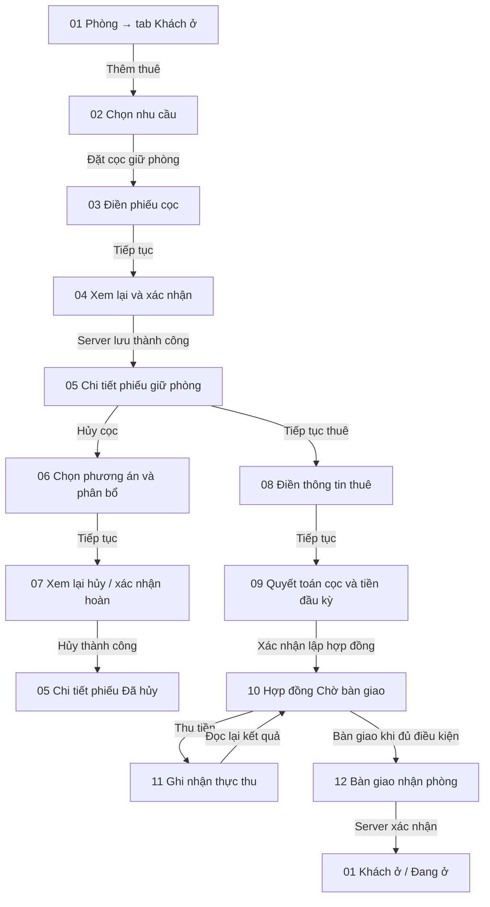

# Quy trình màn hình — Tạo cọc, hủy cọc, chuyển thuê và bàn giao

> Bản thiết kế trước triển khai được giữ để đối chiếu. Trạng thái mã nguồn, đường dẫn màn hình thực tế và kết quả kiểm tra cập nhật tại [IMPLEMENTATION.md](IMPLEMENTATION.md).

Phiên bản 1 · 03/11/2026 · Thiết kế đề xuất trước triển khai. Chưa phải màn hình đã chạy trong ứng dụng; chưa đối chiếu trực tiếp màn hình Homeland-SaaS. Quy tắc tiền chi tiết tại DEPOSIT-LIFECYCLE.md.

## A. Bản đồ màn hình



Trong sơ đồ HTML, hàng đầu đọc từ trái sang phải; nhánh hủy và nhánh tiếp tục thuê đọc theo mũi tên từ phải sang trái. Số 01–12 khớp bảng dưới đây. “Đã hủy”, “Chờ hoàn”, “Đang ở” là trạng thái kết quả trong cùng màn hình chi tiết, không cần thêm trang chúc mừng.

## B. Quy chuẩn điều hướng

- 01 là tab trong hồ sơ phòng. 02–04 và 08–09 là trang quy trình có tiêu đề, breadcrumb, nút Quay lại, bước hiện tại. 05 và 10 là trang chi tiết. 06–07 là quy trình hủy riêng. 11 là hộp thoại thu tiền dùng chung. 12 là trang/biểu mẫu bàn giao.
- Luôn hiển thị tòa nhà, mã phòng, tên khách, mã phiếu/hợp đồng; chuyển bước không làm mất roomId/reservationId hoặc nhập lại phòng.
- Chọn nhu cầu trước khi nhập thông tin. 02 có đúng ba lựa chọn: Đồng bộ dữ liệu / Đặt cọc giữ phòng / Thuê ở ngay. Tài liệu này đi sâu nhánh Đặt cọc.
- Nút Tiếp tục chỉ validate và chuyển bước, chưa tạo dữ liệu. Nút Xác nhận cuối mới ghi lên server. Quay lại trước khi lưu giữ nguyên dữ liệu nháp; rời quy trình có thay đổi cần xác nhận bỏ nháp.
- Sau đã lưu không quay ngược để tạo lại giao dịch; mở chi tiết/sửa bằng nghiệp vụ có quyền tương ứng. Nếu chỉ tải lại dữ liệu thất bại sau khi đã lưu, hiển thị “Đã lưu, chưa tải lại được”, cho tải lại, không gửi lại giao dịch.

## C. Chi tiết từng màn hình

### 01 — Hồ sơ phòng / Tab Khách ở

**Điểm vào:** chọn một phòng trên danh sách/sơ đồ.

**Hiển thị:** mã phòng, trạng thái; hợp đồng/phiếu giữ chỗ hiện có; khách chính, người cùng ở. Nếu có phiếu giữ chỗ, có thẻ tên khách, cọc thỏa thuận, đã thu, hạn giữ, ngày dự kiến vào.

**Nút:** Thêm thuê → 02; Xem phiếu giữ phòng → 05; Thêm người cùng ở là chức năng riêng, không tạo hợp đồng mới.

**Điều kiện:** phòng trống có thể tạo giữ chỗ. Nếu đã giữ chỗ, ưu tiên mở phiếu hiện hữu, chặn tạo trùng. Phòng đang thuê/bảo trì phải giải thích khả năng thực hiện theo mô hình thuê và chính sách, không tự ghi đè.

### 02 — Bạn muốn thực hiện việc gì?

**Hiển thị:** phòng đã chọn; ba thẻ nhu cầu kèm giải thích ngắn.

- Đồng bộ dữ liệu: khách đang ở, tiếp quản hồ sơ và số dư cũ.
- Đặt cọc giữ phòng: giữ chỗ trước ngày nhận phòng.
- Thuê ở ngay: lập hợp đồng và thực hiện nhận phòng.

**Nút:** Quay lại → 01; Tiếp tục chỉ bật sau khi chọn một nhu cầu. Chọn Đặt cọc → 03. Chưa tạo phiếu khi chọn thẻ.

### 03 — Thông tin đặt cọc giữ phòng

**Bố cục:** biểu mẫu bên trái; tóm tắt phòng và giá tham khảo bên phải. Mobile xếp dọc.

**Nhóm Khách:** chọn khách có sẵn hoặc tạo mới; họ tên, điện thoại; giấy tờ/ghi chú khi cần. Không tự chọn khách đầu danh sách.

**Nhóm Giữ phòng:** cọc thỏa thuận; ngày dự kiến nhận phòng; hạn giữ; điều kiện hủy/hoàn và ghi chú.

**Nhóm Thanh toán:** lựa chọn Chưa thu / Ghi nhận đã nhận tiền. Mặc định Chưa thu. Nếu ghi nhận thực thu: số thực nhận, phương thức, ngày thu, mã tham chiếu khi có. Cọc thỏa thuận và số thực nhận hiển thị riêng.

**Nút:** Quay lại → 02; Tiếp tục → 04. Validate khách, ngày/hạn giữ, số tiền không âm. Thu một phần tại bước này là thiết kế cần rà soát/bổ sung API, không giả định paymentConfirmed hiện tại hỗ trợ số thu tùy ý.

### 04 — Xem lại phiếu và xác nhận

**Hiển thị:** khách/phòng; ngày/hạn giữ; cọc thỏa thuận; thực thu lần này; cọc còn thiếu; phương thức; điều kiện hủy. Có Sửa thông tin → 03.

**Nút cuối:** “Tạo phiếu giữ phòng” nếu chưa thu; “Tạo phiếu và ghi nhận thu X đ” khi đã thực nhận. Không ghi Đã thu nếu người dùng mới hẹn chuyển tiền.

**Kết quả:** gửi yêu cầu, khóa gửi trùng; thành công đọc lại → 05. Lỗi giữ dữ liệu, không tạo thông báo thành công. Chưa thu thì không tạo thu tiền thực tế.

### 05 — Chi tiết phiếu giữ phòng

**Hiển thị:** mã phiếu, khách/phòng, trạng thái PENDING/CONFIRMED/CANCELLED/CONVERTED tương ứng nhãn tiếng Việt; hạn giữ; cọc thỏa thuận, đã thu, đã hoàn, chi phí/phạt, đã chuyển, số dư khả dụng; lịch sử thao tác/chứng từ.

**Nút khi phiếu còn hiệu lực:** Ghi nhận thu cọc (nếu còn thiếu), Hủy cọc → 06, Tiếp tục thuê → 08. Thu cọc mở hộp thoại thu cọc riêng, không dùng nhầm hóa đơn chưa tồn tại; sau xác nhận tải lại 05. API confirm-payment hiện tại cần rà soát nếu muốn thu nhiều đợt.

**Kết quả hủy:** nhãn Đã hủy và tình trạng hoàn Chờ hoàn/Đã hoàn/Không hoàn; số đã chi và còn phải chi. Nút Xác nhận hoàn chỉ xuất hiện nếu có nghĩa vụ chờ hoàn và đủ quyền.

**Kết quả chuyển:** nhãn Đã chuyển hợp đồng; nút Mở hợp đồng → 10. Ẩn Hủy cọc/Tiếp tục thuê để tránh dùng lại tiền đã chuyển.

### 06 — Hủy cọc: chọn phương án

**Hiển thị cố định:** khách/phòng, mã phiếu và B — số dư khả dụng mới nhất.

**Ba lựa chọn:**

| Chọn | Trường hiện ra | Tự tính |
|---|---|---|
| Hoàn đủ | Lý do hủy; thông tin nhận hoàn | Hoàn B, giữ lại 0 |
| Hoàn một phần | Tiền hoàn H; chi phí K; phạt/giữ lại F; lý do | H + K + F = B |
| Không hoàn | Chi phí K; phạt/giữ lại F; lý do | H = 0; K + F = B |

Hiển thị “Phần chưa phân bổ” và chặn Tiếp tục nếu khác 0. Với B = 0 hiển thị “Phiếu chưa có tiền để hoàn”, chỉ xác nhận hủy không phát sinh tiền.

**Nút:** Quay lại → 05; Tiếp tục → 07. Chưa hủy phiếu ở màn hình này.

### 07 — Xem lại hủy và xác nhận hoàn

**Hiển thị:** lý do; hoàn khách H; chi phí K; phạt F; tổng B; thông tin người nhận và phương thức hoàn nếu H > 0. Cảnh báo không thể dùng lại phiếu đã hủy để chuyển thuê.

**Nút đề xuất:**

- H = 0: “Xác nhận hủy — không hoàn tiền”.
- H > 0, đã thực chi: “Xác nhận hủy và đã hoàn H đ”; phải có xác nhận thực chi/chứng từ theo chính sách.
- H > 0, chưa chi: “Hủy và ghi nhận chờ hoàn H đ” — chức năng cần bổ sung backend trước khi bật, vì cancel hiện tại ghi chi ngay.

**Kết quả:** thành công → 05 trạng thái Đã hủy. Chờ hoàn không được ghi Đã hoàn. Hết quyền hoặc số dư đổi: báo lỗi, tải lại phân bổ để xem lại, không tự đổi số tiền rồi gửi lại.

### 08 — Thông tin hợp đồng thuê

**Điểm vào:** 05 → Tiếp tục thuê. Khóa đúng phòng, mã phiếu; tự điền khách theo phiếu và cho kiểm tra lại.

**Các phần trên cùng trang:**

1. Khách chính và người cùng ở: tên, điện thoại, giấy tờ theo yêu cầu.
2. Điều khoản: ngày bắt đầu/kết thúc, giá thuê, cọc hợp đồng yêu cầu C, chính sách tính tiền kỳ đầu.
3. Dịch vụ: loại dịch vụ, đơn giá/phương thức kế thừa từ phòng/tòa nhà và quyền điều chỉnh.
4. Dự kiến nhận phòng: ngày nhận, ghi chú. Chỉ số bàn giao thực tế nhập ở 12, tránh nhập hai lần.

**Nút:** Quay lại → 05; Tiếp tục → 09. Chưa tạo hợp đồng. Không yêu cầu đi lại bước chọn phòng hoặc đặt cọc lần nữa.

### 09 — Quyết toán cọc và tiền đầu kỳ

**Hiển thị rõ ràng:**

```text
QUYẾT TOÁN NHẬN PHÒNG · Phòng 3101
Cọc hợp đồng yêu cầu                     4.500.000 đ
Tiền thuê kỳ đầu                        4.500.000 đ
Tổng nghĩa vụ ban đầu                   9.000.000 đ

Cọc giữ phòng khả dụng                  2.000.000 đ
  Chuyển vào cọc hợp đồng               2.000.000 đ
  Trừ tiền thuê                                 0 đ

Cọc còn phải bổ sung                    2.500.000 đ
Tiền thuê còn phải trả                  4.500.000 đ
CẦN THU MỚI                             7.000.000 đ
Đã thực thu mới ở bước này                       0 đ

[Quay lại]                   [Xác nhận lập hợp đồng]
```

Nếu B > C, hiển thị lựa chọn **Trừ phần dư vào tiền thuê** hoặc **Hoàn phần dư**. Nêu rõ số bảo lưu kỳ sau hoặc số chờ hoàn. Tiền thuê kỳ đầu có cách tính, khoảng ngày và số ngày tính tiền. Phí khác chỉ hiển thị/cộng khi đã có dòng tính hợp lệ phía server.

**Nút:** Quay lại → 08; Xác nhận lập hợp đồng → server → 10. Nút này không ghi nhận thực thu 7 triệu trong ví dụ. Nếu tính toán server thay đổi, hiển thị bảng mới để xác nhận lại.

### 10 — Chi tiết hợp đồng / Chờ bàn giao

**Hiển thị:** nhãn Chờ bàn giao; thông tin hợp đồng; người ở dự kiến; cọc yêu cầu/đã chuyển/đã thu thêm/còn thiếu; hóa đơn đầu kỳ: tổng, đã thu mới, còn nợ; khoản hoàn dư và tín dụng bảo lưu nếu có.

**Nút:** Thu tiền → 11; Bàn giao phòng → 12 nếu đủ điều kiện; Xem phiếu cọc gốc → 05. Nếu thiếu cọc, giải thích lý do chặn và đường xin phê duyệt nợ cọc theo quyền/chính sách, không tự đánh dấu cọc đủ.

Nếu hóa đơn không còn nợ hoặc N = 0: không bắt mở bước thu 0 đồng; đi bàn giao trực tiếp khi đủ điều kiện. Nếu còn nợ thuê nhưng cọc đủ, chính sách bàn giao phải hiển thị rõ; API hiện tại không đồng nghĩa bắt buộc thu đủ thuê.

### 11 — Hộp thoại ghi nhận thực thu

```text
THU TIỀN HÓA ĐƠN
Cần thu ban đầu                         7.000.000 đ
Đã thu mới trước lần này                        0 đ
Còn phải thu                            7.000.000 đ

Số tiền thực nhận lần này              [5.000.000]
Phương thức                            [Chuyển khoản]
Tham chiếu                             [           ]

Sau khi xác nhận:
Tổng thực thu mới                       5.000.000 đ
Còn nợ                                  2.000.000 đ

[Đóng]                     [Xác nhận đã thu 5.000.000 đ]
```

**Trường:** số thực nhận > 0; phương thức/nhà cung cấp; tham chiếu giao dịch khi có; người trả và ghi chú phù hợp khả năng API. Thời điểm hệ thống xác minh không được giả làm ngày nhận tiền do người dùng nhập nếu backend chưa hỗ trợ.

**Kết quả:** API pay/đối soát xác nhận và tải lại → 10 cập nhật thực thu, công nợ, tình trạng cọc. Thu thiếu là PARTIAL; trả dư hiển thị tiền dư và phương án xử lý, không bỏ mất. Không tính B là thực thu lần này. Chờ kiểm tra giao dịch thì ghi Chờ xác minh, chưa cộng thực thu đã xác nhận.

### 12 — Bàn giao nhận phòng

**Hiển thị:** khách/phòng, trạng thái hợp đồng; tóm tắt cọc còn thiếu, nợ thuê nếu có; điều kiện được bàn giao.

**Trường:** ngày nhận; người giao/nhận; chỉ số điện đầu vào nếu tính theo công tơ; nước đầu vào nếu PER_M3; ghi chú bàn giao. Chỉ số không âm. Nếu được phép nợ cọc: lý do và người có quyền phê duyệt theo chính sách đã chốt.

**Nút:** Quay lại → 10; Xác nhận bàn giao. Nếu server chặn, giữ thông tin và hiển thị điều kiện chưa đạt.

**Thành công:** đọc lại → 01 tab Khách ở, nhãn Đang ở; hợp đồng ACTIVE; phòng OCCUPIED; khách/người cùng ở ACTIVE. Hiển thị công nợ còn lại nếu có; không xóa nợ chỉ vì đã nhận phòng.

## D. Trạng thái tải và lỗi áp dụng mọi màn hình

- Loading theo yêu cầu thật; ngăn gửi trùng, không giả phần trăm bằng timer. Tiến độ theo bước màn hình không phải tiến độ ghi dữ liệu.
- Lỗi trường đặt ngay dưới trường; lỗi server ở đầu form và focus tới thông báo. Dữ liệu nháp được giữ lại.
- Phiếu bị người khác hủy/chuyển hoặc số dư đổi: khóa xác nhận cũ, tải lại và yêu cầu xem lại. Không tự động chọn phương án tài chính thay người dùng.
- Chưa đủ quyền thu/hoàn: hiển thị rõ quyền cần xử lý và giữ khả năng xem. Quyền cuối do server kiểm tra.
- Dùng shared UI và @animate-ui/react theo skill dự án khi triển khai. Mobile một cột, số tiền không tràn; nút cuối dễ chạm; focus/keyboard/reduced motion đầy đủ. Các wireframe trong tài liệu là minh họa bố cục, chưa phải UI đã kiểm tra tương tác.

## E. Phần phải triển khai trước khi nghiệm thu màn hình

- Entry Thêm thuê, trang 3 lựa chọn và tách form theo nhu cầu.
- Ba lựa chọn hủy; payload H/K/F; phân biệt chờ hoàn/đã chi.
- Quyết toán bằng dữ liệu server, không dùng con số tính ở trình duyệt làm quyết định tài chính.
- Thu một phần/đối soát phải cập nhật phân bổ cọc và thuê nhất quán.
- Điều kiện bàn giao, quyền phê duyệt, số dư cọc dùng chung và đọc lại trong transaction.
- Kiểm tra đi tới/quay lại, rời nháp, retry, số dư thay đổi, thu 0/thiếu/đủ/dư, lỗi tải lại sau lưu; sau đó mobile, keyboard và reduced motion.
