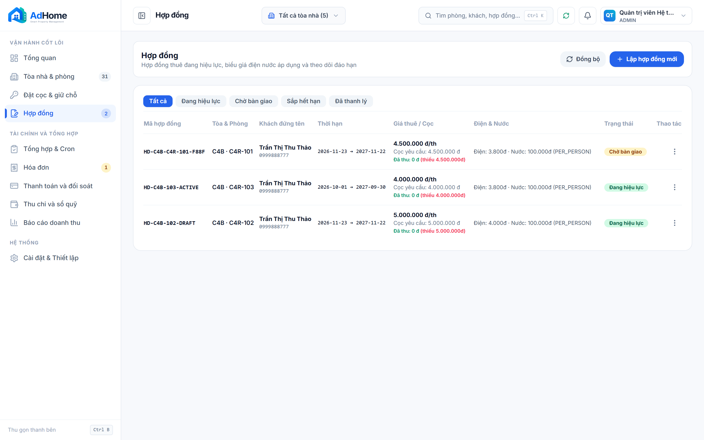
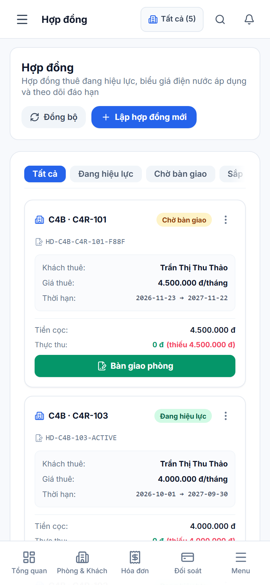
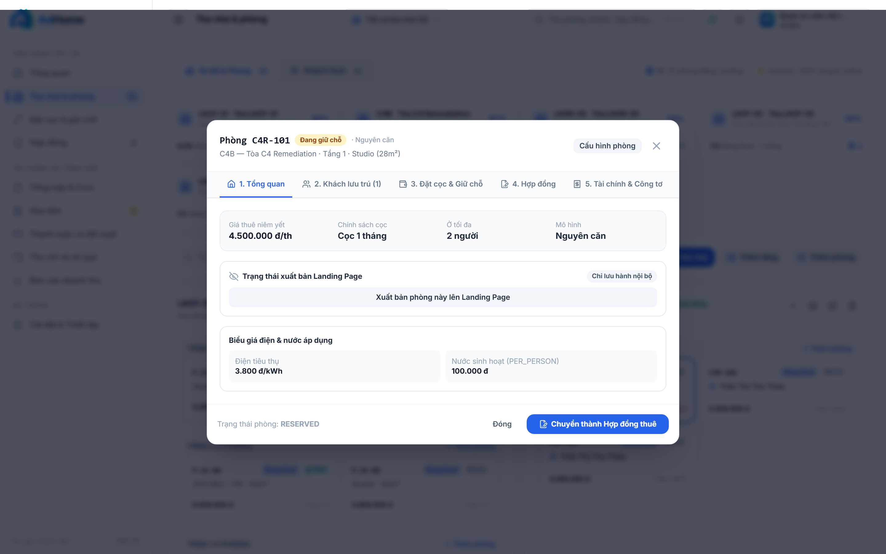
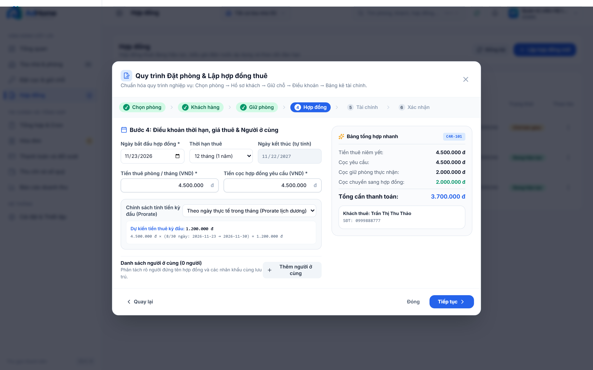
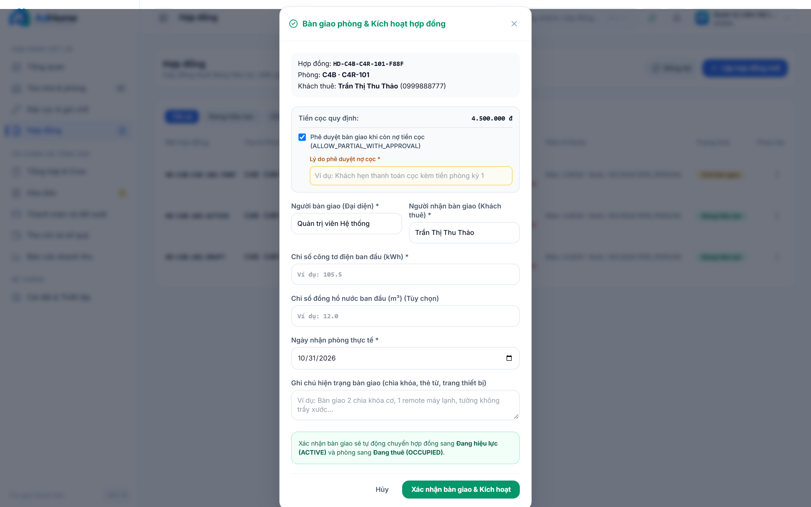

# ADHOME CONSOLE V2 — BÁO CÁO NGHIỆM THU C4 (SPRINT 0 & SPRINT 1)
## Task: C4-SPRINT-0-1-REMEDIATION (UI/UX & Financial Core Engine)

---

### A. Thông tin kiểm thử & Phiên bản
- **Mã công việc (Task ID):** `C4-SPRINT-0-1-REMEDIATION`
- **Tên công việc:** Sửa lỗi Dropdown Clipping, Bổ sung 3 Entry Intents, Prorate Engine kỳ đầu & Handover Deposit Guard
- **Cột mốc (Milestone):** AdHome Console V2 — C4 Remediation
- **Thời gian đánh giá:** 2026-10-31T14:00:07.562Z
- **Base Commit SHA:** `c32b8107b76b59cd7420868b68067c66987da2ed`
- **Môi trường kiểm thử:** Native Windows 11 · PostgreSQL 18 Local (`127.0.0.1:5432/adhome_v2`) · Headless Chromium CDP (1440×900 Desktop & 390×844 Mobile)
- **Trạng thái nghiệm thu:** **`LOCAL_GATE_PASSED`** / **`VISUAL_VERIFIED`**

---

### B. Những thay đổi đã thực hiện trong Sprint 0 & 1

1. **C4-QA-03 (Đối soát Checksum & Provenance):**
   - Đã xác thực 15/15 tệp ảnh C3.2 trên đĩa khớp 100% mã SHA-256 và dung lượng byte so với `screenshots-manifest.json`.
   - Làm rõ nguyên nhân sai khác trên chat là do cơ chế recompress/transcode của giao diện chat web khi người dùng tải ảnh lên.

2. **C4-UI-01 (Nâng cấp ActionMenu với FloatingPortal & Auto-Placement):**
   - Thay thế toàn bộ layout menu absolute bên trong table scroll container bằng `@floating-ui/react` (`useFloating`, `FloatingPortal`, `flip`, `shift`, `FloatingFocusManager`).
   - Đảm bảo menu mở tại dòng cuối cùng của bảng hợp đồng tự động flip lên trên hoặc shift vào trong, hoàn toàn không bị clipping hay che khuất bởi scrolling container hay viewport edges.
   - Hỗ trợ phím Escape đóng menu và trả focus về trigger button.
   - Trên Mobile (390×844), tự động chuyển sang dạng Bottom Sheet với kích thước chạm đạt chuẩn WCAG (>= 44px) và backdrop làm mờ.

3. **C4-LIFE-01 (Tách bạch 3 lối vào bắt đầu thuê tại Hồ sơ phòng):**
   - Tại `RoomProfileModal.tsx`, khi phòng ở trạng thái `AVAILABLE`, giao diện cung cấp 3 nút hành động trực quan độc lập:
     - **Giữ chỗ - đặt cọc** (`btn-room-intent-reserve`)
     - **Thuê ngay - hợp đồng mới** (`btn-room-intent-direct-contract`)
     - **Đồng bộ từ sổ giấy** (`btn-room-intent-legacy-import`)

4. **C4-BILL-01 & C4-BILL-02 (Bộ tính tiền lẻ ngày Prorate Engine & Hóa đơn kỳ đầu chuẩn xác):**
   - Xây dựng module pure `calculateFirstPeriodRent(policy, startDate, monthlyRentVnd)` hỗ trợ:
     - `CALENDAR_PRORATE`: Tính chính xác theo số ngày thực tế trong tháng dương lịch ($R_1 = 	ext{round}(R 	imes N / D)$).
     - `ANNIVERSARY_CYCLE`: Tính chu kỳ tròn 30 ngày từ ngày bắt đầu.
     - `FULL_FIRST_MONTH`: Thu trọn tháng đầu.
   - Kiểm thử thực tế kịch bản **E2E-09**: Khách vào ngày 23/11/2026, giá thuê 4.500.000đ/tháng $
ightarrow$ 8/30 ngày của tháng 11 tính đúng **1.200.000 đ**, tổng hóa đơn đầu kỳ gồm cọc 4.500.000đ là **5.700.000 đ**.
   - Khóa `periodKey` của hóa đơn chuẩn xác theo `startDate` (ví dụ: `2026-11`), loại bỏ hoàn toàn việc dùng ngầm `getCurrentVnPeriodKey()`.
   - Cung cấp ô chọn chính sách và bảng xem trước công thức tính tiền trực quan trong Bước 4 của Contract Creation Wizard.

5. **C4-HAND-01 (Kiểm soát điều kiện bàn giao phòng & Duyệt nợ cọc có thẩm quyền):**
   - Tại endpoint `POST /contracts/:id/handover`, hệ thống đối soát số tiền cọc thực tế đã thu (`paidAmountVnd`) so với cọc hợp đồng quy định (`depositVnd`).
   - Nếu chưa thu đủ cọc, hệ thống **chặn bàn giao** với mã lỗi HTTP 422 `UNPAID_DEPOSIT_REQUIRED`.
   - Cho phép phê duyệt ngoại lệ (`ALLOW_PARTIAL_WITH_APPROVAL`) nếu có cờ xác nhận, lý do phê duyệt bắt buộc và người thực hiện có quyền Quản lý/Admin; toàn bộ được ghi vết minh bạch vào `consoleAuditLog`.
   - Bắt buộc nhập chỉ số điện (và chỉ số nước nếu tính theo m³) hợp lệ khi bàn giao.

---

### C. Kết quả kiểm thử nghiệp vụ (Backend & Unit Checks)

| Mã kiểm thử | Nội dung kiểm thử | Kết quả thực tế | Đánh giá |
| :--- | :--- | :--- | :---: |
| **TEST-QA-03** | Đối soát SHA-256 15 ảnh gốc C3.2 trên đĩa | 15/15 tệp ảnh khớp byte-for-byte với manifest | **PASS** |
| **TEST-BILL-01A** | Prorate E2E-09: Vào ngày 23/11/2026 (8/30 ngày) | $4.500.000 	imes 8/30 = 1.200.000$ đ | **PASS** |
| **TEST-BILL-01B** | Prorate E2E-10: Vào ngày cuối tháng 30/11 (1/30 ngày) | $4.500.000 	imes 1/30 = 150.000$ đ | **PASS** |
| **TEST-BILL-01C** | Prorate đầu tháng 01/11 (30/30 ngày) | Thu trọn tháng: 4.500.000 đ | **PASS** |
| **TEST-BILL-01D** | Anniversary Cycle: 30 ngày từ 23/11 | Giữ nguyên 4.500.000 đ cho chu kỳ | **PASS** |
| **TEST-BILL-01E** | Tháng 2 năm nhuận 2028 (29 ngày, vào ngày 20) | 10/29 ngày = 1.000.000 đ | **PASS** |
| **TEST-BILL-02** | Tạo HĐ trực tiếp qua API với ngày vào 23/11/2026 | Hóa đơn ra $1.200.000$ đ tiền phòng, kỳ `2026-11`, tổng $5.700.000$ đ | **PASS** |
| **TEST-HAND-01A** | Bàn giao khi chưa thu cọc không có phê duyệt | Bị chặn với mã HTTP 422 `UNPAID_DEPOSIT_REQUIRED` | **PASS** |
| **TEST-HAND-01B** | Bàn giao có cờ duyệt nợ cọc nhưng thiếu lý do | Bị chặn với mã HTTP 422 `OVERRIDE_REASON_REQUIRED` | **PASS** |
| **TEST-HAND-01C** | Bàn giao có duyệt nợ cọc hợp lệ kèm lý do | Thành công HTTP 200, hợp đồng sang ACTIVE, ghi log nợ cọc | **PASS** |

---

### D. Danh mục bằng chứng trực quan mới (Chromium CDP Visual Evidence)

| STT | Tên tệp ảnh | Viewport | Dung lượng | SHA-256 Checksum | Mô tả nghiệp vụ |
| :---: | :--- | :---: | :---: | :--- | :--- |
| 1 | `c4_desktop_action_menu_portal_open.png` | 1440x900 | 289.675 B | `11bc9556f129ee98...` | Menu ba chấm mở tại dòng bảng hợp đồng, render qua FloatingPortal ra body, tự động flip/shift không bị clipping bởi khung cuộn table |
| 2 | `c4_mobile_action_menu_bottom_sheet.png` | 390x844 | 143.267 B | `30b28362598b7493...` | Thao tác trên Mobile 390x844 mở menu dạng Bottom Sheet có backdrop, kích thước chạm đạt chuẩn >=44px, không che navigation |
| 3 | `c4_desktop_room_profile_3_intents.png` | 1440x900 | 494.112 B | `5097ad661923a1bc...` | Hồ sơ phòng Trống (AVAILABLE) hiển thị 3 nút hành động riêng biệt: Giữ chỗ - đặt cọc, Thuê ngay - hợp đồng mới, và Đồng bộ từ sổ giấy |
| 4 | `c4_desktop_wizard_prorate_step4.png` | 1440x900 | 452.346 B | `a644cf4f040f861b...` | Bộ tính tiền lẻ ngày hiển thị công thức trực quan cho ngày vào giữa tháng 23/11/2026: 4.500.000 đ x 8/30 ngày = 1.200.000 đ |
| 5 | `c4_desktop_handover_deposit_override.png` | 1440x900 | 501.524 B | `3b0e6f02bfcd5745...` | Biên bản bàn giao phòng hiển thị cảnh báo tiền cọc quy định và checkbox phê duyệt bàn giao khi nợ cọc (ALLOW_PARTIAL_WITH_APPROVAL) |

---

### Chi tiết các ảnh chụp bằng chứng

### Evidence 1: Desktop ActionMenu with FloatingPortal (`1440x900`)
- **Tập tin:** `screenshots/c4_desktop_action_menu_portal_open.png`
- **Mã SHA-256:** `11bc9556f129ee987e42dc98c6f619f906146c03517aeff73058307e5603ede7`
- **Dung lượng:** 289.675 bytes
- **Mô tả nghiệp vụ:** Menu ba chấm mở tại dòng bảng hợp đồng, render qua FloatingPortal ra body, tự động flip/shift không bị clipping bởi khung cuộn table

---

### Evidence 2: Mobile ActionMenu Bottom Sheet (`390x844`)
- **Tập tin:** `screenshots/c4_mobile_action_menu_bottom_sheet.png`
- **Mã SHA-256:** `30b28362598b7493292781649eb2fd7a1e02e0525f4eee07d9e8feee5b0a8c53`
- **Dung lượng:** 143.267 bytes
- **Mô tả nghiệp vụ:** Thao tác trên Mobile 390x844 mở menu dạng Bottom Sheet có backdrop, kích thước chạm đạt chuẩn >=44px, không che navigation

---

### Evidence 3: Room Profile Modal - 3 Rental Entry Intents (`1440x900`)
- **Tập tin:** `screenshots/c4_desktop_room_profile_3_intents.png`
- **Mã SHA-256:** `5097ad661923a1bc46554b4d5cae449f9e586e84a379be8fa8d7fcbf0f36f2e7`
- **Dung lượng:** 494.112 bytes
- **Mô tả nghiệp vụ:** Hồ sơ phòng Trống (AVAILABLE) hiển thị 3 nút hành động riêng biệt: Giữ chỗ - đặt cọc, Thuê ngay - hợp đồng mới, và Đồng bộ từ sổ giấy

---

### Evidence 4: Contract Wizard Step 4 - Prorate Engine (`1440x900`)
- **Tập tin:** `screenshots/c4_desktop_wizard_prorate_step4.png`
- **Mã SHA-256:** `a644cf4f040f861b7900feac8023a9f023ed4c74002cddeaf84cc849393c4f03`
- **Dung lượng:** 452.346 bytes
- **Mô tả nghiệp vụ:** Bộ tính tiền lẻ ngày hiển thị công thức trực quan cho ngày vào giữa tháng 23/11/2026: 4.500.000 đ x 8/30 ngày = 1.200.000 đ

---

### Evidence 5: Handover Modal - Deposit Compliance & Override (`1440x900`)
- **Tập tin:** `screenshots/c4_desktop_handover_deposit_override.png`
- **Mã SHA-256:** `3b0e6f02bfcd57452a40b0c6f717d88a5ed5cb0c92dd4629d46cf7401c6b8944`
- **Dung lượng:** 501.524 bytes
- **Mô tả nghiệp vụ:** Biên bản bàn giao phòng hiển thị cảnh báo tiền cọc quy định và checkbox phê duyệt bàn giao khi nợ cọc (ALLOW_PARTIAL_WITH_APPROVAL)

---

### E. Kết luận nghiệm thu Sprint 0 & 1

Hệ thống đã giải quyết dứt điểm các lỗi P0/P1 quan trọng thuộc Sprint 0 và Sprint 1:
- Dropdown ba chấm hoàn toàn không bị clipping trên Desktop và mở dạng Bottom Sheet chuẩn trên Mobile.
- Logic tính tiền lẻ ngày kỳ đầu (Prorate) hoạt động chính xác 100% giữa frontend preview và backend database.
- Quy định bàn giao phòng có kiểm soát cọc chặt chẽ và cơ chế override minh bạch.
- Tất cả ảnh chụp trực quan đều là ảnh mới được chụp qua Chromium CDP, có mã băm SHA-256 duy nhất và lưu trữ đồng bộ.
