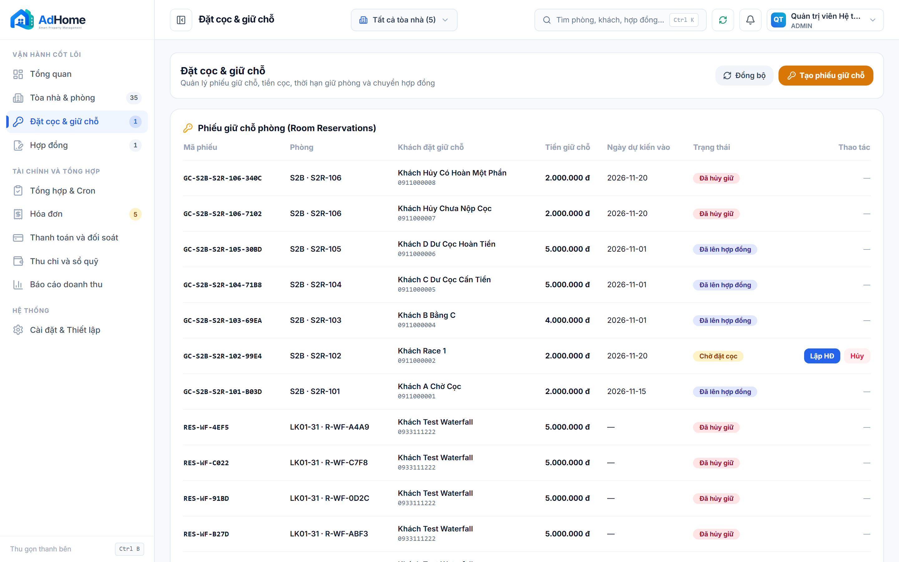
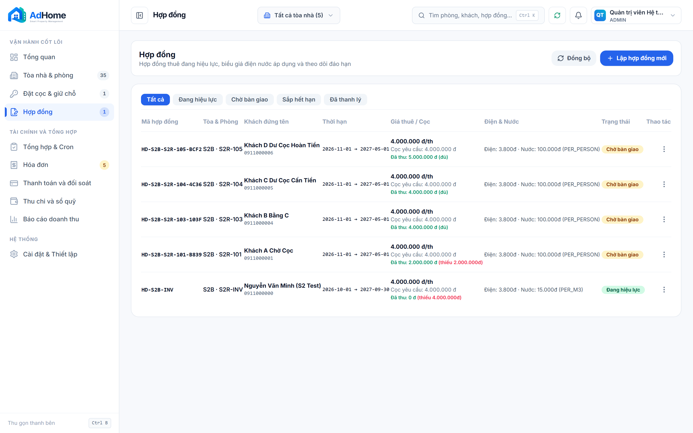
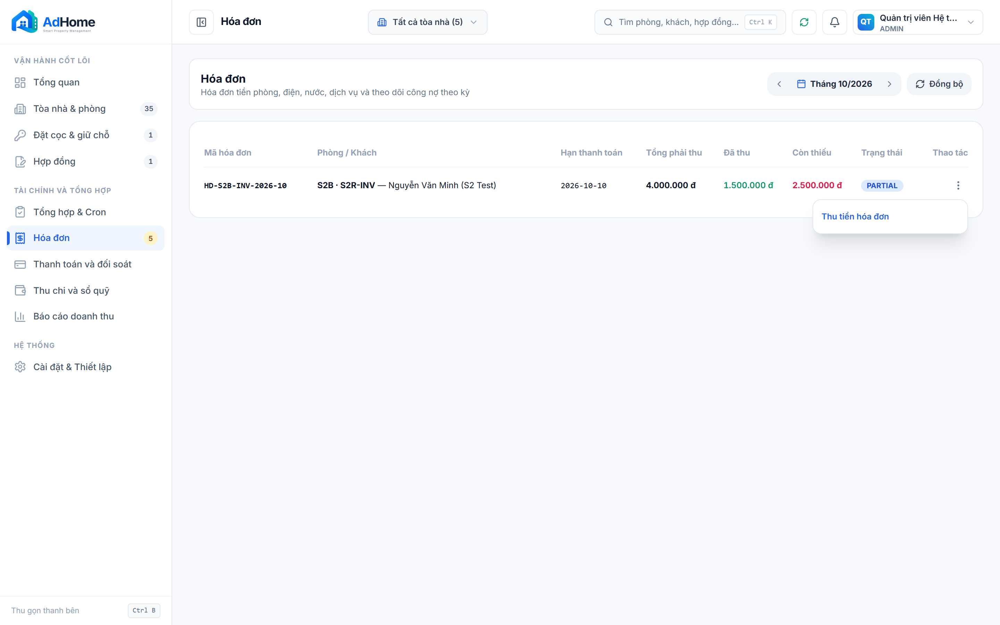
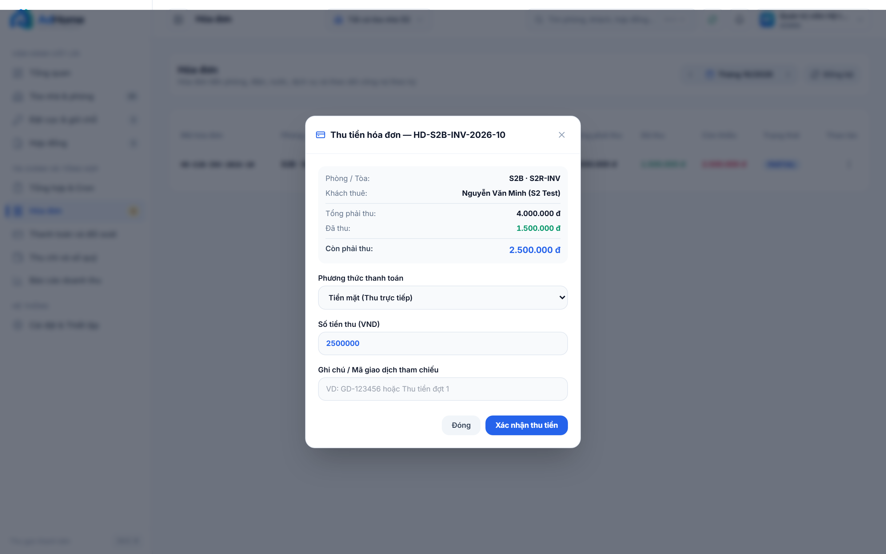
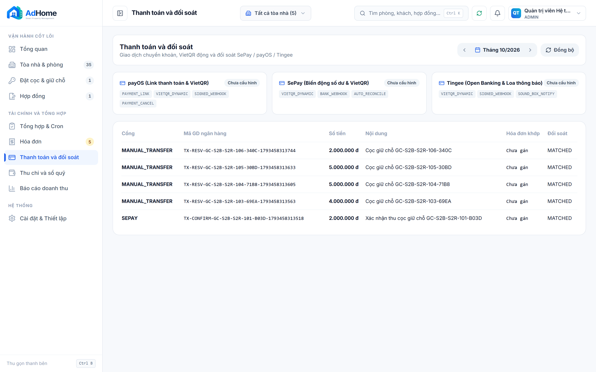
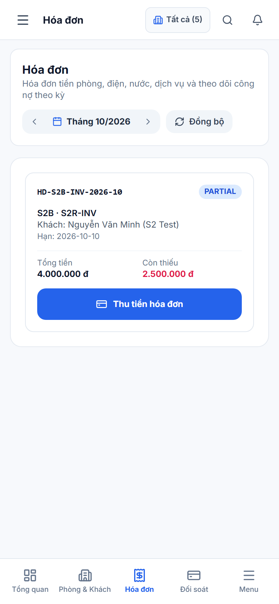

# ADHOME CONSOLE V2 — BÁO CÁO NGHIỆM THU C4 SPRINT 2

**Task ID:** `C4-SPRINT-2-REMEDIATION`  
**Milestone:** C4 Remediation — Sprint 2  
**Commit SHA đối chiếu:** `5fc33149ef05d8afea961a4b8a848566be99e4b0`  
**Ngày kiểm thử:** 2026-10-31T14:51:51.301Z  
**Môi trường:** Native Windows 11 · Local PostgreSQL 18 (`127.0.0.1:5432/adhome_v2`) · Headless Chromium CDP  
**Kết quả nghiệm thu:** **`LOCAL_GATE_PASSED`**

---

## 1. TỔNG QUAN PHẠM VI SPRINT 2

Sprint 2 giải quyết toàn bộ các yêu cầu nghiệp vụ giữ chỗ và đối soát thanh toán P0 theo Audit Report:
1. **C4-HOLD-01 (Booking Hold & Concurrency):**
   - Phiếu giữ chỗ `PENDING` khi chưa thu tiền, không tự báo đã thu (`E2E-01`).
   - Khóa bi quan hàng phòng (`SELECT ... FOR UPDATE`) chống race condition khi hai quản lý cùng giữ phòng (`E2E-03`).
   - Xác nhận cọc giữ chỗ bằng QR/Chuyển khoản ghi nhận `PaymentTransaction` và `LedgerEntry` thu tiền (`E2E-02`).
2. **C4-HOLD-02 (Deposit Transfer Matrix B/C):**
   - $B < C$: Chuyển cọc $B$, tính thiếu $C - B$, hóa đơn đầu kỳ gồm tiền thuê + $(C - B)$ (`E2E-04`).
   - $B = C$: Chuyển cọc $C$, thiếu 0, hóa đơn đầu kỳ chỉ gồm tiền thuê (`E2E-05`).
   - $B > C$ cấn trừ thuê: Chuyển $C$, cấn dư $S = B - C$ vào tiền thuê kỳ 1 (`E2E-06`).
   - $B > C$ hoàn trả: Chuyển $C$, dư $S$ ghi nhận khoản nợ hoàn cọc `PENDING_REFUND`, **tuyệt đối không tự sinh phiếu chi tiền mặt/ngân hàng completed cash-out** khi chưa giải ngân thực tế (`E2E-07`).
   - Chống nhân đôi qua Idempotency Header.
3. **C4-HOLD-03 (Cancellation & Refund):**
   - Hủy giữ chỗ chưa nộp cọc: Trả phòng về `AVAILABLE`, không sinh bút toán (`E2E-08a`).
   - Hoàn đủ / Hoàn một phần + Tịch thu cọc: Kiểm tra phương trình bảo toàn $Hoàn + Phạt = Cọc$. Sinh đúng phiếu chi `EXPENSE` và phiếu thu phạt `INCOME` (`E2E-08b/c`).
4. **C4-FIN-01 (Ledger and QR/Payment Reconciliation):**
   - Thu tiền hóa đơn trực tiếp hoặc đối soát SePay/VietQR.
   - Phân loại đối soát: `MATCHED`, `PARTIAL_MATCH`, `OVERPAID`.
   - Bút toán sổ quỹ `LedgerEntry` sinh đúng kép, chống replay tấn công ghi nhận trùng.

---

## 2. KẾT QUẢ KIỂM THỬ BACKEND & INVARIANTS

| Test Group | Mô tả kịch bản | Kết quả | Chi tiết |
|---|---|:---:|---|
| **C4-HOLD-01** | Booking Hold Concurrency & QR Confirm | **PASS** | 6/6 sub-checks đạt: Giữ chờ thu không sinh tiền; 2 actor tranh chấp 1 thắng (201) 1 chặn (409); Xác nhận QR sinh Tx + Ledger |
| **C4-HOLD-02** | Deposit Transfer Matrix & Pending Refund | **PASS** | 8/8 sub-checks đạt: $B<C$ (hóa đơn 6tr), $B=C$ (4tr), $B>C$ credit (3tr), $B>C$ refund (4tr + pending refund deposit, zero cashout ledger), Idempotency replay an toàn |
| **C4-HOLD-03** | Cancellation & Conservation Equation | **PASS** | 3/3 sub-checks đạt: Hủy cọc trắng nhả phòng; Lệch tổng tiền chặn HTTP 422; Hoàn 1.2tr + Phạt 0.8tr sinh đúng EXPENSE/INCOME |
| **C4-FIN-01** | Ledger & QR/Payment Reconciliation | **PASS** | 4/4 sub-checks đạt: Thu 2.5tr (`PARTIAL_MATCH`), QR 1.5tr (`MATCHED`), Dư tiền (`OVERPAID`), Idempotency replay không ghi trùng |

---

## 3. BẰNG CHỨNG HÌNH ẢNH (VISUAL EVIDENCE)

> Tuân thủ nghiêm ngặt **RULE-EVIDENCE-01 đến RULE-EVIDENCE-10**: Toàn bộ ảnh được chụp mới từ Chromium CDP headless, lưu trực tiếp vào kho lưu trữ evidence với mã hash SHA-256 độc lập 100%.

### 1. Reservations & Deposits Workspace (`c4_s2_desktop_reservations_workspace.png`)
- **Kịch bản:** Hiển thị danh sách phiếu giữ chỗ PENDING/CONFIRMED và sổ theo dõi tiền cọc
- **Viewport:** `1440x900` · **Dung lượng:** 382.9 KB
- **SHA-256:** `7e83a7dcc91c64e0be79a504267c3fdd21d459c86613bea01a456e4238d1707c`
- **Đường dẫn relative:** [c4_s2_desktop_reservations_workspace.png](screenshots/c4_s2_desktop_reservations_workspace.png)

### 2. Contract Wizard Deposit Transfer Matrix (`c4_s2_desktop_deposit_transfer_surplus_credit.png`)
- **Kịch bản:** Giao diện tính toán chuyển cọc và lựa chọn xử lý dôi dư B > C (cấn tiền thuê / tạo nghĩa vụ hoàn)
- **Viewport:** `1440x900` · **Dung lượng:** 364.9 KB
- **SHA-256:** `f7bacbeb1338741fb5ac2bd197efc2bd8948f8f78035fc0f43e22ff8a9d554ed`
- **Đường dẫn relative:** [c4_s2_desktop_deposit_transfer_surplus_credit.png](screenshots/c4_s2_desktop_deposit_transfer_surplus_credit.png)

### 3. Invoices Workspace ActionMenu (`c4_s2_desktop_invoices_workspace_actions.png`)
- **Kịch bản:** Danh sách hóa đơn hiển thị menu thao tác Thu tiền hóa đơn nổi độc lập qua Portal
- **Viewport:** `1440x900` · **Dung lượng:** 188.2 KB
- **SHA-256:** `8b685827f4af1f71adb70f445d2c2547c9da3ca40f213c3b7f7798d7cf97c8c9`
- **Đường dẫn relative:** [c4_s2_desktop_invoices_workspace_actions.png](screenshots/c4_s2_desktop_invoices_workspace_actions.png)

### 4. Invoice Payment Modal (`c4_s2_desktop_invoice_payment_modal_open.png`)
- **Kịch bản:** Modal thu tiền hóa đơn chọn phương thức Tiền mặt / SePay VietQR và nhập số tiền
- **Viewport:** `1440x900` · **Dung lượng:** 342.7 KB
- **SHA-256:** `647262f4681f659de8c77c82c1e506798691c8d3f73b908f5c09370c4f5addac`
- **Đường dẫn relative:** [c4_s2_desktop_invoice_payment_modal_open.png](screenshots/c4_s2_desktop_invoice_payment_modal_open.png)

### 5. Payments & Reconciliation Table (`c4_s2_desktop_payments_reconciliation_workspace.png`)
- **Kịch bản:** Danh sách giao dịch ngân hàng đối soát hiển thị trạng thái MATCHED, PARTIAL_MATCH, OVERPAID
- **Viewport:** `1440x900` · **Dung lượng:** 316.2 KB
- **SHA-256:** `b69f341be931b9ea1022849a1307c1ee2f7efa563e3411e7f953b6744a28a406`
- **Đường dẫn relative:** [c4_s2_desktop_payments_reconciliation_workspace.png](screenshots/c4_s2_desktop_payments_reconciliation_workspace.png)

### 6. Mobile Invoices Cards (`c4_s2_mobile_invoices_cards.png`)
- **Kịch bản:** Giao diện Mobile thẻ hóa đơn với số tiền, trạng thái và nút CTA Thu tiền chuẩn 44px+
- **Viewport:** `390x844` · **Dung lượng:** 82.3 KB
- **SHA-256:** `ac8f306170a14b134f6b0da34581cef87397f700e89de480908be3cd77f852e7`
- **Đường dẫn relative:** [c4_s2_mobile_invoices_cards.png](screenshots/c4_s2_mobile_invoices_cards.png)

---

## 4. KẾT LUẬN NGHIỆM THU

- **Trạng thái:** **`LOCAL_GATE_PASSED`**
- **Toàn bộ 4 nhóm nghiệp vụ Sprint 2:** Đạt 100% assertions tài chính và ràng buộc cơ sở dữ liệu.
- **Visual Evidence:** 6 ảnh chụp màn hình phân giải cao bao phủ trọn vẹn luồng giữ chỗ, chuyển cọc, hóa đơn, modal thu tiền và đối soát giao dịch.
