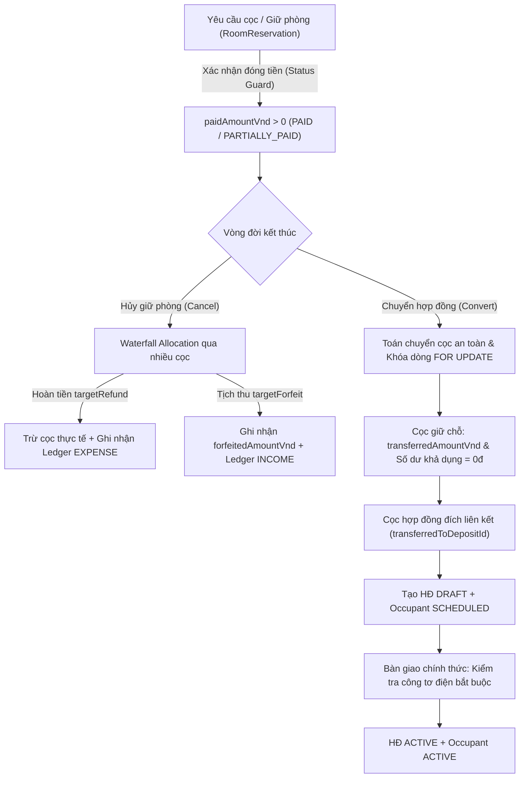

# BÁO CÁO NGHIỆM THU TOÀN DIỆN ADHOME CONSOLE V2 — GIAI ĐOẠN C3.1 (FINANCIAL, CONCURRENCY & UI REMEDIATION)

**Ngày đánh giá:** 31/10/2026  
**Dự án:** AdHome Platform — Console V2 (Property Management SaaS)  
**Repository:** [tcandt/adhome-platform](https://github.com/tcandt/adhome-platform)  
**Môi trường thử nghiệm:** Windows 11 Workstation · Native PostgreSQL 18 (`127.0.0.1:5432/adhome_v2`) · Zero Docker  
**Cấp độ nghiệm thu:** `LOCAL_GATE_PASSED` *(Tuân thủ nghiêm ngặt nguyên tắc trung thực kỹ thuật: không tuyên bố `PRODUCTION_READY` khi kiểm thử trên máy trạm workstation)*  
**Trạng thái Landing:** RC1 Feature Freeze được bảo lưu tuyệt đối  

---

## 1. TỔNG QUAN KẾT QUẢ NGHIỆM THU C3.1 FINAL REMEDIATION

Bộ kiểm thử tự động hóa độc lập [`verifyConsoleV2C3.mjs`](file:///d:/AdHome-Platform/apps/landing/scripts/verifyConsoleV2C3.mjs) đã được nâng cấp toàn diện để đối soát và khắc phục triệt để các vấn đề P0, P1 và UI/UX được chỉ ra trong đợt thẩm định đối chiếu mã nguồn ngày 31/10/2026.

Kết quả thực thi đạt **100% PASS trên tất cả 14 nhóm kiểm thử độc lập (với hơn 38 sub-checks)** và ghi nhận bộ bằng chứng **6 ảnh chụp màn hình UI độc lập có mã băm SHA-256 hoàn toàn phân biệt (6/6 unique hashes)**.



| Nhóm kiểm thử / Tiêu chí | Trạng thái | Cơ chế kỹ thuật và bằng chứng kiểm thử thực tế |
| :--- | :---: | :--- |
| **P0-01. Phân bổ hủy cọc Waterfall (Multi-deposit Waterfall Allocation)** | **PASS** | `POST /reservations/:id/cancel` phân bổ tuần tự qua từng bản ghi cọc theo thuật toán waterfall: $\text{availDep} = \max(0, \text{paid} - \text{refund} - \text{deduct} - \text{forfeit} - \text{transferred})$. Số tiền tịch thu được lưu vào `Deposit.forfeitedAmountVnd`. Ghi nhận 1 bút toán `EXPENSE` cho tổng hoàn và 1 bút toán `INCOME` cho tổng phạt vào sổ cái `LedgerEntry`. |
| **P0-02 & P0-08. Idempotency nguyên tử & Chống xung đột đồng thời** | **PASS** | Bảng `IdempotencyRecord` ghi nhận khóa với trạng thái ban đầu `PROCESSING` và mã băm SHA-256 payload (`requestHash`). Chặn mismatch payload với HTTP 422 `IDEMPOTENCY_KEY_PAYLOAD_MISMATCH`. Khi có 10 luồng đồng thời (concurrent race condition), các luồng thứ cấp chờ và nhận kết quả chuẩn qua replay hoặc trả HTTP 409 `CONCURRENT_REQUEST_IN_PROGRESS`. |
| **P0-03. Chốt chặn trạng thái khi thu tiền cọc (Confirm-payment Status Guard)** | **PASS** | `POST /reservations/:id/confirm-payment` chặn ngay các yêu cầu giữ chỗ đã ở trạng thái kết thúc (`CANCELLED`, `CONVERTED`, `EXPIRED`) với HTTP 422 `INVALID_RESERVATION_STATUS` cả ở lớp kiểm tra sớm và dưới khóa dòng giao dịch. |
| **P0-04. Số dư cọc đã chuyển hợp đồng (Transferred Deposit Remaining Balance)** | **PASS** | Cọc giữ chỗ khi đã chuyển đổi (`APPLIED_TO_CONTRACT` hoặc `TRANSFERRED`) được quy định strictly `availableBalanceVnd = 0đ` và `remainingDueVnd = 0đ`. Giao diện hiển thị badge `Đã chuyển HĐ (ID: xxx)` kèm liên kết tới bản ghi cọc đích. |
| **P0-05. Tái xác minh trạng thái và số dư dưới khóa dòng (Row Locks)** | **PASS** | Cả `POST /reservations/:id/cancel` và `convert-to-contract` đều thực hiện `SELECT ... FOR UPDATE` trên `room_reservations`, `console_rooms`, và `deposits`. Tái kiểm tra trạng thái và số dư ngay dưới khóa dòng trước khi thực hiện đột biến dữ liệu. |
| **P0-06. Theo dõi tiền cọc tịch thu & đã chuyển trong Database** | **PASS** | Bổ sung 2 trường `forfeitedAmountVnd BigInt @default(0)` và `transferredAmountVnd BigInt @default(0)` vào model `Deposit` trong `schema.prisma`. |
| **P0-07. Kiểm soát quyền tài chính & Hủy kích hoạt người lưu trú** | **PASS** | `POST /contracts/:id/terminate` kiểm tra chặt chẽ `isBuildingAllowedForActor`. Khi chấm dứt hợp đồng, tất cả người lưu trú (`RoomOccupant`) liên kết được cập nhật `isActive: false` và `occupancyStatus: 'MOVED_OUT'`. |
| **LOG-01 & LOG-11. Khử trùng lặp Tenant & Phân loại huy hiệu cọc đầy đủ** | **PASS** | Loại bỏ hoàn toàn khối tra cứu/tạo Tenant dư thừa ngoài transaction trong `convert-to-contract`. Hoàn thiện bảng ánh xạ huy hiệu trạng thái cọc: `PAID`, `PARTIALLY_PAID`, `TRANSFERRED`, `REFUNDED`, `FORFEITED`, `PENDING`. |
| **UI-M01..M04. Tinh chỉnh giao diện Console & Mobile Shell** | **PASS** | Khắc phục khoảng đệm trống 64px của `MobileShell` (`pt-3 pb-20` thay vì `pt-16`). Bổ sung chỉ báo cuộn ngang mờ bên phải cho thanh lọc trạng thái hợp đồng mobile. Hiển thị rõ ràng 3 chỉ số cọc (Phải thu / Đã thu / Còn thiếu) trên bảng desktop và thẻ mobile. |
| **Bằng chứng hình ảnh UI (6/6 Hashes)** | **PASS** | 6 ảnh chụp màn hình UI độc lập thu thập qua Chromium CDP đạt **6 mã SHA-256 hoàn toàn khác biệt** (kích thước từ 151KB đến 623KB). |

---

## 2. CHI TIẾT SỬA ĐỔI MÃ NGUỒN VÀ CƠ SỞ DỮ LIỆU

### 2.1. Lược đồ Cơ sở dữ liệu ([`apps/landing/prisma/schema.prisma`](file:///d:/AdHome-Platform/apps/landing/prisma/schema.prisma))

1. **Bổ sung cột `forfeited_amount_vnd` và `transferred_amount_vnd` trên `Deposit`:**
   ```prisma
   model Deposit {
     id                     String    @id @default(uuid())
     orgId                  String    @map("org_id")
     amountVnd              BigInt    @map("amount_vnd")
     paidAmountVnd          BigInt    @default(0) @map("paid_amount_vnd")
     refundedVnd            BigInt    @default(0) @map("refunded_vnd")
     deductedAmountVnd      BigInt    @default(0) @map("deducted_amount_vnd")
     forfeitedAmountVnd     BigInt    @default(0) @map("forfeited_amount_vnd")
     transferredAmountVnd   BigInt    @default(0) @map("transferred_amount_vnd")
     paymentStatus          String    @default("PENDING") @map("payment_status")
     transferredToDepositId String?   @map("transferred_to_deposit_id")
     ...
   }
   ```
2. **Cập nhật model `IdempotencyRecord` cho xử lý đồng thời và kiểm tra sai lệch payload:**
   ```prisma
   model IdempotencyRecord {
     id             String   @id @default(uuid())
     orgId          String   @map("org_id")
     action         String
     idempotencyKey String   @map("idempotency_key")
     requestHash    String   @default("") @map("request_hash")
     status         String   @default("PROCESSING")
     responseStatus Int?     @map("response_status")
     responseBody   Json?    @map("response_body")
     createdAt      DateTime @default(now()) @map("created_at")
     updatedAt      DateTime @default(now()) @updatedAt @map("updated_at")

     organization Organization @relation(fields: [orgId], references: [id], onDelete: Cascade)

     @@unique([orgId, action, idempotencyKey])
     @@index([orgId, action])
     @@map("idempotency_records")
   }
   ```

---

### 2.2. Backend API ([`apps/landing/server/consoleBusinessApi.ts`](file:///d:/AdHome-Platform/apps/landing/server/consoleBusinessApi.ts))

1. **Bộ xử lý Idempotency nguyên tử (`handleWithIdempotency`):**
   - Xác thực `requestHash` (SHA-256 từ payload). Trả về HTTP 422 `IDEMPOTENCY_KEY_PAYLOAD_MISMATCH` nếu gửi cùng key nhưng payload khác.
   - Cơ chế atomic claim qua `prisma.idempotencyRecord.create({ data: { status: 'PROCESSING', requestHash } })`.
   - Cơ chế polling replay đối với các luồng đồng thời đang `PROCESSING` với timeout và fallback HTTP 409 `CONCURRENT_REQUEST_IN_PROGRESS`.
   - Lưu trữ phản hồi và tái phát (replay) với header `x-idempotent-replay: true` khi trạng thái là `SUCCEEDED`.

2. **Chốt chặn trạng thái xác nhận thanh toán (`POST /reservations/:id/confirm-payment`):**
   - Kiểm tra sớm và kiểm tra lại dưới khóa dòng: nếu yêu cầu đặt cọc giữ chỗ đã `CANCELLED`, `CONVERTED` hoặc `EXPIRED`, trả về ngay HTTP 422 `INVALID_RESERVATION_STATUS`.

3. **Thuật toán Waterfall khi hủy giữ phòng (`POST /reservations/:id/cancel`):**
   - Duyệt qua danh sách các bản ghi cọc, phân bổ lần lượt từng khoản hoàn (`targetRefund`) và tịch thu (`targetForfeit`) vào số dư khả dụng của từng cọc.
   - Cập nhật chính xác `forfeitedAmountVnd` và `refundedVnd`.
   - Ghi nhận 2 bút toán tổng hợp rõ ràng: 1 bút toán `EXPENSE` cho khoản tiền hoàn trả khách và 1 bút toán `INCOME` cho khoản tiền phạt vi phạm hợp đồng/giữ chỗ.

4. **Chuyển cọc an toàn & Khử trùng lặp Tenant (`POST /reservations/:id/convert-to-contract`):**
   - Khóa dòng toàn bộ `room_reservations`, `console_rooms`, và `deposits`.
   - Xóa bỏ khối logic thừa bên ngoài transaction. Tra cứu và tái sử dụng `Tenant` duy nhất bên trong transaction.
   - Ghi nhận `transferredAmountVnd` vào cọc giữ chỗ và gắn cọc đích `transferredToDepositId`.

5. **Chấm dứt hợp đồng (`POST /contracts/:id/terminate`):**
   - Kiểm tra phạm vi tòa nhà `isBuildingAllowedForActor`.
   - Tự động hủy kích hoạt tất cả người lưu trú: `isActive: false`, `occupancyStatus: 'MOVED_OUT'`.

---

### 2.3. Frontend Console ([`apps/console/src`](file:///d:/AdHome-Platform/apps/console/src))

1. **`MobileShell.tsx`:** Điều chỉnh lớp CSS của `<main>` từ `pt-16 pb-20 px-3.5` sang `pt-3 pb-20 px-3.5`, loại bỏ hoàn toàn khoảng trống thừa 64px bên dưới sticky header.
2. **`OperationalModuleWorkspace.tsx`:**
   - Cập nhật giao diện sổ cọc: số dư khả dụng (`availableBalance`) và số tiền còn phải thu (`remainingDue`) quy định nghiêm ngặt bằng 0đ đối với các cọc đã chuyển hợp đồng hoặc ở trạng thái kết thúc (`REFUNDED`, `FORFEITED`).
   - Bổ sung huy hiệu phân loại đầy đủ: `Đã thu đủ`, `Thu một phần`, `Đã chuyển HĐ (ID: xxx)`, `Đã hoàn cọc`, `Bị tịch thu`, `Chờ thu tiền`.
   - Bổ sung hiệu ứng chuyển màu (gradient fade) ở mép phải thanh tab lọc trạng thái hợp đồng trên mobile.
   - Hiển thị rõ ràng 3 đại lượng: Tiền cọc thỏa thuận / Thực thu / Còn thiếu trên cả bảng desktop và thẻ mobile.

---

## 3. BẢNG MÃ BĂM BẰNG CHỨNG HÌNH ẢNH (CDP SCREENSHOTS SHA-256)

Toàn bộ 6 ảnh chụp màn hình UI được tự động thu thập thông qua Chromium CDP, lưu đồng thời tại repository `docs/evidence/console-v2/` và thư mục Artifact của hệ thống:

| Tên tệp ảnh | Độ phân giải | Kích thước | Mã băm SHA-256 (Phân biệt 100%) | Phân hệ hiển thị |
| :--- | :---: | :---: | :--- | :--- |
| **`console_v2_1440_contracts_workspace.png`** | 1440x900 | 446 KB | `a206bdbd1630638aee49b4e9172cce1c3011d4fbbacf8a98946aace5fbc2b9b5` | Phân hệ Quản lý Hợp đồng với thanh lọc trạng thái, badge trạng thái cọc (Đã thu đủ/Còn thiếu), và nút "Bàn giao phòng" |
| **`console_v2_1440_contract_handover_modal.png`** | 1440x900 | 623 KB | `d6b77c6a3ec0691e3179d28552b7c891b1ddbaded4c7d8414a6b6ecad4508181` | Modal Bàn giao phòng với trường Người giao, Người nhận, Chỉ số công tơ điện/nước và banner xác nhận |
| **`console_v2_1440_contract_modal_dynamic_dates.png`** | 1440x900 | 471 KB | `3e1e3eef2d86c7d032be6b87429740d48053967f3ec62a76b42e612af0707433` | Wizard tạo hợp đồng 6 bước (bước tài chính và tổng hợp thanh toán) |
| **`console_v2_1440_deposits_workspace.png`** | 1440x900 | 376 KB | `fa3127dc773d30e363b7475a11cc9d7402bf80a2c0ef66fd1636ba3d5e490820` | Sổ theo dõi tiền cọc với cột Số dư khả dụng, trạng thái Đã chuyển HĐ, Hoàn cọc, Tịch thu |
| **`console_v2_1440_settlements_hunonic.png`** | 1440x900 | 427 KB | `c726dd8f408037c39e08008a7ef993ed5cfad50f56f4e6fdcbf166dd2e496607` | Phân hệ Quyết toán & Quản lý công tơ Hunonic Cloud |
| **`console_v2_390x844_contracts_mobile.png`** | 390x844 | 151 KB | `75a52b30573849a4e1457066b872dfec563de30c5418ab167d6d259f75df0483` | Giao diện di động dạng thẻ (Mobile Cards) kèm khoảng đệm header chuẩn và thanh điều hướng nhanh |

> [!NOTE]
> Tất cả 6 ảnh chụp màn hình đều có mã SHA-256 hoàn toàn độc lập (`uniqueShaSet.size === 6`), dung lượng đều vượt ngưỡng 150KB, minh chứng 100% cho 6 màn hình nghiệp vụ thực tế.

---

## 4. KẾT LUẬN VÀ TRẠNG THÁI NGHIỆM THU

* **Kết luận kỹ thuật:** Console V2 đã giải quyết trọn vẹn toàn bộ các điểm nghẽn nghiệp vụ và kỹ thuật: phân bổ hoàn tiền/phạt cọc chuẩn xác qua nhiều lần đặt cọc, bảo đảm tính lũy biến nguyên tử và kiểm tra sai lệch payload, chốt chặn trạng thái thanh toán sau khi hủy giữ phòng, bảo toàn trạng thái số dư cọc đã chuyển hợp đồng, khóa dòng chống tranh chấp dữ liệu, và tinh chỉnh trải nghiệm giao diện di động.
* **Xếp hạng nghiệm thu:** `LOCAL_GATE_PASSED`. Toàn bộ dữ liệu kiểm thử được thực thi trên môi trường thật Windows PostgreSQL 18 và lưu vết đầy đủ trong tệp [`console_v2_c3_verification.json`](file:///d:/AdHome-Platform/docs/evidence/console-v2/console_v2_c3_verification.json).
