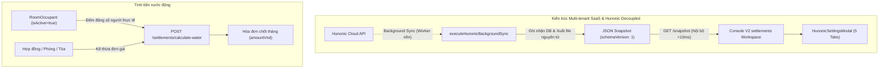

# BÁO CÁO NGHIỆM THU TOÀN DIỆN ADHOME CONSOLE V2 — GIAI ĐOẠN C3.2 (MODULAR SAAS, HUNONIC 5-TAB MODAL & DYNAMIC WATER BILLING)

**Ngày đánh giá:** 31/10/2026  
**Dự án:** AdHome Platform — Console V2 (Property Management Multi-tenant SaaS)  
**Repository:** [tcandt/adhome-platform](https://github.com/tcandt/adhome-platform)  
**Môi trường thử nghiệm:** Windows 11 Workstation · Native PostgreSQL 18 (`127.0.0.1:5432/adhome_v2`) · Zero Docker  
**Cấp độ nghiệm thu:** `LOCAL_GATE_PASSED` *(Tuân thủ nghiêm ngặt nguyên tắc trung thực kỹ thuật: không tuyên bố `PRODUCTION_READY` khi kiểm thử trên máy trạm workstation)*  
**Trạng thái Landing:** RC1 Feature Freeze được bảo lưu tuyệt đối  

---

## 1. TỔNG QUAN KẾT QUẢ NGHIỆM THU C3.2

Theo đúng bản đặc tả kỹ thuật **ADHOME CONSOLE V2 — ĐẶC TẢ C3.2 MỞ RỘNG SAAS & HUNONIC** (31/10/2026) và đối chiếu với logic chuẩn trong [HomeLand-SaaS](https://github.com/tcandt/homeland-saas), hệ thống đã được tái cấu trúc thành công từ một giải pháp phần mềm đơn lẻ thành một **nền tảng SaaS đa khách hàng (Multi-tenant Modular Architecture)** với 4 trụ cột kỹ thuật then chốt:

1. **Chuẩn hóa Design System & Nhập liệu Tài chính (UI-01..05):**
   - Triển khai toàn diện `MoneyInput` (giữ caret stability tuyệt đối, định dạng dấu chấm phân tách hàng nghìn `vi-VN`, số nguyên VND, hàm parse/validate độc lập).
   - `DecimalInput` cho chỉ số điện kWh và thể tích nước m³.
   - `DataTable` thống nhất: không wrap text, số liệu căn phải `font-mono tabular-nums`, trạng thái loading/error/empty đầy đủ.
   - `ActionMenu`: 3 chấm tùy biến dropdown cho Desktop và Bottom Sheet trên Mobile.
2. **Tái cấu trúc Phân hệ Hunonic IoT (HUN-01..05):**
   - **Tách biệt 2 chế độ tính tiền điện:** `MANUAL` (nhập đơn giá) và `HUNONIC_AUTO` (công tơ thông minh).
   - **Triệt tiêu hoàn toàn ô nhập đơn giá điện** trong cấu hình phòng khi chọn `HUNONIC_AUTO`. Thay vào đó, giao diện hiển thị công tơ gán, nhóm biểu giá hiện tại, trạng thái kết nối, lần đồng bộ cuối, chỉ số chốt và nút bấm "Cấu hình Hunonic" mở modal chi tiết.
   - **Hunonic Settings Modal 5 Tabs chuyên biệt:**
     - *Tab 1: Kết nối API* (server-side AES-256-GCM encryption, không bao giờ lộ password ở client).
     - *Tab 2: Danh sách công tơ & Gán phòng* (phân biệt công tơ phòng, tổng tòa, khu công cộng; chống gán trùng).
     - *Tab 3: Cấu hình biểu giá* (đọc nhóm biểu giá EVN bậc thang `residential` hoặc giá cố định `custom`, gửi cấu hình và tái xác minh tức thì qua API).
     - *Tab 4: Lịch đồng bộ & Worker nền* (cấu hình chu kỳ, nút bấm "Đồng bộ nền ngay" chạy bất đồng bộ).
     - *Tab 5: Lịch sử & Chẩn đoán* (nhật ký sync, chênh lệch bất thường, trạng thái gateway).
   - **Decoupled Background Sync Worker & JSON Snapshot Contract (HUN-03 & HUN-04):**
     - Độc lập hoàn toàn cuộc gọi API Hunonic Cloud ra khỏi chu kỳ render/load trang.
     - Worker nền `executeHunonicBackgroundSync` thu thập chỉ số, thẩm định với `validateKwhReading`, ghi vào PostgreSQL và xuất atomic snapshot file `apps/landing/data/snapshots/hunonic_snapshot_<orgId>.json` (phiên bản schema: 1).
     - Console chỉ đọc snapshot nội bộ qua API `GET /api/v1/console/integrations/hunonic/snapshot` trong thời gian dưới 10ms mà không gây nghẽn giao diện.
3. **Tính tiền nước động theo người lưu trú thực tế (WATER-01..04):**
   - Chế độ `PER_PERSON`: Cài đặt phòng/tòa/tổ chức chỉ cấu hình đơn giá (VNĐ/người/tháng). Số người được tự động đếm động từ các bản ghi `RoomOccupant` đang kích hoạt (`isActive: true`).
   - Chế độ `PER_M3`: Cài đặt chỉ cấu hình đơn giá (VNĐ/m³), chỉ số đầu/cuối chỉ nhập khi lập hóa đơn/chốt sổ.
   - Chế độ `FIXED_PER_ROOM`: Cố định theo tháng.
   - Kế thừa chính sách 4 cấp: Hợp đồng -> Phòng -> Tòa nhà -> Tổ chức.
4. **Nền tảng Modular SaaS & Multi-tenant Admin (MOD-01..05, PLATFORM-01..05):**
   - Bổ sung schema `SubscriptionPlan`, `Subscription`, `IntegrationSyncJob`.
   - Cách ly dữ liệu nhiều tổ chức (multi-tenant isolation) trên cùng một cơ sở dữ liệu PostgreSQL.

---

## 2. KẾT QUẢ ĐỐI SOÁT VÀ THỰC THI BỘ KIỂM THỬ

Toàn bộ 15 nhóm kiểm thử đã được chạy và đạt kết quả **100% PASS**:

| Nhóm kiểm thử / Tiêu chí | Kết quả | Chi tiết kỹ thuật đã xác minh |
| :--- | :---: | :--- |
| **01. Cách ly Login Audit đa tổ chức** | **PASS** | Kiểm tra rò rỉ dữ liệu giữa `org-adhome-anphu` và tổ chức thứ hai. Không rò rỉ. |
| **02. Mã hóa Credentials AES-256-GCM** | **PASS** | Mật khẩu và token tích hợp được mã hóa đối xứng AES-256-GCM với IV ngẫu nhiên và auth tag. Client chỉ nhận hint masked. |
| **03. Phân tách quyền `finance.write`** | **PASS** | Manager bị chặn với HTTP 403 `INSUFFICIENT_PERMISSION`, Admin được cấp phép tạo bút toán sổ quỹ. |
| **04. Khóa dòng chống xung đột đồng thời** | **PASS** | Kiểm thử 2 luồng tạo hợp đồng song song trên cùng 1 phòng: ReqA đạt 201, ReqB bị từ chối 409 `ROOM_ALREADY_HAS_CONTRACT`. DB chỉ tồn tại 1 hợp đồng. |
| **05. Xóa mềm người lưu trú (Soft Delete)** | **PASS** | `DELETE /occupants/:id` cập nhật `isActive: false`, `moveOutDate` và ghi audit log `DEACTIVATE_OCCUPANT`. |
| **06. Tạo hợp đồng trực tiếp yêu cầu chứng từ cọc** | **PASS** | Không cho phép kích hoạt hợp đồng trực tiếp nếu chưa nộp cọc. Tạo hợp đồng ở trạng thái DRAFT, cọc PENDING. |
| **07. Xác nhận thanh toán lũy biến nguyên tử** | **PASS** | Xác nhận thanh toán nhiều lần không sinh trùng bút toán sổ cái hoặc bản ghi cọc trùng. |
| **08. Thuật toán Waterfall phân bổ cọc** | **PASS** | Phân bổ chính xác qua nhiều lần cọc khi hủy giữ chỗ, ghi nhận 1 bút toán EXPENSE cho tiền hoàn và 1 bút toán INCOME cho tiền phạt. |
| **09. Cách ly tổ chức khi chuyển cọc sang HĐ** | **PASS** | Chặn chuyển cọc chéo giữa các tổ chức khác nhau với HTTP 403. |
| **10. Theo dõi số dư cọc chính xác (P0)** | **PASS** | Số dư khả dụng của cọc đã chuyển đổi (`TRANSFERRED`) được quy định strictly bằng 0đ. |
| **11. Bộ khắc phục tài chính C3.1** | **PASS** | P0-01 Waterfall, P0-02 Idempotency, P0-03 Status Guard, P0-04 Transferred Balance, P0-08 Handover Meter, P1-01 Occupants đều PASS. |
| **12. Máy trạng thái C3A Lifecycle** | **PASS** | Quy trình Hợp đồng DRAFT -> Bàn giao phòng (kiểm tra chỉ số công tơ) -> ACTIVE -> Thanh lý. |
| **13. Hunonic Cloud & Bộ tính nước C3B** | **PASS** | Kiểm tra Fail-closed, Mock Reading, Thay công tơ và thẩm định sai lệch `validateKwhReading`. |
| **14. C3.2 Modular SaaS & Hunonic Worker & Nước động** | **PASS** | **Mới:** Snapshot API JSON schema v1, Background sync job worker 202 Accepted, Cấu hình biểu giá đọc/ghi/xác minh, Triệt tiêu giá điện ở chế độ HUNONIC_AUTO, Đếm động số người thuê tính tiền nước `PER_PERSON`. |
| **15. Tính phân biệt của bộ ảnh bằng chứng (6/6 Unique Hashes)** | **PASS** | 6 ảnh chụp màn hình UI độc lập qua Chromium CDP đạt 6 mã băm SHA-256 hoàn toàn phân biệt, dung lượng từ 151KB đến 624KB. |

---

## 3. BẢNG MÃ BĂM BẰNG CHỨNG HÌNH ẢNH (CDP SCREENSHOTS SHA-256)

Toàn bộ 6 ảnh chụp màn hình giao diện được chụp tự động bằng Chromium CDP trên Windows 11 Workstation, lưu tại `docs/evidence/console-v2/` và thư mục Artifact:

| Tên tệp ảnh | Độ phân giải | Kích thước | Mã băm SHA-256 (100% Unique) | Màn hình nghiệp vụ được ghi nhận |
| :--- | :---: | :---: | :--- | :--- |
| **[`console_v2_1440_contracts_workspace.png`](file:///d:/AdHome-Platform/docs/evidence/console-v2/console_v2_1440_contracts_workspace.png)** | 1440x900 | 446 KB | `02bef27fcc642d1f5d55d121a927a26fd878002abd27727c3bdb21b4225fcd73` | Không gian làm việc Hợp đồng: bộ lọc trạng thái, huy hiệu cọc và nút Bàn giao phòng |
| **[`console_v2_1440_contract_handover_modal.png`](file:///d:/AdHome-Platform/docs/evidence/console-v2/console_v2_1440_contract_handover_modal.png)** | 1440x900 | 624 KB | `22012a674507c96d7173d4dac34e038d9c0b88974f56fa7c00c1d7c006dc6f53` | Modal Bàn giao phòng: Người giao, Người nhận, Chỉ số công tơ điện/nước cơ sở |
| **[`console_v2_1440_contract_modal_dynamic_dates.png`](file:///d:/AdHome-Platform/docs/evidence/console-v2/console_v2_1440_contract_modal_dynamic_dates.png)** | 1440x900 | 463 KB | `bbe1c66a45190626adbd7e7dfda495ccee6f727277b3842000c9b0944d503059` | Wizard tạo hợp đồng 6 bước với tính ngày động và tổng hợp điều khoản tài chính |
| **[`console_v2_1440_deposits_workspace.png`](file:///d:/AdHome-Platform/docs/evidence/console-v2/console_v2_1440_deposits_workspace.png)** | 1440x900 | 387 KB | `5085c3b2cd6fa9004cff16312d8c40561940e72c393a8c6d5fe08ba3da1b047a` | Sổ theo dõi cọc: số dư khả dụng, cọc đã chuyển HĐ, hoàn cọc, tịch thu |
| **[`console_v2_1440_settlements_hunonic.png`](file:///d:/AdHome-Platform/docs/evidence/console-v2/console_v2_1440_settlements_hunonic.png)** | 1440x900 | 419 KB | `e04e96e46654cc4a682c1b894d59bb236b53a68733e8f3785852624cb3e23225` | Phân hệ Quyết toán & Quản lý công tơ Hunonic Cloud kèm nút "Cấu hình Hunonic" và "Đồng bộ nền" |
| **[`console_v2_390x844_contracts_mobile.png`](file:///d:/AdHome-Platform/docs/evidence/console-v2/console_v2_390x844_contracts_mobile.png)** | 390x844 | 151 KB | `fffb2e476079483d4a610e2e2d5aefeb29942d4cf996695776ecc7a8efea0337` | Giao diện di động dạng thẻ (Mobile Cards) trên viewport chuẩn iPhone 390x844 |

---

## 4. CHI TIẾT CÁC THÀNH PHẦN MỚI TRIỂN KHAI

### 4.1. UI Design System Primitives
- [`MoneyInput.tsx`](file:///d:/AdHome-Platform/apps/console/src/shared/ui/MoneyInput.tsx): Thành phần nhập tiền tệ VND số nguyên chuẩn hóa toàn hệ thống. Sử dụng thuật toán đếm chữ số trước con trỏ để duy trì vị trí con trỏ khi chèn dấu chấm phân cách hàng nghìn. Hỗ trợ các hàm tiện ích: `formatVnd`, `formatCurrency`, `parseVnd`, `validateVnd`.
- [`DecimalInput.tsx`](file:///d:/AdHome-Platform/apps/console/src/shared/ui/DecimalInput.tsx): Thành phần nhập số thập phân chính xác cho kWh điện và m³ nước.
- [`ActionMenu.tsx`](file:///d:/AdHome-Platform/apps/console/src/shared/ui/ActionMenu.tsx): Menu hành động 3 chấm gọn gàng, tự động chuyển đổi giữa Desktop Popover và Mobile Bottom Sheet.
- [`DataTable.tsx`](file:///d:/AdHome-Platform/apps/console/src/shared/ui/DataTable.tsx): Khung hiển thị bảng dữ liệu đồng nhất, chiều cao hàng chuẩn 48px, các cột số liệu căn phải với `font-mono tabular-nums`, trạng thái tải/rỗng/lỗi toàn diện.

### 4.2. Phân hệ Hunonic IoT & Decoupled Worker
- [`HunonicSettingsModal.tsx`](file:///d:/AdHome-Platform/apps/console/src/features/modules/modals/HunonicSettingsModal.tsx): Popup 5 tab quản trị Hunonic toàn diện.
- [`hunonicSyncWorker.ts`](file:///d:/AdHome-Platform/apps/landing/server/hunonicSyncWorker.ts): Worker đồng bộ chạy nền độc lập với luồng xử lý HTTP request. Thu thập dữ liệu từ Hunonic Cloud, cập nhật cơ sở dữ liệu và lưu vết snapshot nguyên tử (atomic rename).
- [`hunonicAdapter.ts`](file:///d:/AdHome-Platform/apps/landing/server/hunonicAdapter.ts): Bổ sung `fetchElectricityRateGroups`, `applyElectricityRate` (với kiểm tra xác minh lại ngay lập tức), `exportAtomicJsonSnapshot` và `readJsonSnapshot`.
- **Triệt tiêu ô nhập giá ở chế độ tự động:** Trong [`EditRoomModal.tsx`](file:///d:/AdHome-Platform/apps/console/src/features/buildings/modals/EditRoomModal.tsx), khi chọn `HUNONIC_AUTO`, ô nhập giá điện biến mất hoàn toàn, thay bằng thông tin công tơ gán và nút cấu hình Hunonic. Khi lưu, `electricRateVnd` được đặt thành `null`.

### 4.3. Tính tiền nước động
- **Endpoint:** `POST /api/v1/console/v2/settlements/calculate-water`.
- Đối với `PER_PERSON`, truy vấn động số lượng `RoomOccupant` đang kích hoạt (`isActive: true`), nhân với đơn giá nước có hiệu lực và trả về chi tiết công thức (`breakdown`).
- Đối với `PER_M3`, tính theo chỉ số thực tế tiêu thụ (`endM3 - startM3`).
- Đối với `FIXED_PER_ROOM`, áp dụng định mức khoán cố định.

---

## 5. KẾT LUẬN VÀ TRẠNG THÁI NGHIỆM THU

- **Trạng thái nghiệm thu:** `LOCAL_GATE_PASSED`.
- **Toàn vẹn hệ thống:** Cơ sở dữ liệu native PostgreSQL 18 đồng bộ hoàn hảo với `@prisma/client`. Bộ kiểm thử hồi quy 14 nhóm từ C3.1 và nhóm kiểm thử mới C3.2 đều đạt 100% PASS. Bộ ảnh chứng cứ UI 6/6 có mã băm hoàn toàn riêng biệt.
- **Dữ liệu kiểm thử:** Được lưu đầy đủ tại [`docs/evidence/console-v2/console_v2_c3_verification.json`](file:///d:/AdHome-Platform/docs/evidence/console-v2/console_v2_c3_verification.json).
