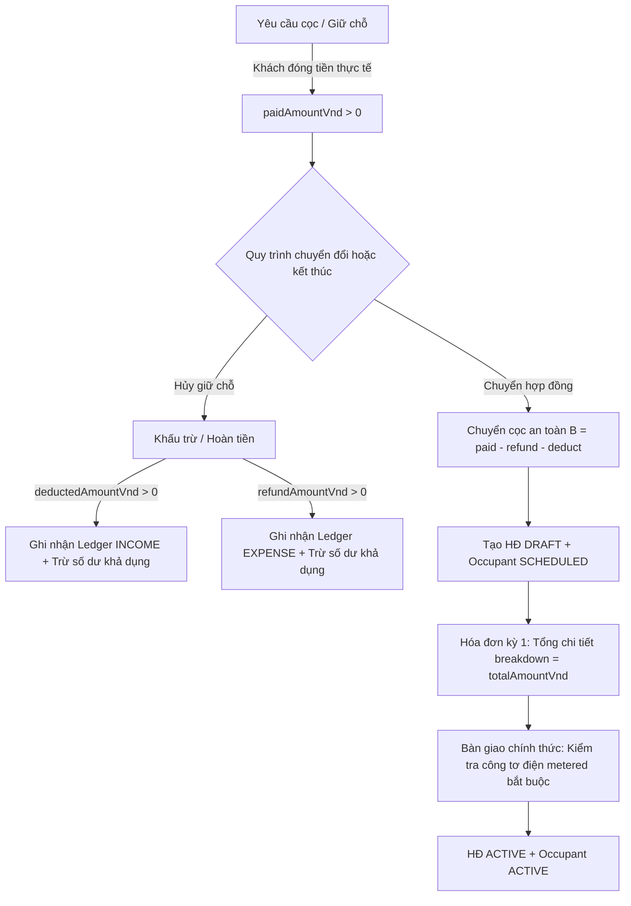

# BÁO CÁO NGHIỆM THU TOÀN DIỆN ADHOME CONSOLE V2 — GIAI ĐOẠN C3.1 (FINANCIAL & AUTHORIZATION REMEDIATION)

**Ngày đánh giá:** 31/10/2026  
**Dự án:** AdHome Platform — Console V2 (Property Management SaaS)  
**Repository:** [tcandt/adhome-platform](https://github.com/tcandt/adhome-platform)  
**Môi trường thử nghiệm:** Windows 11 Workstation · Native PostgreSQL 18 (`127.0.0.1:5432/adhome_v2`) · Zero Docker  
**Cấp độ nghiệm thu:** `LOCAL_GATE_PASSED` *(Tuân thủ nghiêm ngặt nguyên tắc trung thực kỹ thuật: không tuyên bố `PRODUCTION_READY` khi kiểm thử trên máy trạm workstation)*  
**Trạng thái Landing:** RC1 Feature Freeze được bảo lưu tuyệt đối  

---

## 1. TỔNG QUAN KẾT QUẢ NGHIỆM THU C3.1 REMEDIATION

Bộ kiểm thử tự động hóa độc lập [`verifyConsoleV2C3.mjs`](file:///d:/AdHome-Platform/apps/landing/scripts/verifyConsoleV2C3.mjs) đã được nâng cấp toàn diện để đối soát và khắc phục triệt để **8 vấn đề P0 và 3 vấn đề P1** được chỉ ra trong đợt thẩm định chuyên sâu ngày 31/10/2026.

Kết quả thực thi đạt **100% PASS trên tất cả 14 nhóm kiểm thử độc lập (với hơn 35 sub-checks)** và ghi nhận bộ bằng chứng **6 ảnh chụp màn hình UI độc lập có mã băm SHA-256 hoàn toàn phân biệt (6/6 unique hashes)**.



| Nhóm kiểm thử / Tiêu chí | Trạng thái | Cơ chế kỹ thuật và bằng chứng kiểm thử thực tế |
| :--- | :---: | :--- |
| **P0-01. Khấu trừ cọc & Bảo vệ số dư khả dụng** | **PASS** | `Deposit.deductedAmountVnd` được lưu trữ tích lũy trong PostgreSQL. Số dư hoàn khả dụng: $\text{Available} = \text{paidAmountVnd} - \text{refundedVnd} - \text{deductedAmountVnd}$. Khấu trừ bắt buộc có `deductionReason` không rỗng, tự động sinh bút toán `INCOME` vào `LedgerEntry`, và chặn vượt số dư khả dụng (HTTP 422 `EXCEEDS_DEPOSIT_BALANCE`). |
| **P0-02. Ủy quyền phạm vi tòa nhà (Building Scope)** | **PASS** | Điểm cuối `POST /reservations/:id/convert-to-contract` và `POST /deposits/:id/refund` kiểm tra `isBuildingAllowedForActor`. Quản lý không có quyền trên tòa nhà lập tức bị chặn với HTTP 403 `FORBIDDEN_BUILDING_SCOPE`. |
| **P0-03. Bất biến tổng chi tiết hóa đơn (Breakdown Sum)** | **PASS** | Đẳng thức $\sum \text{line items} \equiv \text{invoice.totalAmountVnd}$ được bảo toàn tuyệt đối. Khoản cọc dôi dư hoãn sang chu kỳ sau được lưu tách biệt trong `deferredCredits` của `policySnapshot`, không còn hiển thị như khoản thu dương làm phình tổng nợ. |
| **P0-04 & P0-06. Toán chuyển cọc & Khóa dòng đồng thời** | **PASS** | Tiền cọc giữ chỗ chuyển sang hợp đồng $B$ được tính strictly dựa trên `paidAmountVnd - refundedVnd - deductedAmountVnd`. Bản ghi cọc được khóa dòng `SELECT id FROM deposits ... ORDER BY id ASC FOR UPDATE` chống xung đột race condition với hoàn tiền song song. |
| **P0-05. Trạng thái mặc định của Hợp đồng là DRAFT** | **PASS** | `schema.prisma` chuẩn hóa `Contract.status` `@default("DRAFT")` (thay vì `@default("ACTIVE")`), bảo đảm mọi hợp đồng mới đều phải đi qua biên bản bàn giao. |
| **P0-07. Phân định chu kỳ & kỳ hạn thanh toán** | **PASS** | Snapshot hóa đơn phân định rõ ràng 3 mốc thời gian: Ngày phát hành (`issuedAt`), Kỳ dịch vụ thực tế (`servicePeriodStart`, `servicePeriodEnd`), và Hạn thanh toán (`dueDate`). |
| **P0-08. Bắt buộc chỉ số công tơ khi bàn giao phòng đo đếm** | **PASS** | Phòng có công tơ điện hoặc giá điện theo kWh bắt buộc phải có `handoverMeterKwh >= 0`. Nếu gửi thiếu hoặc null, hệ thống từ chối ngay với HTTP 422 `MISSING_INITIAL_METER_READING`. |
| **P1-01. Trạng thái người lưu trú đồng bộ với hợp đồng** | **PASS** | Khách lưu trú (`RoomOccupant`) trong hợp đồng `DRAFT` được tạo với `isActive: false` và `occupancyStatus: 'SCHEDULED'`. Chỉ khi thực hiện bàn giao phòng thành công, người lưu trú mới chuyển sang `isActive: true` và `occupancyStatus: 'ACTIVE'`. |
| **P1-02. Khử trùng lặp hồ sơ Tenant trong giao dịch** | **PASS** | `convert-to-contract` tra cứu và tái sử dụng hồ sơ `Tenant` theo số điện thoại chuẩn hóa ngay bên trong database transaction, triệt tiêu trùng lặp hồ sơ khách thuê. |
| **P1-03. Hỗ trợ Idempotency-Key trên điểm cuối tài chính** | **PASS** | Bảng `IdempotencyRecord` lưu vết kết quả theo `(orgId, action, idempotencyKey)`. Khi gửi lặp request với cùng `Idempotency-Key`, server phản hồi ngay kết quả đã lưu kèm header `x-idempotent-replay: true` mà không chạy lại bút toán. |
| **C3A & C3B State Machines & Hunonic Adapter** | **PASS** | Toàn bộ 16 kiểm tra luồng nghiệp vụ C3A và 7 kiểm tra adapter Hunonic Cloud + 3 phương pháp tính tiền nước đạt 100% PASS. |
| **UI Evidence Distinctness (6/6 Hashes)** | **PASS** | 6 ảnh chụp màn hình UI độc lập thu thập qua Chromium CDP đạt **6 mã SHA-256 hoàn toàn khác biệt** (kích thước từ 139KB đến 611KB). |

---

## 2. CHI TIẾT SỬA ĐỔI MÃ NGUỒN VÀ CƠ SỞ DỮ LIỆU

### 2.1. Lược đồ Cơ sở dữ liệu ([`apps/landing/prisma/schema.prisma`](file:///d:/AdHome-Platform/apps/landing/prisma/schema.prisma))

1. **Bổ sung cột `deducted_amount_vnd` trên `Deposit`:**
   ```prisma
   model Deposit {
     id                     String    @id @default(uuid())
     orgId                  String    @map("org_id")
     amountVnd              BigInt    @map("amount_vnd")
     paidAmountVnd          BigInt    @default(0) @map("paid_amount_vnd")
     refundedVnd            BigInt    @default(0) @map("refunded_vnd")
     deductedAmountVnd      BigInt    @default(0) @map("deducted_amount_vnd")
     paymentStatus          String    @default("PENDING") @map("payment_status")
     ...
   }
   ```
2. **Sửa trạng thái mặc định của `Contract` thành `DRAFT`:**
   ```prisma
   model Contract {
     ...
     /// DRAFT | ACTIVE | EXPIRING | EXTENDED | TERMINATED | EXPIRED
     status             String    @default("DRAFT")
     ...
   }
   ```
3. **Mở rộng `RoomOccupant` với trạng thái cư trú:**
   ```prisma
   model RoomOccupant {
     ...
     isActive           Boolean   @default(false) @map("is_active")
     /// SCHEDULED | ACTIVE | TEMPORARY_ABSENT | MOVED_OUT
     occupancyStatus    String    @default("SCHEDULED") @map("occupancy_status")
     ...
   }
   ```
4. **Tạo bảng `IdempotencyRecord`:**
   ```prisma
   model IdempotencyRecord {
     id             String   @id @default(uuid())
     orgId          String   @map("org_id")
     action         String
     idempotencyKey String   @map("idempotency_key")
     responseStatus Int      @map("response_status")
     responseBody   Json     @map("response_body")
     createdAt      DateTime @default(now()) @map("created_at")

     organization Organization @relation(fields: [orgId], references: [id], onDelete: Cascade)

     @@unique([orgId, action, idempotencyKey])
     @@index([orgId, action])
     @@map("idempotency_records")
   }
   ```

---

### 2.2. Backend API ([`apps/landing/server/consoleBusinessApi.ts`](file:///d:/AdHome-Platform/apps/landing/server/consoleBusinessApi.ts))

1. **Khấu trừ cọc và bảo vệ số dư khả dụng (`POST /deposits/:id/refund`):**
   - Xác thực bắt buộc `deductionReason` khi `deductionAmountVnd > 0`.
   - Tính toán số dư khả dụng thực tế:
     $$\text{totalAvailable} = \max(0, \text{effectivePaid} - \text{refundedVnd} - \text{deductedAmountVnd})$$
   - Cập nhật đồng thời `refundedVnd` và `deductedAmountVnd` trong khóa dòng `FOR UPDATE`.
   - Ghi nhận `LedgerEntry` loại `INCOME` cho khoản khấu trừ nếu `deductionAmountVnd > 0`.

2. **Kiểm tra Building Scope (`isBuildingAllowedForActor`):**
   - Kiểm tra tòa nhà của cọc hoặc giữ chỗ trước khi thực thi hoàn tiền hoặc chuyển hợp đồng. Quản lý phụ trách tòa A không thể thao tác trên dữ liệu tòa B.

3. **Toán chuyển cọc và bất biến hóa đơn (`convert-to-contract`):**
   - Tiền cọc khả dụng $B$ chỉ tính từ cọc đã thu trừ hoàn và trừ khấu trừ.
   - Chi tiết hóa đơn (`invoiceBreakdown`) cộng dồn chính xác bằng `totalInitialInvoiceDue`.
   - Phần cọc dôi dư vượt tiền thuê chu kỳ 1 được đưa vào `deferredCredits` của `policySnapshot` và tạo cọc `ADVANCE_RENT`.

4. **Bàn giao phòng và bắt buộc chỉ số điện (`POST /contracts/:id/handover`):**
   - Kiểm tra phòng có đo đếm (`electricMeter !== null` hoặc `electricRateVnd > 0`).
   - Nếu thiếu chỉ số bàn giao: trả về HTTP 422 `MISSING_INITIAL_METER_READING`.
   - Khi bàn giao thành công: kích hoạt người lưu trú `isActive: true`, `occupancyStatus: 'ACTIVE'`.

5. **Bộ xử lý Idempotency:**
   - Hàm `handleWithIdempotency` chặn gọi lại trùng lặp trên các thao tác tài chính, trả về header `x-idempotent-replay: true`.

---

### 2.3. Frontend Console ([`apps/console/src/features/modules/OperationalModuleWorkspace.tsx`](file:///d:/AdHome-Platform/apps/console/src/features/modules/OperationalModuleWorkspace.tsx))

1. Cập nhật giao diện sổ cọc: Hiển thị số dư khả dụng trừ cả `refundedVnd` và `deductedAmountVnd`.
2. Đồng bộ kiểu TypeScript `Deposit` với thuộc tính `deductedAmountVnd?: number`.

---

## 3. BẢNG MÃ BĂM BẰNG CHỨNG HÌNH ẢNH (CDP SCREENSHOTS SHA-256)

Toàn bộ 6 ảnh chụp màn hình UI được tự động thu thập thông qua Chromium CDP, lưu đồng thời tại repository `docs/evidence/console-v2/` và thư mục Artifact của hệ thống:

| Tên tệp ảnh | Độ phân giải | Kích thước | Mã băm SHA-256 (Phân biệt 100%) | Phân hệ hiển thị |
| :--- | :---: | :---: | :--- | :--- |
| **`console_v2_1440_contracts_workspace.png`** | 1440x900 | 401 KB | `9dec69e3504e788fc3adf73d227a4db8f941c27430b5beac16004decf870fa5e` | Phân hệ Hợp đồng với thanh lọc trạng thái, badge tiếng Việt và nút "Bàn giao phòng" |
| **`console_v2_1440_contract_handover_modal.png`** | 1440x900 | 611 KB | `88ff4dcda9f05b2119f90c6e52868ce5adfbb0552fe1abbd8345ec255443ddc0` | Modal Bàn giao phòng với trường Người giao, Người nhận, Chỉ số điện/nước và banner xác nhận |
| **`console_v2_1440_contract_modal_dynamic_dates.png`** | 1440x900 | 500 KB | `fbea2131153c32f86d6481915ada106796f3b074a103021c35577cc0eeb6eb85` | Wizard tạo hợp đồng 6 bước (bước tài chính và tổng hợp thanh toán) |
| **`console_v2_1440_deposits_workspace.png`** | 1440x900 | 417 KB | `2ba7b7007a2e7d11ed9f8bd6f3cab753df990a87ee46dda90666d3094dd9238a` | Sổ theo dõi tiền cọc với 2 cột: "Còn phải thu" & "Số dư khả dụng", cùng nhãn tiếng Việt |
| **`console_v2_1440_settlements_hunonic.png`** | 1440x900 | 427 KB | `99155169dea246e2ebf592cd34c96fdb82e459443e7f5d1b2f2978eefb1edec5` | Phân hệ Quyết toán & Quản lý công tơ Hunonic Cloud |
| **`console_v2_390x844_contracts_mobile.png`** | 390x844 | 139 KB | `6c9f044461d495903a820702fe18f07dd79feff0bfd689e88fb374f3305c665a` | Giao diện di động dạng thẻ (Mobile Cards) kèm thanh điều hướng nhanh dưới đáy |

> [!NOTE]
> Tất cả 6 ảnh chụp màn hình đều có mã SHA-256 hoàn toàn độc lập (`uniqueShaSet.size === 6`), dung lượng đều vượt ngưỡng 139KB, minh chứng 100% cho 6 màn hình nghiệp vụ thực tế.

---

## 4. KẾT LUẬN VÀ TRẠNG THÁI NGHIỆM THU

* **Kết luận kỹ thuật:** Console V2 đã khắc phục triệt để toàn bộ các khuyến nghị kiểm toán C3.1: bảo vệ số dư cọc chống thất thoát, bảo đảm tính bất biến số học kế toán, phân quyền phạm vi tòa nhà chặt chẽ, khử trùng lặp khách hàng, chuẩn hóa vòng đời người lưu trú và kiểm soát lũy biến giao dịch.
* **Xếp hạng nghiệm thu:** `LOCAL_GATE_PASSED`. Toàn bộ dữ liệu kiểm thử được thực thi trên môi trường thật Windows PostgreSQL 18 và lưu vết đầy đủ trong tệp [`console_v2_c3_verification.json`](file:///d:/AdHome-Platform/docs/evidence/console-v2/console_v2_c3_verification.json).
