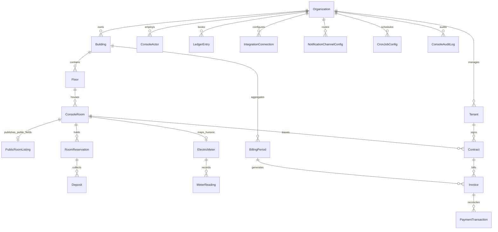

# ĐẶC TẢ KỸ THUẬT CONSOLE V2 — GIAI ĐOẠN C0 (ARCHITECTURE & CONTRACT FREEZE)

- **Dự án:** AdHome V2 — Property Management SaaS (`https://adhome.vn` · `https://console.adhome.vn`)
- **Giai đoạn:** `C0` — Chốt thiết kế giao diện, sơ đồ dữ liệu PostgreSQL 18, hợp đồng phân quyền RBAC và kiến trúc tích hợp 3 lớp
- **Trạng thái Landing RC1:** **Feature Freeze** (chỉ duy trì đồng bộ danh mục phòng công khai đã xuất bản và luồng tiếp nhận `LeadInquiry`)
- **Nguyên tắc hạ tầng:** Native Windows / Linux Systemd + Native PostgreSQL 18 (không sử dụng Docker)

---

## 1. Hợp đồng Điều hướng Chính thức (10 Module — 3 Nhóm)

Cấu trúc điều hướng cấp cao được khóa cứng gồm đúng **10 module chính chia làm 3 nhóm**, dùng chung một nguồn cấu hình trung tâm (`apps/console/src/app/navigation/navigationConfig.ts`) cho cả Desktop Sidebar và Mobile Console:

| Nhóm | STT | Mã định danh (`NavModuleId`) | Tên hiển thị chuẩn | Quyền yêu cầu (`Capability`) | Hỗ trợ lọc Tòa nhà (Header) | Bộ chọn Kỳ `MM/YYYY` (Toolbar) | Giai đoạn hoàn thiện |
| :--- | :-: | :--- | :--- | :--- | :-: | :-: | :-: |
| **VẬN HÀNH CỐT LÕI** | 1 | `overview` | **Tổng quan** | `canViewOverview` | Có | Không | `C1–C2` (KPI DB thực) |
| **VẬN HÀNH CỐT LÕI** | 2 | `buildings` | **Tòa nhà & phòng** *(gồm tab con **Khách thuê**)* | `canManageRooms` | Có | Không | `C1–C2` (CRUD PG thực) |
| **VẬN HÀNH CỐT LÕI** | 3 | `deposits` | **Đặt cọc & giữ chỗ** | `canManageDeposits` | Có | Không | `C2` Schema / `C3` Luồng đầy đủ |
| **VẬN HÀNH CỐT LÕI** | 4 | `contracts` | **Hợp đồng** | `canManageContracts` | Có | Không | `C2` Schema / `C3` Vòng đời HĐ |
| **TÀI CHÍNH VÀ TỔNG HỢP** | 5 | `settlements` | **Tổng hợp & Cron** | `canManageSettlements` | Có | Có | `C2` Schema / `C4` Hunonic & Nước |
| **TÀI CHÍNH VÀ TỔNG HỢP** | 6 | `invoices` | **Hóa đơn** | `canManageInvoices` | Có | Có | `C2` Schema / `C4` Phát hành HĐ |
| **TÀI CHÍNH VÀ TỔNG HỢP** | 7 | `payments` | **Thanh toán và đối soát** | `canManagePayments` | Có | Có | `C2` Schema / `C5` Payment Hub |
| **TÀI CHÍNH VÀ TỔNG HỢP** | 8 | `finance` | **Thu chi và sổ quỹ** | `canAccessFinance` | Có | Có | `C2` Schema / `C6` Sổ quỹ đầy đủ |
| **TÀI CHÍNH VÀ TỔNG HỢP** | 9 | `reports` | **Báo cáo doanh thu** | `canViewReports` | Có | Có | `C2` Tổng hợp PG / `C6` Phân tích |
| **HỆ THỐNG** | 10 | `settings` | **Cài đặt & Thiết lập** *(8 tab cấu hình)* | `canManageSettings` | Không | Không | `C1–C2` (8 tab PG) |

### Quy tắc tổ chức chức năng con
1. **Khách thuê (`Tenants`):** Không tạo mục Sidebar cấp 1 thứ 11. Được tích hợp làm tab chính thức **`Khách thuê`** bên trong module **`Tòa nhà & phòng`**, liên kết trực tiếp với hồ sơ Phòng, hồ sơ Hợp đồng và hộp thoại Tìm kiếm toàn hệ thống (`Ctrl/Cmd + K`).
2. **Các nhà cung cấp tích hợp (`Hunonic`, `Zalo OA/ZBS`, `Zalo Bot`, `Telegram Bot`, `Facebook Messenger`, `SePay`, `payOS`, `Tingee`):** Quản lý cấu hình tập trung trong 8 tab của **`Cài đặt & Thiết lập`**, chỉ hiển thị thao tác nghiệp vụ ngữ cảnh tại module liên quan khi kết nối đã được kích hoạt.

---

## 2. Hợp đồng Giao diện Console Shell (Header, BrandLogo, Animate UI Sidebar & Mobile)

### 2.1. Desktop Header 3 Vùng (`height: 64px` / `h-16`)
- **Vùng trái (Điều hướng):** `SidebarTrigger` (sử dụng `TriggerIcon` của Animate UI) + Tên phân hệ hiện tại + Breadcrumb cấp 2 (chỉ hiển thị khi đang ở tab con như `Tòa nhà & phòng / Khách thuê` hoặc tab con của `Cài đặt & Thiết lập`).
- **Vùng giữa (Phạm vi làm việc):** Bộ chọn phạm vi Tòa nhà hỗ trợ chọn **Tất cả phạm vi**, **1 tòa đơn lẻ**, hoặc **nhiều tòa cùng lúc** trong danh sách tòa được server cấp quyền. Tự động ẩn khi ở module cấp tổ chức (`Cài đặt & Thiết lập`). Không lặp lại tên tổ chức hay nhãn gói `PRO`.
- **Vùng phải (Tiện ích):**
  1. Nút tìm kiếm toàn hệ thống (`Ctrl/Cmd + K`).
  2. Chỉ báo trạng thái đồng bộ/mất kết nối API.
  3. Nút thông báo có số lượng chưa đọc thực tế từ PostgreSQL (ẩn hoàn toàn chấm đỏ khi `unreadCount === 0`).
  4. Menu Avatar người dùng (chứa thông tin Vai trò & Phạm vi từ server, chuyển đổi Sáng/Tối, tùy chọn tài khoản và Đăng xuất).
- **Loại bỏ khỏi Header production:** Bộ chọn kỳ cố định `Kỳ T10/2026` (chuyển sang thanh công cụ của 5 phân hệ tài chính) và nút `Bản Mobile`.
- **Chuẩn đáp ứng không chồng lấn:** Kiểm chứng không tràn ngang (`scrollWidth <= clientWidth`) tại `1024px`, `1280px`, `1440px` và `1920px`.

### 2.2. BrandLogo & Chuẩn hóa SVG (`BrandLogo.tsx`)
- Căn chỉnh lại `viewBox` của tài nguyên thương hiệu gốc (`adhome-logo-full.svg`, `adhome-logo-full-dark.svg` từ `0 0 340 96` sang `0 4 272 88` để loại bỏ `68px` khoảng trống thừa bên phải mà không vẽ lại đường nét vector thương hiệu).
- **Sidebar mở rộng (`256px`):** Hiển thị biểu tượng + chữ `AdHome` cân đối (`object-fit: contain`, `shrink-0`), hỗ trợ Light/Dark.
- **Sidebar thu gọn (`68px`):** Chỉ hiển thị biểu tượng (`adhome-icon.svg`) căn giữa tuyệt đối, không thu nhỏ chữ.
- **Mobile Drawer:** Hiển thị logo ngang đầy đủ ở đầu Drawer kèm duy nhất nút đóng `X`.

### 2.3. Hệ thống Sidebar theo Animate UI (`@animate-ui/react`)
- Sử dụng trực tiếp primitive `@animate-ui/react/primitives/sidebar` (`Provider`, `Gap`, `Container`, `Highlight`, `TriggerIcon`, `useSidebar`), `@animate-ui/react/primitives/tooltip` (`TooltipProvider`, `Tooltip`, `TooltipTrigger`, `TooltipContent`), `@animate-ui/react/primitives/base-ui/dialog` (`Sheet` cho Mobile Drawer) và `@animate-ui/react/primitives/base-ui/collapsible`.
- Một nguồn trạng thái duy nhất (`SidebarProvider`), hỗ trợ `SidebarRail`, phím tắt `Ctrl/Cmd + B`, ghi nhớ trạng thái thu gọn và tự động tôn trọng `prefers-reduced-motion`.

---

## 3. Tách Biệt Trạng Thái Nghiệp Vụ & Sơ Đồ Dữ Liệu PostgreSQL 18

### 3.1. Nguyên tắc tách trạng thái độc lập
Một phòng không gộp chung mọi sự kiện vào một cột `status`. Hệ thống tách rõ:
1. **Trạng thái chiếm dụng phòng (`ConsoleRoom.occupancyStatus`):** `AVAILABLE` | `RESERVED` | `OCCUPIED` | `MAINTENANCE` | `ARCHIVED`.
2. **Trạng thái xuất bản Landing (`ConsoleRoom.isPublishedToLanding`):** Quyết định phòng có đồng bộ sang `PublicRoomListing` hay không (chỉ đồng bộ thông tin công khai, tuyệt đối không xuất PII khách thuê/hợp đồng/công nợ).
3. **Trạng thái giữ chỗ & tiền cọc (`RoomReservation.status` / `Deposit.status`):** `PENDING` | `CONFIRMED` | `CONVERTED` | `CANCELLED` | `REFUNDED`.
4. **Trạng thái hợp đồng (`Contract.status`):** `DRAFT` | `ACTIVE` | `EXPIRING` | `TERMINATED` | `EXPIRED`.
5. **Trạng thái hóa đơn (`Invoice.status`):** `DRAFT` | `ISSUED` | `PARTIAL` | `PAID` | `OVERDUE` | `VOID`.
6. **Trạng thái công tơ Hunonic (`ElectricMeter.connectionStatus`):** `UNCONFIGURED` | `ONLINE` | `OFFLINE` | `STALE`.

### 3.2. Sơ đồ quan hệ thực thể cốt lõi (ERD)

> **Quy tắc tiền tệ bắt buộc:** Toàn bộ số tiền VND (`listPriceVnd`, `depositAmountVnd`, `monthlyRentVnd`, `totalAmountVnd`, `paidAmountVnd`, `electricRateVnd`, `waterRateVnd`) lưu trữ bằng số nguyên chính xác (`INTEGER` / `BIGINT`), tuyệt đối không dùng số thực dấu phẩy động (`FLOAT`).

---

## 4. Hợp đồng Kiến trúc Tích hợp 3 Lớp (Chuẩn bị C4 & C5)

1. **Lớp 1 — Nghiệp vụ (Domain Layer):** Phát sinh yêu cầu nghiệp vụ thuần túy (cần đọc chỉ số điện kỳ `YYYY-MM`, cần tạo yêu cầu thu tiền cho `Invoice`, cần phát thông báo sự kiện `INVOICE_ISSUED`) kèm `idempotencyKey`.
2. **Lớp 2 — Integration Service:** Tra cứu `IntegrationConnection` / `NotificationChannelConfig` của `orgId`, kiểm tra provider đang bật và hỗ trợ capability tương ứng, kiểm tra điều kiện nhận tin (consent), quản lý hàng đợi retry và không bao giờ đánh dấu thành công giả khi provider tắt hoặc trả lỗi.
3. **Lớp 3 — Provider Adapters:**
   - **Đồng hồ điện (Duy nhất `Hunonic`):** Tham chiếu `tcandt/api-hunonic`, tách biệt `W` (công suất tức thời), `kWh` (sản lượng kỳ), chỉ số tích lũy và `money_month_vnd` ước tính (không dùng `money_month_vnd` để thu tiền khách; áp dụng công thức `Sản lượng kWh hợp lệ × Đơn giá hợp đồng/tòa/tổ chức`). Xử lý reset công tơ, thay công tơ, mất kết nối và nhập tay có lý do + người nhập + audit log.
   - **Tiền nước (3 phương thức bắt buộc):** `PER_M3` (`Số m³ đầu/cuối kỳ × Đơn giá`), `PER_PERSON` (`Số người chịu phí xác nhận trong kỳ × Mức phí/người`), `FIXED_PER_ROOM` (`Mức cố định/phòng/kỳ`). Thứ tự ưu tiên snapshot khi khóa kỳ: `Hợp đồng → Phòng → Tòa nhà → Mặc định Tổ chức`.
   - **Tổng hợp & Cron (`Asia/Ho_Chi_Minh`):** Chu trình trạng thái `DRAFT → REVIEW → APPROVED → ISSUED → LOCKED` (kèm `EXCEPTION` khi lỗi dữ liệu), khóa phân tán theo `(orgId, periodKey, buildingId)` chống chạy trùng hoặc sinh trùng hóa đơn.
   - **Payment Hub (`SePay`, `payOS`, `Tingee`):** Phân biệt rõ capability (`SePay`: webhook biến động số dư; `payOS`: tạo payment link/QR + webhook; `Tingee`: webhook HMAC-SHA512 + QR/VA theo gói dịch vụ). Chống ghi thu trùng xuyên provider, xử lý thu thiếu/thu dư/giao dịch treo chờ đối soát thủ công.
   - **Notification Hub (`Zalo OA / ZBS`, `Zalo Bot`, `Telegram Bot`, `Facebook Messenger`):** Phân biệt rạch ròi `Zalo OA`, `ZBS Template Message` và `Zalo Bot`; kiểm tra điều kiện gửi, lưu lịch sử gửi và hỗ trợ retry có `idempotencyKey`.

---

## 5. Ma Trận Loại Bỏ Dữ Liệu Mock & `localStorage` Nghiệp Vụ

| Tệp / Thành phần cũ | Tình trạng Mock trước C1/C2 | Hành động khắc phục tại C1 & C2 |
| :--- | :--- | :--- |
| `src/shared/data/buildingsData.ts` | Chứa `BUILDINGS_HOMELAND_MOCK`, `ROOMS_HOMELAND_MOCK` | **Xóa hoàn toàn tệp khỏi repo**; thay thế 100% bằng bảng `buildings`, `floors`, `console_rooms` trong PostgreSQL 18. |
| `src/shared/data/businessMetrics.ts` | Chứa `EXPIRING_CONTRACTS_MOCK`, `PENDING_INVOICES_MOCK`, `RECENT_TRANSACTIONS_MOCK` | **Xóa hoàn toàn tệp khỏi repo**; truy vấn thực từ bảng `contracts`, `invoices`, `payment_transactions`, `ledger_entries`. |
| `src/app/providers/PortfolioContext.tsx` | Đọc/ghi `adhome_v2_organizations`, `adhome_v2_buildings`, `adhome_v2_rooms` trong `localStorage`, gán cứng `hunonicOnline: true` | **Viết lại 100%** gọi API `/api/v1/console/v2/*` trên PostgreSQL 18; chỉ giữ `localStorage` cho tùy chọn UI không nhạy cảm (`theme`, `sidebar_open`, `active_module`). |
| `src/features/overview/OverviewDashboard.tsx` | Hiển thị `Doanh thu tháng 10`, `Đã thu: 92%`, `Đồng bộ Hunonic IoT trực tiếp`, nút `alert()` nhắc nợ Zalo | **Kết nối 100% dữ liệu thực từ PostgreSQL**; hiển thị trung thực `Chưa kết nối Hunonic` khi chưa cấu hình; bỏ toàn bộ `alert()`. |
| `src/features/modules/GenericModuleView.tsx` | Nhãn `Console V2 Alpha`, danh sách HĐ/Hóa đơn mock, số liệu cứng `125/128 phòng`, các nút `alert()` | **Xóa bỏ & thay bằng `OperationalModuleWorkspace.tsx`** có bộ chọn kỳ `MM/YYYY` động, truy vấn bảng PostgreSQL thật và trạng thái rỗng minh bạch. |
| `DesktopSidebar.tsx` / `MobileDrawer.tsx` | Cấu trúc 11 mục rời rạc, đếm badge từ `PENDING_INVOICES_MOCK`, nhãn giả `Hunonic` | **Hợp nhất về cấu hình 10 module trung tâm**, dùng Animate UI Sidebar & Sheet, chỉ hiển thị số đếm thực > 0 từ PostgreSQL. |

